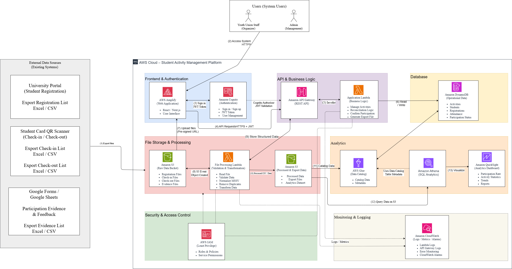

---
title: "Blog 1 - Tôi thử gỡ từng AWS Service khỏi kiến trúc đồ án"
date: 2026-09-18
weight: 1
chapter: false
pre: "<b>3.1.</b>"
---

# TÔI THỬ “GỠ” TỪNG AWS SERVICE KHỎI KIẾN TRÚC QUẢN LÝ HOẠT ĐỘNG SINH VIÊN – HỆ THỐNG SẼ HỎNG Ở ĐÂU?

## Hiểu AWS thông qua một đồ án thực tế

### 1. Một câu hỏi khi học AWS

Khi bắt đầu tìm hiểu AWS, tôi thường tiếp cận từng dịch vụ riêng lẻ:

* Amazon S3 dùng để lưu trữ dữ liệu.
* Amazon DynamoDB là cơ sở dữ liệu NoSQL.
* AWS Lambda giúp chạy code mà không cần quản lý máy chủ.
* AWS IAM dùng để quản lý quyền truy cập.
* Amazon CloudWatch dùng để giám sát hệ thống.
* AWS Amplify hỗ trợ triển khai ứng dụng Web.

Tuy nhiên, việc ghi nhớ định nghĩa của từng dịch vụ chưa thực sự giúp tôi hiểu cách chúng phối hợp với nhau trong một hệ thống hoàn chỉnh.

Trong quá trình phát triển đồ án Student Activity Management & Engagement Analytics Platform tại First Cloud AI Journey (FCAJ), tôi tự đặt ra một câu hỏi:

**Nếu lần lượt loại bỏ từng dịch vụ AWS khỏi kiến trúc của mình, hệ thống sẽ bị ảnh hưởng như thế nào?**

Liệu toàn bộ ứng dụng có ngừng hoạt động? Hay chỉ một chức năng nhất định bị ảnh hưởng?

Đây là cách tôi lựa chọn để hiểu rõ hơn vai trò của từng dịch vụ AWS thay vì chỉ học thuộc các khái niệm.

### 2. Bài toán thực tế của đồ án

Đồ án của tôi hướng đến việc quản lý và phân tích dữ liệu tham gia hoạt động của sinh viên.

Ví dụ, trong một ngày hội công nghệ thông tin như IT Day, Ban Tổ chức cần quản lý:

* Danh sách sinh viên đăng ký từ University Portal.
* Dữ liệu Check-in và Check-out.
* Minh chứng tham gia từ Google Forms hoặc Google Sheets.
* Kết quả đối soát và xác nhận tham gia.
* Các báo cáo thống kê sau chương trình.

Nếu một hoạt động có hơn 1.000 sinh viên đăng ký, việc kiểm tra từng MSSV trên nhiều file Excel sẽ mất rất nhiều thời gian.

Vì vậy, tôi xây dựng một Web Application để tập trung hóa các quy trình này.

### 3. Kiến trúc hệ thống

Phiên bản hiện tại của đồ án sử dụng:

* React/Vite để phát triển Frontend.
* Python/FastAPI để phát triển Backend.
* SQLite để hỗ trợ lưu trữ và khôi phục dữ liệu trong môi trường Demo.
* Amazon DynamoDB để tích hợp và kiểm thử lưu trữ dữ liệu nghiệp vụ trên AWS.
* Cloudflare Quick Tunnel để kết nối Frontend với Backend chạy local.

Bên cạnh đó, đồ án tích hợp và thử nghiệm sáu dịch vụ AWS:

1. AWS Amplify.
2. Amazon DynamoDB.
3. Amazon S3.
4. AWS Lambda.
5. AWS IAM.
6. Amazon CloudWatch.



Kiến trúc được chia thành ba phần:

**Web Application**

ADMIN và STUDENT sử dụng trình duyệt để truy cập giao diện React/Vite được triển khai trên AWS Amplify.

Trình duyệt gửi các REST API Request thông qua Cloudflare Quick Tunnel đến FastAPI Backend.

**Cloud Data Storage**

FastAPI sử dụng cơ chế lưu trữ local với SQLite, đồng thời tích hợp Amazon DynamoDB thông qua AWS SDK for Python (boto3).

Các nhóm dữ liệu được tích hợp hoặc kiểm thử với DynamoDB bao gồm Activities, Registrations, Attendance, Evidence và Participation.

**Serverless CSV Processing Demo**

Amazon S3 lưu file CSV đầu vào. AWS Lambda đọc, kiểm tra và xử lý dữ liệu, sau đó ghi kết quả JSON trở lại Amazon S3.

AWS IAM cung cấp quyền thực thi, trong khi Amazon CloudWatch ghi nhận thông tin và log của Lambda.

### 4. Thử gỡ AWS Amplify: Sinh viên còn truy cập được Website không?

AWS Amplify Hosting là dịch vụ được sử dụng để triển khai Frontend React/Vite của đồ án.

Khi truy cập Website, trình duyệt tải các tài nguyên HTML, CSS và JavaScript từ môi trường hosting.

Sau khi tải giao diện, trình duyệt mới gửi API Request đến Backend.

Nếu loại bỏ AWS Amplify khỏi kiến trúc hiện tại:

* Website được hosting trên Amplify sẽ không còn khả dụng tại địa chỉ đó.
* ADMIN và STUDENT không thể sử dụng giao diện thông qua URL triển khai hiện tại.
* Backend FastAPI vẫn có thể hoạt động.
* SQLite và các tài nguyên DynamoDB vẫn có thể tồn tại.
* Lambda CSV Processor vẫn có thể được thực thi độc lập.

Điều này cho thấy AWS Amplify đảm nhiệm vai trò triển khai và phân phối giao diện, không phải nơi xử lý toàn bộ nghiệp vụ của ứng dụng.

Tôi có thể chạy lại Frontend trong môi trường local để tiếp tục phát triển và kiểm thử.

**Bài học rút ra:** Frontend Hosting và Backend Processing là hai thành phần khác nhau. Một hệ thống có thể mất giao diện truy cập nhưng Backend và dữ liệu vẫn hoạt động.

### 5. Thử gỡ Amazon DynamoDB: Dữ liệu sinh viên sẽ ra sao?

Amazon DynamoDB là cơ sở dữ liệu NoSQL được quản lý bởi AWS.

Trong đồ án, tôi đã tích hợp và kiểm thử các nhóm dữ liệu:

* Activities.
* Registrations.
* Attendance.
* Evidence.
* Participation.

Các nhóm dữ liệu này phục vụ việc quản lý hoạt động, theo dõi điểm danh và xác định kết quả tham gia.

Ví dụ, khi Ban Tổ chức ghi nhận một sinh viên tham gia hoạt động, thông tin cần được lưu theo MSSV và hoạt động tương ứng.

```text
Student ID: 0818XXXXXX
Activity ID: ACT-DEMO-001
Check-in: Recorded
Check-out: Recorded
```

Nếu loại bỏ DynamoDB hoặc ứng dụng không còn quyền truy cập DynamoDB:

* Các thao tác đọc và ghi dữ liệu trên AWS sẽ thất bại.
* Các chức năng tích hợp lưu trữ Cloud không thể hoạt động bình thường.
* Dữ liệu đã lưu trên Cloud không thể được truy xuất bởi ứng dụng khi mất kết nối hoặc quyền truy cập.
* Việc đồng bộ dữ liệu giữa môi trường local và AWS có thể bị gián đoạn.

Tuy nhiên, vì phiên bản Demo hiện vẫn có SQLite, các chức năng local có thể tiếp tục hoạt động tùy theo cơ chế xử lý lỗi và lưu trữ của Backend.

Không thể kết luận rằng toàn bộ hệ thống sẽ ngừng hoạt động chỉ vì DynamoDB không khả dụng.

**Bài học rút ra:** Cần xác định rõ đâu là nguồn dữ liệu chính, đâu là cơ chế lưu trữ bổ sung và cách hệ thống xử lý khi một nguồn dữ liệu không khả dụng.

### 6. Thử gỡ Amazon S3: Lambda còn dữ liệu để xử lý không?

Amazon S3 là dịch vụ Object Storage được sử dụng để lưu trữ các file dữ liệu.

Trong Serverless CSV Processing Demo của đồ án, S3 có hai vai trò:

* Lưu file CSV đầu vào.
* Lưu kết quả JSON sau khi xử lý.

Giả sử file đăng ký được lưu trên S3 và chứa dữ liệu như sau:

```csv
student_id,full_name
0818000001,Student A
0818000002,Student B
0818000001,Student A
,Student C
```

File có bốn bản ghi, trong đó có dữ liệu trùng lặp và dữ liệu thiếu MSSV.

AWS Lambda đọc file, kiểm tra từng bản ghi và tạo kết quả xử lý.

Nếu loại bỏ S3 Input:

* Lambda không có file CSV đầu vào để xử lý.
* Thao tác đọc object có thể thất bại.

Nếu loại bỏ S3 Output:

* Lambda có thể đọc và xử lý được dữ liệu.
* Tuy nhiên, kết quả không thể được ghi vào vị trí lưu trữ dự kiến.

Điều này không đồng nghĩa với việc chức năng Registration Import trên Website ngừng hoạt động, vì chức năng đó hiện được xử lý riêng bằng FastAPI.

**Bài học rút ra:** S3 không chỉ là nơi lưu file. Trong các Data Pipeline, S3 có thể đóng vai trò nguồn dữ liệu và đích lưu kết quả.

### 7. Thử gỡ AWS Lambda: Ai sẽ xử lý dữ liệu CSV?

AWS Lambda cho phép thực thi code mà không cần quản lý máy chủ trực tiếp.

Trong đồ án, tôi sử dụng Lambda để thử nghiệm một quy trình CSV Processing.

Lambda đảm nhiệm:

* Đọc file CSV từ S3.
* Kiểm tra các trường bắt buộc.
* Phát hiện bản ghi trùng lặp.
* Phát hiện bản ghi không hợp lệ.
* Tổng hợp kết quả.
* Ghi kết quả JSON lên S3.


Một bài kiểm thử của CSV Processor cho kết quả:

| Chỉ số | Kết quả |
| --- | --- |
| Total Records | 4 |
| Valid Records | 2 |
| Duplicate Records | 1 |
| Invalid Records | 1 |

Nếu loại bỏ AWS Lambda:

* File CSV vẫn có thể tồn tại trên Amazon S3.
* Dữ liệu vẫn có thể được tải xuống.
* Tuy nhiên, quy trình CSV Processing Demo không còn thành phần thực thi để tạo kết quả JSON mới.

Một điểm quan trọng là Lambda không phải Backend chính của đồ án.

Các chức năng Activity Management, Authentication, Attendance, Reconciliation và Analytics vẫn được xử lý bởi FastAPI.

**Bài học rút ra:** AWS Lambda là thành phần Compute có thể thực hiện những tác vụ độc lập, đặc biệt phù hợp với các công việc xử lý dữ liệu theo từng lần thực thi.

### 8. Thử gỡ AWS IAM: Có tài nguyên nhưng không có quyền

Trong quá trình thực hành AWS, tôi nhận ra rằng việc tạo tài nguyên thành công không đồng nghĩa với việc ứng dụng có thể truy cập tài nguyên đó.

AWS IAM quản lý các quyền truy cập và thực thi trên AWS.

Ví dụ, Lambda CSV Processor cần các quyền phù hợp để:

* Đọc file CSV từ S3.
* Ghi kết quả JSON vào S3.
* Gửi log đến CloudWatch.

Nếu Lambda thiếu quyền đọc S3, yêu cầu đọc object có thể trả về lỗi:

```text
AccessDenied
```

Nếu Lambda đọc được file nhưng thiếu quyền ghi, quá trình lưu kết quả có thể thất bại.

Nếu thiếu quyền ghi log, Lambda có thể không cung cấp được những thông tin cần thiết để theo dõi quá trình thực thi.

Vì vậy, việc loại bỏ các quyền IAM cần thiết có thể khiến quy trình AWS không hoạt động dù tài nguyên vẫn tồn tại.

Trong thực tế, IAM cần được cấu hình theo nguyên tắc Least Privilege, tức là chỉ cấp những quyền cần thiết cho nhiệm vụ của từng thành phần.

**Bài học rút ra:** Cloud Security không chỉ là bảo vệ tài khoản đăng nhập. Đó còn là kiểm soát chính xác ứng dụng nào được phép thực hiện hành động nào trên tài nguyên nào.

### 9. Thử gỡ Amazon CloudWatch: Hệ thống có còn chạy không?

Amazon CloudWatch được sử dụng để theo dõi log và các chỉ số thực thi của Lambda.

Khi CSV Processor thực thi, CloudWatch giúp tôi kiểm tra:

* Lambda có được gọi hay không.
* Quá trình xử lý có xảy ra lỗi không.
* Thời gian thực thi.
* Các thông tin được ghi trong log.
* Kết quả của quá trình xử lý.

Nếu không có CloudWatch Logs:

* Lambda vẫn có thể thực thi nếu các điều kiện và quyền cần thiết khác được đáp ứng.
* File CSV vẫn có thể được xử lý.
* Kết quả JSON vẫn có thể được ghi vào S3.
* Tuy nhiên, việc tìm nguyên nhân khi xảy ra lỗi sẽ khó khăn hơn.

Ví dụ, nếu Lambda không tạo được file JSON, log có thể giúp xác định nguyên nhân là file đầu vào không tồn tại, dữ liệu sai định dạng hay thiếu quyền IAM.

**Bài học rút ra:** Monitoring không nhất thiết trực tiếp tạo ra kết quả nghiệp vụ, nhưng giúp hệ thống có khả năng quan sát, kiểm tra và khắc phục sự cố.

### 10. Tổng hợp: Hệ thống bị ảnh hưởng ở đâu?

| AWS Service | Vai trò | Ảnh hưởng nếu loại bỏ |
| --- | --- | --- |
| AWS Amplify | Frontend Hosting | Website không còn truy cập qua URL hosting hiện tại |
| Amazon DynamoDB | Cloud Database | Các luồng đọc/ghi dữ liệu trên DynamoDB bị gián đoạn |
| Amazon S3 | Object Storage | Thiếu file đầu vào hoặc không thể lưu kết quả |
| AWS Lambda | Serverless Compute | CSV Processing Demo không được thực thi |
| AWS IAM | Access Control | Các yêu cầu thiếu quyền có thể bị từ chối |
| Amazon CloudWatch | Monitoring | Khó theo dõi và phân tích lỗi |

Không phải mọi dịch vụ AWS đều có cùng mức độ ảnh hưởng đến toàn bộ hệ thống.

Một số dịch vụ trực tiếp hỗ trợ chức năng của người dùng, một số đảm nhiệm lưu trữ, trong khi những dịch vụ khác hỗ trợ bảo mật và giám sát.

Đây chính là lý do kiến trúc hệ thống cần xác định rõ trách nhiệm của từng thành phần.

### 11. Một thử nghiệm tư duy dành cho người mới học AWS

Khi nghiên cứu một kiến trúc AWS, tôi nhận thấy có thể đặt ra bốn câu hỏi:

1. Dịch vụ này nhận dữ liệu từ đâu?
2. Dịch vụ này thực hiện nhiệm vụ gì?
3. Kết quả được gửi đến đâu?
4. Điều gì xảy ra nếu dịch vụ không còn khả dụng?

Ví dụ, với AWS Lambda:

* Input: File CSV trên Amazon S3.
* Processing: Kiểm tra và phân loại dữ liệu.
* Output: File JSON trên Amazon S3.
* Failure: Không thể tạo kết quả xử lý mới nếu Lambda không thực thi.

Phương pháp này giúp tôi hiểu kiến trúc theo luồng dữ liệu và sự phụ thuộc giữa các thành phần.

### 12. Kết luận

Thông qua việc phân tích sáu dịch vụ AWS trong đồ án Student Activity Management & Engagement Analytics Platform, tôi hiểu rõ hơn rằng xây dựng hệ thống Cloud không đơn giản là kết hợp càng nhiều dịch vụ càng tốt.

Điều quan trọng là:

* Chọn đúng dịch vụ cho từng nhiệm vụ.
* Xác định rõ luồng dữ liệu.
* Hiểu sự phụ thuộc giữa các thành phần.
* Áp dụng quyền truy cập phù hợp.
* Theo dõi và xử lý lỗi.
* Cân nhắc khả năng mở rộng và chi phí.

Việc thử “gỡ” từng dịch vụ là một cách học giúp tôi nhìn kiến trúc AWS dưới góc độ thực tế hơn.

Thay vì chỉ ghi nhớ Amazon S3 là gì hoặc AWS Lambda là gì, tôi có thể hiểu được tại sao những dịch vụ đó cần xuất hiện trong một hệ thống và hệ thống sẽ thay đổi như thế nào khi thiếu chúng.

Đây cũng là nền tảng để tôi tiếp tục phát triển theo định hướng Cloud Computing và Cloud & Data Engineering.

**Ghi chú:** Các tình huống loại bỏ dịch vụ trong bài viết là phân tích kiến trúc giả định, không phải việc xóa tài nguyên AWS đang hoạt động. Sơ đồ và nội dung kỹ thuật đã được cập nhật theo phạm vi đồ án hiện tại.

### 13. Tài liệu tham khảo

* [AWS Amplify Hosting](https://docs.aws.amazon.com/amplify/latest/userguide/welcome.html)
* [Amazon DynamoDB Developer Guide](https://docs.aws.amazon.com/amazondynamodb/latest/developerguide/Introduction.html)
* [Amazon S3 User Guide](https://docs.aws.amazon.com/AmazonS3/latest/userguide/Welcome.html)
* [AWS Lambda Developer Guide](https://docs.aws.amazon.com/lambda/latest/dg/welcome.html)
* [AWS IAM User Guide](https://docs.aws.amazon.com/IAM/latest/UserGuide/introduction.html)
* [Amazon CloudWatch User Guide](https://docs.aws.amazon.com/AmazonCloudWatch/latest/monitoring/WhatIsCloudWatch.html)
* [AWS Well-Architected Framework](https://docs.aws.amazon.com/wellarchitected/latest/framework/welcome.html)


> 📌 **Chia sẻ cộng đồng:** Bài viết kỹ thuật này đã được đăng tải trên cộng đồng AWS Study Group VN nhằm chia sẻ những kiến thức, kinh nghiệm thực tế trong quá trình tìm hiểu kiến trúc AWS Cloud, đồng thời trao đổi và học hỏi thêm từ các thành viên trong cộng đồng.
>
> 🔗 **Bài viết gốc:** [Xem bài đăng trên Facebook](https://www.facebook.com/share/p/1FBZRfrKJZ/)
