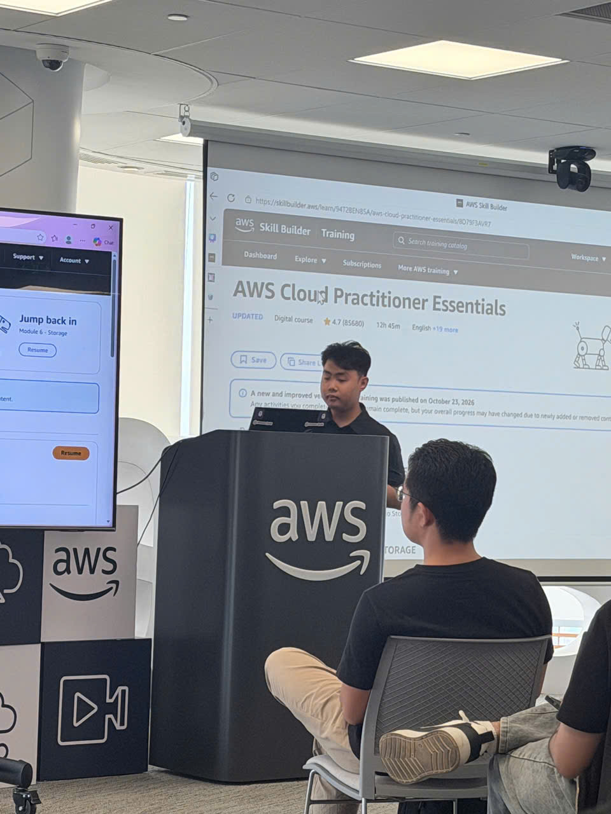
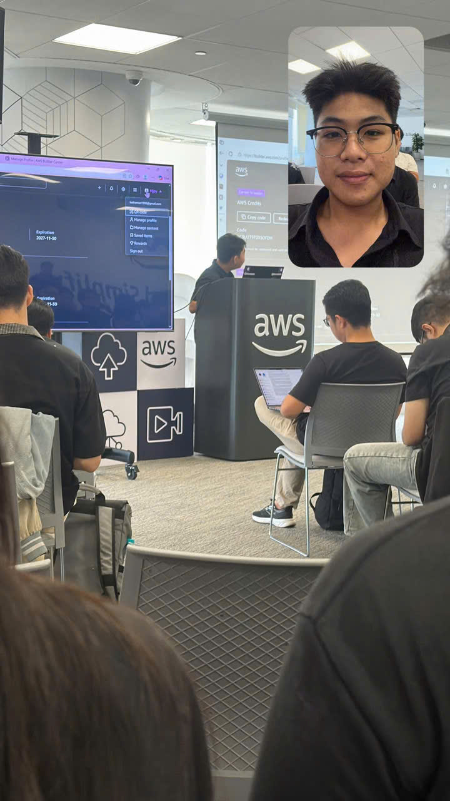
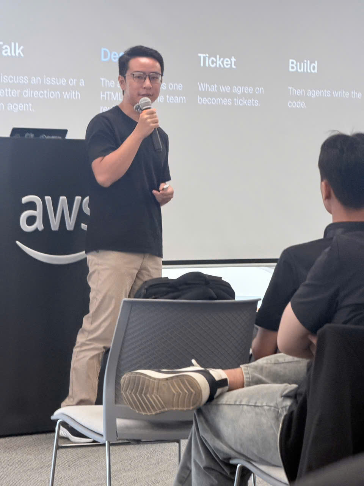
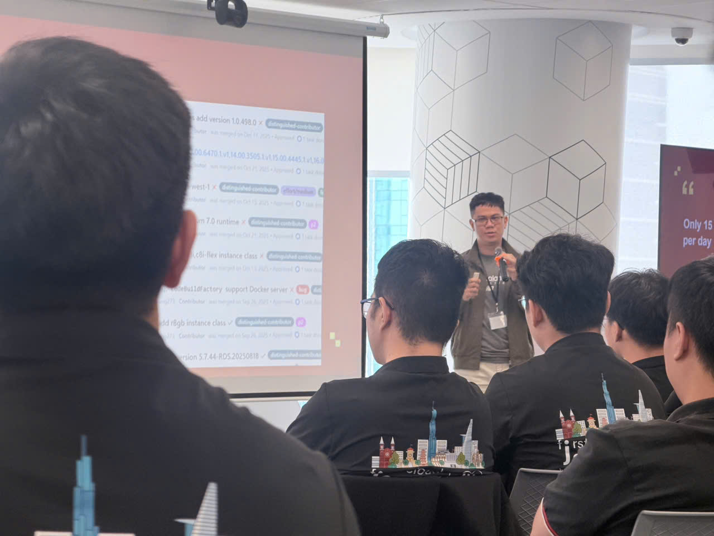

---
title: "AWS First Cloud AI Journey Community Day 2026"
date: 2026-10-31
weight: 2
chapter: false
pre: "<b>4.2. </b>"
---

# AWS First Cloud AI Journey Community Day 2026

## 1. Event Introduction

**AWS First Cloud AI Journey Community Day 2026** was an event organized as part of the First Cloud AI Journey (FCAJ) program, providing students and technology enthusiasts with opportunities to learn, exchange ideas, and explore developments in cloud computing, artificial intelligence, and modern software engineering.

The event featured topics related to AWS Cloud, Serverless Architecture, asynchronous systems, internship experiences, and professional development through Open Source communities.

For me, attending this event was an opportunity to broaden my technical knowledge beyond university coursework, learn from practical engineering experiences, and understand how AWS technologies can be applied to real-world software development.

The knowledge shared during the event was also relevant to my project, **Student Activity Management & Engagement Analytics Platform**, developed as part of my First Cloud AI Journey learning experience.

## 2. Event Information

- **Event Name:** AWS First Cloud AI Journey Community Day 2026
- **Date:** Saturday, October 31, 2026
- **Time:** 09:00 AM – 12:00 PM
- **Venue:** Bitexco Financial Tower
- **Address:** 02 Hai Trieu Street, Sai Gon Ward, Ho Chi Minh City, Vietnam
- **Format:** In-person event
- **Role:** FCAJ learner / Student attendee

## 3. Participation Objectives

My main objectives for attending the event were:

- To expand my knowledge of AWS services and modern cloud application development.
- To learn about designing, deploying, and optimizing Serverless systems.
- To better understand the roles of AWS Lambda and Amazon SQS in modern architectures.
- To gain insights into internships, real-world engineering projects, and technical problem-solving.
- To explore the skills required for careers in Cloud Computing and Data Engineering.
- To understand the value of Open Source communities and continuous professional development.

## 4. Sessions Attended

During the event, I had the opportunity to attend sessions covering the following topics:

1. **Lessons Learned from Building Software Factories**
2. **Education**
3. **AWS Lambda Web Functions: Rethinking Serverless Web Architecture**
4. **Amazon SQS: Building Asynchronous Systems**
5. **My 3-Month AWS Internship Journey**
6. **Start & Maintain Consistency with Open Source Contributing**

Each session provided valuable perspectives on system architecture, data processing, internship experiences, software development practices, and long-term career growth.

## 5. Key Knowledge and Takeaways

### 5.1. Lessons Learned from Building Software Factories

This session provided insights into organizing software development processes in a structured, reusable, and maintainable way.

I learned that building a software application involves much more than writing code. It also requires thoughtful architecture design, development workflows, testing, deployment, and long-term maintenance.

**Connection to my project:**

While developing the Student Activity Management & Engagement Analytics Platform, I organized the application into several major components:

- A Frontend developed with React and Vite.
- A Backend developed with Python and FastAPI.
- A SQLite database for the local Demo environment.
- Modules for registration, attendance, evidence processing, and reporting.
- Selected AWS services used for cloud computing experiments.

Separating these components helped make the application easier to test, debug, maintain, and extend.

### 5.2. Education – Preparing for the Technology Industry

The Education session helped me better understand the knowledge and practical skills students should develop before entering the professional technology industry.

In addition to academic knowledge, students need to strengthen their programming skills, problem-solving abilities, technical documentation reading, and familiarity with technologies used in real-world projects.

As a Data Science student, I recognized that gaining additional knowledge in Cloud Computing could provide a valuable foundation for a future career in Data Engineering.

Developing my project allowed me to combine database concepts, data processing, API development, and application deployment into a practical learning experience.

### 5.3. AWS Lambda Web Functions: Rethinking Serverless Web Architecture

This was one of the most interesting sessions for me because it was closely related to the AWS Lambda experiments in my Workshop.

The session explored how AWS Lambda can support Serverless Web architectures, including:

- HTTP-related processing capabilities in Serverless applications.
- Scalability and request handling.
- Performance and cost optimization considerations.
- Architectural trade-offs when comparing Serverless approaches with Docker-based deployments on Amazon EC2 or Amazon ECS.

Through this session, I gained a better understanding of why architecture decisions should consider application requirements, traffic patterns, performance expectations, and operating costs.

**Connection to my project:**

As part of the Student Activity Management & Engagement Analytics Platform, I implemented a Serverless experiment that used AWS Lambda to process student registration data from a CSV file.

The workflow included:

1. Uploading a sample CSV file to Amazon S3.
2. Executing AWS Lambda through a Test Event.
3. Reading and validating registration data.
4. Detecting valid, duplicate, and invalid records.
5. Generating a JSON processing result.
6. Writing the result to Amazon S3.
7. Reviewing execution logs using Amazon CloudWatch.

This experiment allowed me to apply Serverless concepts to a specific data processing task.

### 5.4. Amazon SQS: Building Asynchronous Systems

The Amazon Simple Queue Service (Amazon SQS) session introduced important concepts related to asynchronous processing and message-driven system architectures.

The main concepts I learned included:

- The role of Message Queues in application architectures.
- Decoupling services to reduce direct dependencies.
- The benefits of asynchronous background processing.
- Scaling applications to handle increasing workloads.
- Potential integration patterns involving Amazon SQS and other AWS services.

I learned that asynchronous systems can handle background operations without requiring users to wait for every processing step to complete.

**Potential application to my project:**

The current Student Activity Management & Engagement Analytics Platform primarily processes requests through a FastAPI Backend.

In the future, Amazon SQS could be considered for:

- Processing large student registration datasets.
- Queuing background data processing tasks.
- Separating data ingestion from processing.
- Integrating AWS Lambda with Amazon SQS to build event-driven workflows.

These are potential future improvements rather than features already implemented in the current Demo version.

### 5.5. My 3-Month AWS Internship Journey

This session provided valuable insights into the learning process, project development, and practical challenges associated with an AWS internship.

I realized that internships require not only technical knowledge but also independent learning, effective task management, and the ability to solve unexpected problems.

Some important lessons included:

- Actively exploring documentation and new technologies.
- Practicing consistently to strengthen technical knowledge.
- Documenting tasks, progress, and results.
- Debugging technical issues systematically.
- Building practical projects to demonstrate skills.
- Continuing to improve professional knowledge after completing an internship.

These lessons encouraged me to continue improving my project and maintaining detailed Worklog and Workshop documentation.

### 5.6. Start & Maintain Consistency with Open Source Contributing

The Open Source session helped me understand the benefits of participating in open-source projects and the importance of consistent contributions.

I learned that Open Source provides opportunities to explore technologies, read existing codebases, practice collaboration, and develop skills using Git and GitHub.

These concepts were relevant to my own project development process, particularly in:

- Managing source code using GitHub.
- Organizing project directories.
- Writing README documentation and architecture descriptions.
- Tracking changes throughout development.
- Creating documentation that helps others understand the system.

In the future, I would like to learn more about Git workflows, Pull Requests, Code Reviews, and contributing to Open Source projects related to Cloud Computing and Data Engineering.

## 6. Lessons Learned and Application to My Project

After attending AWS First Cloud AI Journey Community Day 2026, I realized that learning AWS requires more than memorizing the features of individual services.

It is equally important to understand how to select and combine services to address practical engineering problems.

In particular, the sessions on AWS Lambda, Serverless Architecture, and asynchronous systems gave me new perspectives on how the Student Activity Management & Engagement Analytics Platform could be expanded.

The current Demo version includes Frontend, Backend, database, and student activity management functionalities. I also practiced deploying the Frontend through AWS Amplify and experimenting with CSV processing using Amazon S3 and AWS Lambda.

Based on the knowledge gained from the event, I identified several potential areas for future development:

- Developing automated Serverless data processing workflows.
- Using Amazon SQS for asynchronous background tasks.
- Building Data Pipelines for data aggregation and analytics.
- Improving application scalability and performance.
- Strengthening security, monitoring, and cloud cost optimization.
- Enhancing source code management and technical documentation practices.

Beyond technical knowledge, the event reinforced the importance of self-learning, persistence, and adapting to emerging technologies.

## 7. Personal Evaluation and Reflection

I consider AWS First Cloud AI Journey Community Day 2026 a meaningful learning experience that provided students with opportunities to explore practical knowledge and experiences in the technology industry.

The sessions introduced not only AWS Cloud technologies and system architecture concepts but also useful perspectives on professional development, internship preparation, and participation in technology communities.

For me, the event helped reinforce my interest in Cloud Computing and Data Engineering while motivating me to continue developing practical, data-driven software projects.

## 8. Event Participation Evidence

The following photographs document my participation in AWS First Cloud AI Journey Community Day 2026.

### Photo 1. Event participation

### Photo 2. Event activities

### Photo 3. Event documentation

### Photo 4. Additional event photograph

