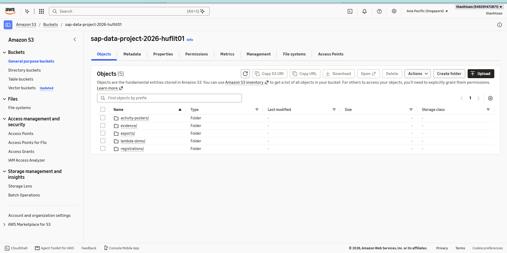
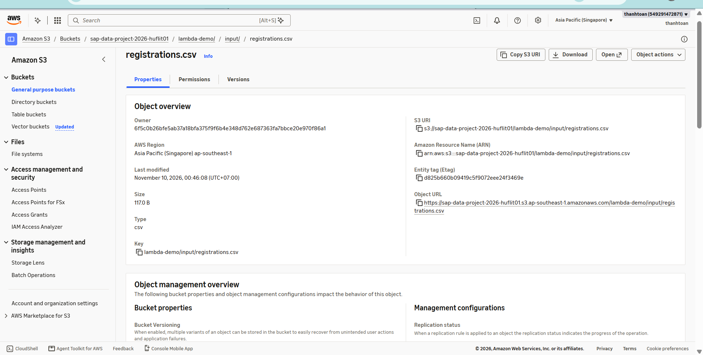

---
title: "Set Up Amazon S3 and Prepare Data"
date: 2026-11-09
weight: 1
chapter: false
pre: "<b>5.10.1.</b>"
---

## Set Up Amazon S3 and Prepare Data

In this section, we will use Amazon S3 to store the CSV input file and prepare the output location for JSON results generated by AWS Lambda.

Amazon Simple Storage Service (Amazon S3) is an AWS object storage service. Data is stored as Objects within Buckets.

#### 1. Open the Amazon S3 Console

1. Open the [Amazon S3 Console](https://console.aws.amazon.com/s3/).
2. Select Buckets.
3. Locate the project's existing Bucket:

```text
sap-data-project-2026-huflit01
```

<!--

-->

Reuse the existing Bucket if it is already available.

#### 2. Create an S3 Bucket if required

1. Choose Create bucket.
2. Select Asia Pacific (Singapore) - ap-southeast-1.
3. Choose General purpose bucket.
4. Enter a Bucket name.
5. Keep Object Ownership set to Bucket owner enforced.
6. Keep Block all public access enabled.
7. Use appropriate default encryption, such as SSE-S3.
8. Choose Create bucket.

<!--

-->

{}
S3 Bucket names must be unique within the applicable AWS namespace. sap-data-project-2026-huflit01 is the existing project Bucket. If using another AWS account, choose an available Bucket name and update IAM and Lambda configuration accordingly.
{}

The Bucket does not need to be publicly accessible for Lambda to read its Objects.

#### 3. Prepare the storage structure

The workshop uses the following Object Keys:

```text
sap-data-project-2026-huflit01/
└── lambda-demo/
    ├── input/
    │   └── registrations.csv
    └── processed/
        └── registrations-result.json
```

Where:

* input/: Stores the original CSV data.
* processed/: Stores the JSON processing result.

Amazon S3 organizes data using Object Keys and Prefixes. Console folders represent these Prefixes.

The processed Prefix does not need to exist before Lambda writes an Object using the corresponding Key.

#### 4. Prepare a CSV file

Create registrations.csv with the following synthetic data:

```csv
mssv,full_name
DEMO001,Student A
DEMO002,Student B
DEMO001,Student A
,Student C
```

Fields:

* mssv: Student identifier.
* full_name: Student full name.

The file contains four data records excluding its header.

| Record | Expected Classification |
| --- | --- |
| DEMO001 - Student A | Valid |
| DEMO002 - Student B | Valid |
| DEMO001 - Student A | Duplicate |
| Student C - missing ID | Invalid |

<!--

-->

{}
This synthetic dataset reproduces the structure and record counts of the earlier project test. DEMO identifiers validate the Lambda processing logic rather than the full Web Application's student ID format requirements.
{}

#### 5. Upload the CSV file to S3

1. Open sap-data-project-2026-huflit01.
2. Create the lambda-demo/input/ Prefix using Create folder if necessary.
3. Open the input Prefix.
4. Choose Upload.
5. Choose Add files.
6. Select registrations.csv.
7. Choose Upload.

<!--

-->

Verify the Object Key:

```text
lambda-demo/input/registrations.csv
```

S3 URI:

```text
s3://sap-data-project-2026-huflit01/lambda-demo/input/registrations.csv
```

#### 6. Inspect the uploaded Object

Select registrations.csv.

Review:

* Bucket name.
* Object Key.
* File size.
* Content type if available.
* Encryption.
* Access permissions.

<!--

-->

Download the file using an authorized account if content verification is required.

Do not make the Bucket public.

#### 7. Verify using AWS CLI

With the sap-dev AWS Profile configured, run:

```powershell
aws s3 ls s3://sap-data-project-2026-huflit01/lambda-demo/input/ --region ap-southeast-1 --profile sap-dev
```

The output should include registrations.csv.

Inspect Object metadata:

```powershell
aws s3api head-object `
  --bucket sap-data-project-2026-huflit01 `
  --key lambda-demo/input/registrations.csv `
  --region ap-southeast-1 `
  --profile sap-dev
```

These commands require appropriate AWS permissions.

<!--

-->

#### 8. Prepare the output location

Lambda will store its processing result at:

```text
lambda-demo/processed/registrations-result.json
```

S3 URI:

```text
s3://sap-data-project-2026-huflit01/lambda-demo/processed/registrations-result.json
```

Input and output Objects use different Prefixes within the same Bucket.

This separates source data from processed results and supports scoped IAM permissions.

#### 9. Verify security configuration

Before proceeding:

* Keep Block Public Access enabled.
* Do not grant public Object access.
* Use synthetic student data.
* Do not store AWS credentials in CSV files.
* Apply the Least Privilege principle.

#### Results

After completing this section, we have prepared an Amazon S3 Bucket, created a CSV input file, and uploaded the dataset to AWS.

The registrations.csv Object is ready for Lambda processing.

In the next section, we will configure IAM Execution Role permissions for the required S3 Objects.

[Next: Configure IAM Execution Role](../5.10.2-configure-iam/)
