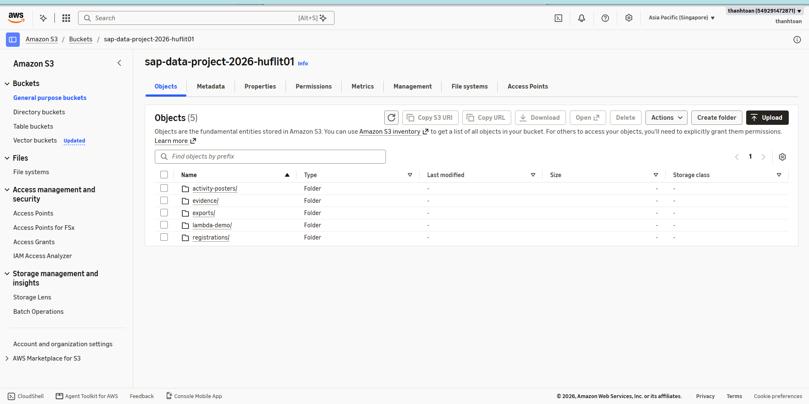
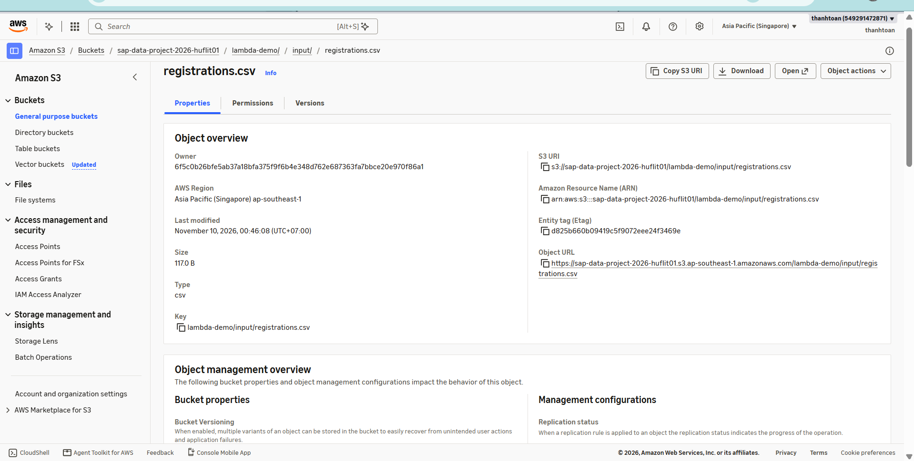

---
title: "Tạo Amazon S3 Bucket và chuẩn bị dữ liệu"
date: 2026-11-09
weight: 1
chapter: false
pre: "<b>5.10.1.</b>"
---

## Tạo Amazon S3 Bucket và chuẩn bị dữ liệu

Trong phần này, chúng ta sẽ sử dụng Amazon S3 để lưu trữ file CSV đầu vào và chuẩn bị vị trí lưu file JSON đầu ra cho AWS Lambda.

Amazon Simple Storage Service (Amazon S3) là dịch vụ lưu trữ đối tượng trên AWS. Dữ liệu được lưu dưới dạng Object trong các Bucket.

#### 1. Mở Amazon S3 Console

1. Truy cập [Amazon S3 Console](https://console.aws.amazon.com/s3/).
2. Chọn Buckets.
3. Kiểm tra Bucket đã được tạo cho đồ án:

```text
sap-data-project-2026-huflit01
```

<!--

-->

Nếu Bucket đã tồn tại, sử dụng Bucket hiện tại và không cần tạo thêm.

#### 2. Tạo S3 Bucket nếu chưa có

1. Chọn Create bucket.
2. Chọn AWS Region Asia Pacific (Singapore) - ap-southeast-1.
3. Chọn General purpose bucket.
4. Nhập Bucket name.
5. Giữ Object Ownership ở Bucket owner enforced.
6. Giữ Block all public access được bật.
7. Sử dụng Default encryption phù hợp, chẳng hạn SSE-S3.
8. Chọn Create bucket.

<!--

-->

{}
Tên Bucket S3 phải duy nhất trong phạm vi tên áp dụng của AWS. Tên sap-data-project-2026-huflit01 là Bucket đã sử dụng trong đồ án. Nếu thực hành bằng tài khoản khác, hãy chọn tên riêng và cập nhật cấu hình IAM và Lambda tương ứng.
{}

Không cần cấu hình Bucket thành Public để Lambda truy cập.

#### 3. Chuẩn bị cấu trúc lưu trữ

Trong Bucket, chúng ta sử dụng các Object Key:

```text
sap-data-project-2026-huflit01/
└── lambda-demo/
    ├── input/
    │   └── registrations.csv
    └── processed/
        └── registrations-result.json
```

Trong đó:

* input/: Lưu dữ liệu CSV đầu vào.
* processed/: Lưu kết quả JSON được Lambda tạo.

Amazon S3 sử dụng Object Key và Prefix để tổ chức dữ liệu. Các thư mục hiển thị trong Console là cách biểu diễn Prefix.

Không bắt buộc tạo trước thư mục processed vì Lambda có thể ghi Object bằng Key tương ứng.

#### 4. Chuẩn bị file CSV

Tạo file registrations.csv.

Sử dụng dữ liệu giả lập với hai cột:

```csv
mssv,full_name
DEMO001,Student A
DEMO002,Student B
DEMO001,Student A
,Student C
```

Giải thích:

* mssv: Mã định danh sinh viên.
* full_name: Họ và tên.

File có bốn dòng dữ liệu, không bao gồm dòng tiêu đề.

| Dòng dữ liệu | Kết quả mong đợi |
| --- | --- |
| DEMO001 - Student A | Hợp lệ |
| DEMO002 - Student B | Hợp lệ |
| DEMO001 - Student A | Trùng lặp |
| Student C - thiếu MSSV | Không hợp lệ |

<!--

-->

{}
Đây là bộ dữ liệu giả lập tái hiện cấu trúc và số lượng bản ghi của bài kiểm thử trước đây. Các mã DEMO được sử dụng để kiểm tra logic Lambda, không phải MSSV thật hoặc quy tắc định dạng MSSV của toàn bộ Web Application.
{}

#### 5. Upload file CSV lên S3

1. Mở Bucket sap-data-project-2026-huflit01.
2. Tạo Prefix lambda-demo/input/ thông qua Create folder nếu cần.
3. Mở Prefix input.
4. Chọn Upload.
5. Chọn Add files.
6. Chọn file registrations.csv.
7. Chọn Upload.

<!--

-->

Sau khi upload thành công, kiểm tra Object Key:

```text
lambda-demo/input/registrations.csv
```

S3 URI:

```text
s3://sap-data-project-2026-huflit01/lambda-demo/input/registrations.csv
```

#### 6. Kiểm tra Object

Chọn Object registrations.csv.

Kiểm tra:

* Bucket name.
* Object Key.
* File size.
* Content type nếu có.
* Default encryption.
* Quyền truy cập.

<!--

-->

Có thể tải file xuống bằng tài khoản được cấp quyền để kiểm tra lại nội dung.

Không thay đổi Bucket thành Public.

#### 7. Kiểm tra bằng AWS CLI

Nếu đã cấu hình AWS CLI với Profile sap-dev, thực hiện:

```powershell
aws s3 ls s3://sap-data-project-2026-huflit01/lambda-demo/input/ --region ap-southeast-1 --profile sap-dev
```

Kết quả cần hiển thị Object registrations.csv.

Kiểm tra thông tin Object:

```powershell
aws s3api head-object `
  --bucket sap-data-project-2026-huflit01 `
  --key lambda-demo/input/registrations.csv `
  --region ap-southeast-1 `
  --profile sap-dev
```

Các lệnh yêu cầu quyền AWS phù hợp.

<!--

-->

#### 8. Chuẩn bị vị trí lưu kết quả

Sau khi Lambda thực thi thành công, kết quả sẽ được lưu tại:

```text
lambda-demo/processed/registrations-result.json
```

S3 URI:

```text
s3://sap-data-project-2026-huflit01/lambda-demo/processed/registrations-result.json
```

Input và Output được lưu trong cùng Bucket nhưng sử dụng Prefix khác nhau.

Điều này giúp phân biệt dữ liệu nguồn với dữ liệu đã xử lý và hỗ trợ giới hạn quyền IAM.

#### 9. Kiểm tra bảo mật

Trước khi tiếp tục:

* Block Public Access được bật.
* Không cấp quyền đọc Object công khai.
* Sử dụng dữ liệu sinh viên giả lập.
* Không lưu AWS Credentials trong file CSV.
* Kiểm tra quyền truy cập Bucket theo nguyên tắc Least Privilege.

#### Kết quả

Sau khi hoàn thành phần này, chúng ta đã chuẩn bị Amazon S3 Bucket, tạo file CSV đầu vào và upload dữ liệu lên AWS.

File registrations.csv đã sẵn sàng để Lambda đọc và xử lý.

Trong phần tiếp theo, chúng ta sẽ cấu hình IAM Execution Role để cấp quyền truy cập các Object cần thiết cho Lambda.

[Tiếp theo: Cấu hình IAM Execution Role](../5.10.2-configure-iam/)
