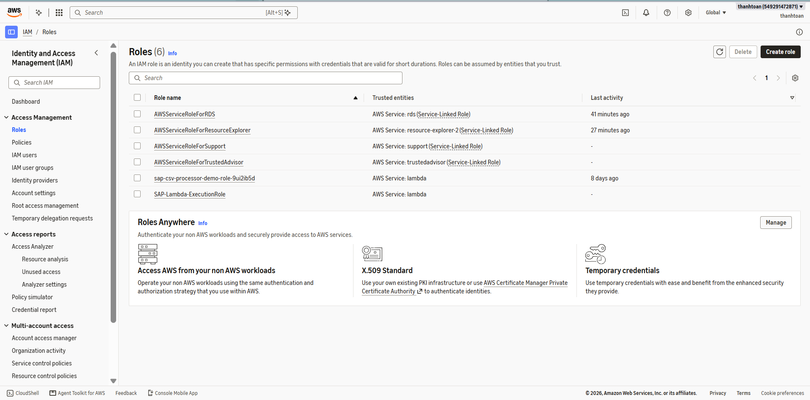
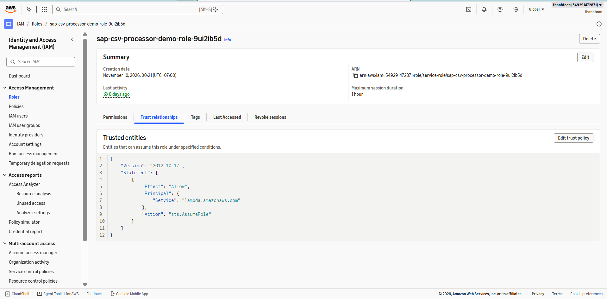
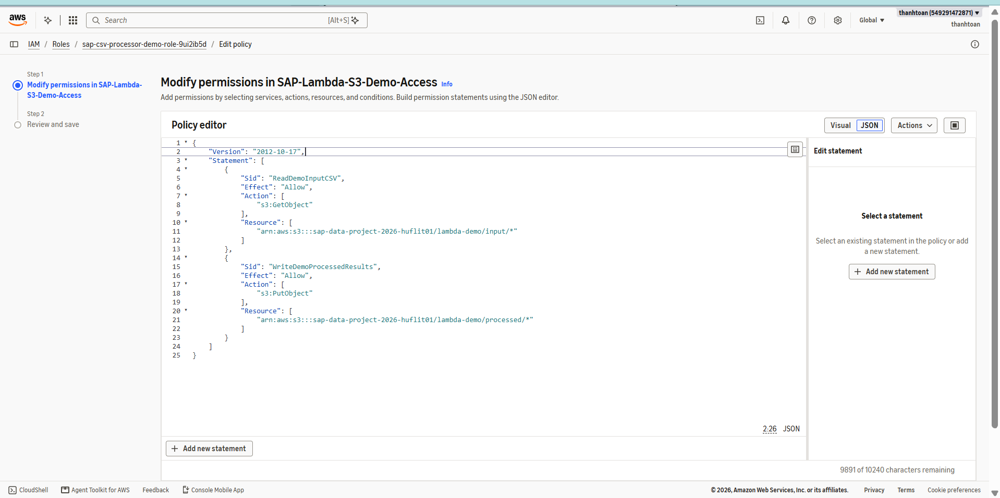
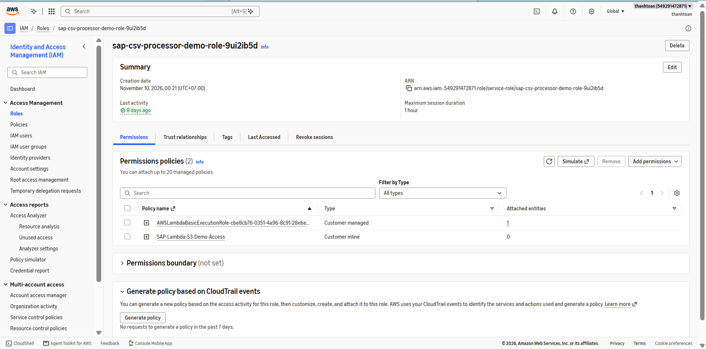
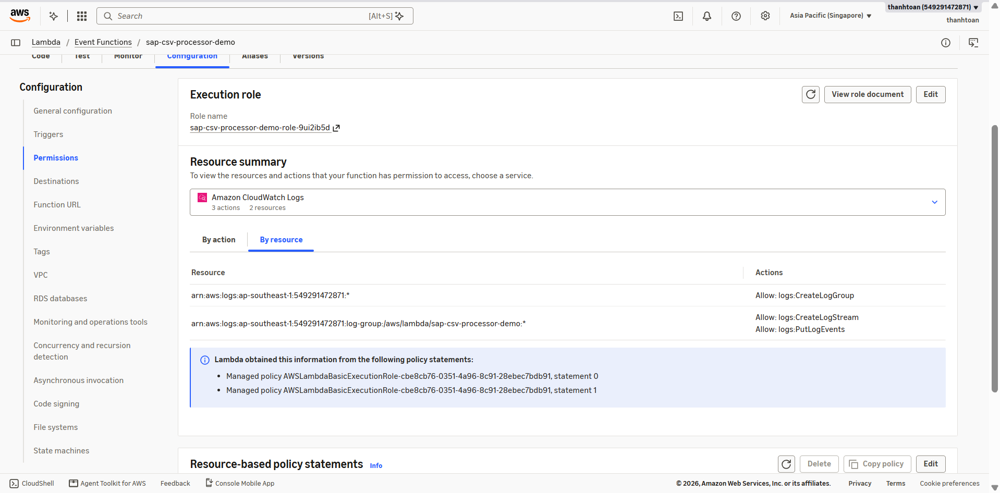

---
title: "Configure IAM Execution Role"
date: 2026-11-09
weight: 2
chapter: false
pre: "<b>5.10.2.</b>"
---

## Configure IAM Execution Role

In this section, we will configure AWS Identity and Access Management (IAM) permissions so that AWS Lambda can read CSV data from Amazon S3, write JSON results, and send execution logs to Amazon CloudWatch.

IAM manages identities and access to AWS resources.

Instead of storing Access Keys and Secret Access Keys in source code, Lambda uses an IAM Execution Role to obtain temporary credentials during execution.

#### 1. Understand the IAM Execution Role

```text
AWS Lambda
    |
    | Assume Execution Role
    v
IAM Role
    |
    +-- AWSLambdaBasicExecutionRole
    |        |
    |        v
    |   CloudWatch Logs
    |
    +-- SAP-Lambda-S3-Demo-Access
             |
             +--> Read Input CSV
             |
             +--> Write Output JSON
```

An Execution Role includes:

* Trust Policy: Allows AWS Lambda to assume the Role.
* Permissions Policy: Defines permitted actions and resources.

Required permissions:

| Permission | Purpose |
| --- | --- |
| s3:GetObject | Read the input CSV |
| s3:PutObject | Write the JSON result |
| logs:CreateLogGroup | Create Log Groups |
| logs:CreateLogStream | Create Log Streams |
| logs:PutLogEvents | Write execution logs |

#### 2. Open the AWS IAM Console

1. Open the [AWS IAM Console](https://console.aws.amazon.com/iam/).
2. Select Roles.
3. Locate the project's existing Role:

```text
sap-csv-processor-demo-role-9ui2ib5d
```

<!--

-->

If the Role already exists, inspect Trust relationships and Permissions.

Do not create another Role unnecessarily.

#### 3. Create an Execution Role if required

1. In IAM, select Roles.
2. Choose Create role.
3. Trusted entity type: AWS service.
4. Use case: Lambda.
5. Choose Next.
6. Attach the AWS managed AWSLambdaBasicExecutionRole policy.
7. Choose Next.
8. Enter a Role name.

Example:

```text
sap-csv-processor-demo-role
```

9. Review and choose Create role.

<!--

-->

A newly created Role name may differ from the automatically generated Role used in the previous project exercise.

#### 4. Inspect the Trust Policy

Open the Role and select Trust relationships.

The Lambda Trust Policy uses the following structure:

```json
{
    "Version": "2012-10-17",
    "Statement": [
        {
            "Effect": "Allow",
            "Principal": {
                "Service": "lambda.amazonaws.com"
            },
            "Action": "sts:AssumeRole"
        }
    ]
}
```

<!--

-->

Explanation:

* Principal: Identifies the trusted service.
* lambda.amazonaws.com: AWS Lambda Service Principal.
* sts:AssumeRole: Allows Lambda to assume the Execution Role.

The Trust Policy does not itself grant S3 Object permissions.

Those permissions must be defined separately.

#### 5. Create an Amazon S3 access policy

In the IAM Console:

1. Select Policies.
2. Choose Create policy.
3. Switch to the JSON editor.
4. Enter the following Policy.

```json
{
    "Version": "2012-10-17",
    "Statement": [
        {
            "Sid": "ReadDemoInput",
            "Effect": "Allow",
            "Action": "s3:GetObject",
            "Resource": "arn:aws:s3:::sap-data-project-2026-huflit01/lambda-demo/input/registrations.csv"
        },
        {
            "Sid": "WriteDemoResult",
            "Effect": "Allow",
            "Action": "s3:PutObject",
            "Resource": "arn:aws:s3:::sap-data-project-2026-huflit01/lambda-demo/processed/registrations-result.json"
        }
    ]
}
```

<!--

-->

Choose Next and enter the Policy name:

```text
SAP-Lambda-S3-Demo-Access
```

Choose Create policy.

{}
This Least Privilege Policy recreates the permissions required for the workshop. If a Policy with the same name already exists, inspect its current permissions before changing it. Avoid duplicates and unintended changes to other applications.
{}

#### 6. Understand the permissions

The Policy grants access to two specific S3 Objects.

##### Read the input file

```text
Action:
s3:GetObject

Resource:
arn:aws:s3:::sap-data-project-2026-huflit01/lambda-demo/input/registrations.csv
```

Lambda can read the CSV without receiving delete permissions from this Policy.

##### Write the processing result

```text
Action:
s3:PutObject

Resource:
arn:aws:s3:::sap-data-project-2026-huflit01/lambda-demo/processed/registrations-result.json
```

Lambda can write the JSON result.

The Function does not require s3:ListBucket because the Bucket and Object Keys are known.

Prefix-based wildcard permissions may be considered if multiple input files are required. Expand permissions only when necessary.

#### 7. Attach the Policy to the Execution Role

1. Return to IAM Roles.
2. Select sap-csv-processor-demo-role-9ui2ib5d or the newly created Role.
3. Open Permissions.
4. Choose Add permissions.
5. Choose Attach policies.
6. Search for SAP-Lambda-S3-Demo-Access.
7. Select and attach the Policy.

<!--

-->

Verify that the Role contains:

* AWSLambdaBasicExecutionRole.
* SAP-Lambda-S3-Demo-Access.

<!--

-->

If S3 uses SSE-KMS rather than SSE-S3, additional KMS permissions may be required according to the Key Policy and Object operations.

This workshop does not require a separate KMS configuration.

#### 8. Verify the Lambda Execution Role

If the Function already exists:

1. Open AWS Lambda Console.
2. Select sap-csv-processor-demo.
3. Select Configuration.
4. Select Permissions.
5. Inspect the Execution role.

<!--

-->

Ensure that the Function uses the intended Role.

If the Function has not been created, select this Role during section 5.10.3.

#### 9. Understand Least Privilege

Least Privilege grants only the permissions necessary for an application to perform its intended task.

For this exercise:

* AdministratorAccess is not required.
* AmazonS3FullAccess is not required.
* S3 delete permissions are not required.
* DynamoDB access is not required.
* Hardcoded AWS Access Keys are not required.

Lambda uses its Execution Role to allow boto3 to access AWS resources within its assigned permissions.

#### 10. Troubleshoot access errors

| Error | What to Check |
| --- | --- |
| AccessDenied reading CSV | s3:GetObject and Input ARN |
| AccessDenied writing JSON | s3:PutObject and Output ARN |
| Missing CloudWatch Logs | CloudWatch Logs permissions |
| Lambda cannot assume Role | Trust Policy and Role configuration |
| Policy not found | Policy name and AWS Account |
| Permissions still denied | Bucket Policy, Permissions Boundary, or SCP |

Do not resolve AccessDenied errors by granting unnecessary AdministratorAccess.

#### Results

After completing this section, we have configured an IAM Execution Role and Least Privilege S3 permissions for AWS Lambda.

The Function can read registrations.csv, write registrations-result.json, and send execution logs to CloudWatch within its assigned permissions.

[Next: Build the AWS Lambda CSV Processor](../5.10.3-create-lambda/)
