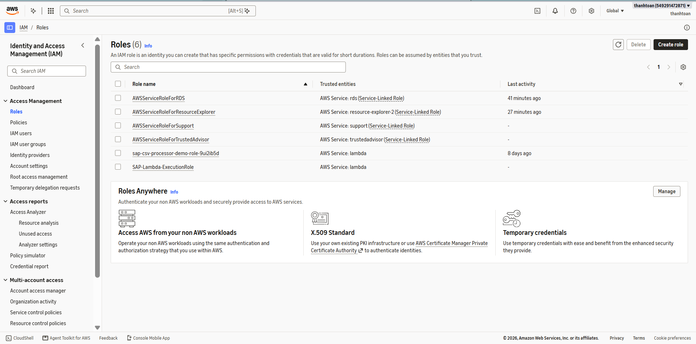
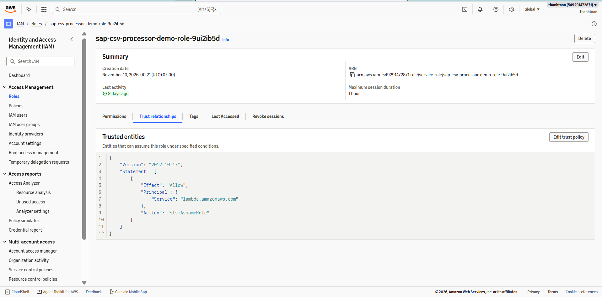
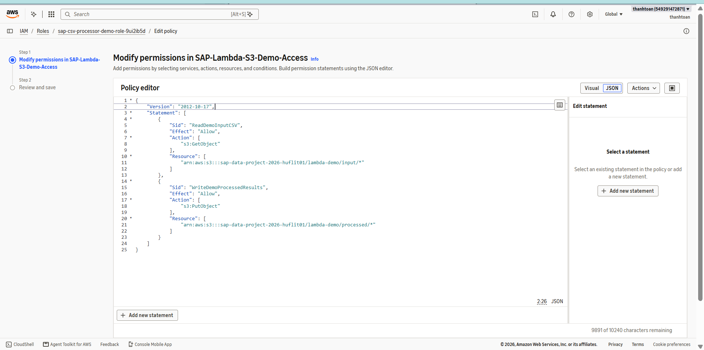
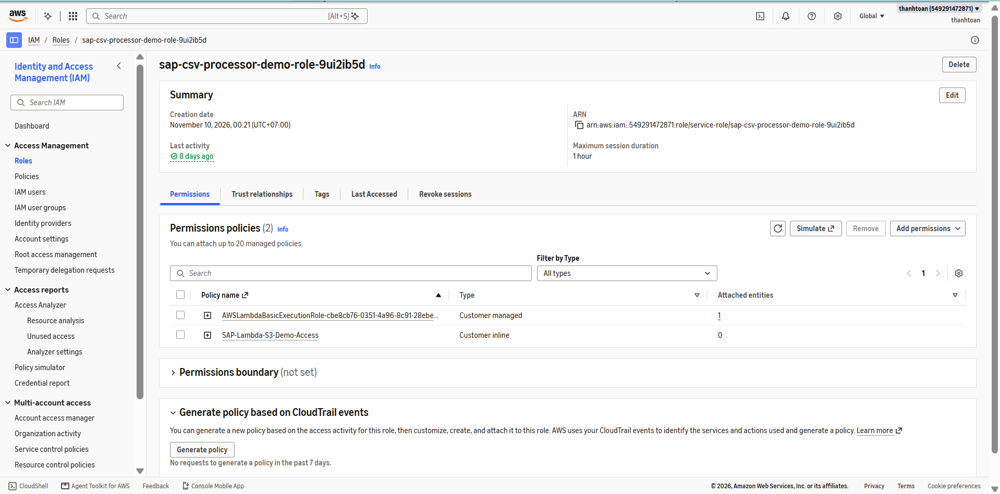
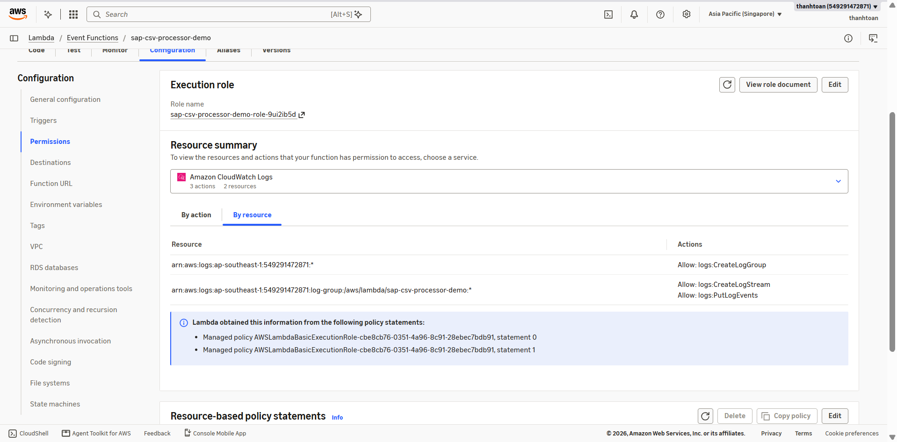

---
title: "Cấu hình IAM Execution Role"
date: 2026-11-09
weight: 2
chapter: false
pre: "<b>5.10.2.</b>"
---

## Cấu hình IAM Execution Role

Trong phần này, chúng ta sẽ cấu hình AWS Identity and Access Management (IAM) để AWS Lambda có quyền đọc file CSV từ Amazon S3, ghi kết quả JSON và gửi nhật ký thực thi đến Amazon CloudWatch.

IAM giúp quản lý danh tính và quyền truy cập tài nguyên AWS.

Thay vì lưu Access Key và Secret Access Key trong mã nguồn, Lambda sử dụng IAM Execution Role để nhận thông tin xác thực tạm thời khi thực thi.

#### 1. Tìm hiểu IAM Execution Role

```text
AWS Lambda
    |
    | Assume Execution Role
    v
IAM Role
    |
    +-- AWSLambdaBasicExecutionRole
    |        |
    |        v
    |   CloudWatch Logs
    |
    +-- SAP-Lambda-S3-Demo-Access
             |
             +--> Read Input CSV
             |
             +--> Write Output JSON
```

Execution Role bao gồm:

* Trust Policy: Cho phép dịch vụ AWS Lambda sử dụng Role.
* Permissions Policy: Xác định các hành động và tài nguyên mà Lambda được phép truy cập.

Các quyền cần thiết trong bài thực hành:

| Permission | Mục đích |
| --- | --- |
| s3:GetObject | Đọc file CSV đầu vào |
| s3:PutObject | Ghi file JSON kết quả |
| logs:CreateLogGroup | Tạo Log Group |
| logs:CreateLogStream | Tạo Log Stream |
| logs:PutLogEvents | Ghi nhật ký thực thi |

#### 2. Mở AWS IAM Console

1. Truy cập [AWS IAM Console](https://console.aws.amazon.com/iam/).
2. Trong thanh điều hướng, chọn Roles.
3. Tìm Role đã sử dụng trong đồ án:

```text
sap-csv-processor-demo-role-9ui2ib5d
```

<!--

-->

Nếu Role đã tồn tại, kiểm tra Trust relationships và Permissions.

Không cần tạo thêm Role mới chỉ để thực hiện lại bài kiểm thử.

#### 3. Tạo Execution Role nếu chưa có

1. Trong IAM Console, chọn Roles.
2. Chọn Create role.
3. Trusted entity type: AWS service.
4. Use case: Lambda.
5. Chọn Next.
6. Thêm AWS managed policy AWSLambdaBasicExecutionRole.
7. Chọn Next.
8. Nhập tên Role.

Ví dụ:

```text
sap-csv-processor-demo-role
```

9. Kiểm tra cấu hình và chọn Create role.

<!--

-->

Tên Role mới có thể khác với tên Role được Lambda tạo tự động trong lần thực hành trước.

#### 4. Kiểm tra Trust Policy

Mở Role và chọn Trust relationships.

Trust Policy cho Lambda có cấu trúc:

```json
{
    "Version": "2012-10-17",
    "Statement": [
        {
            "Effect": "Allow",
            "Principal": {
                "Service": "lambda.amazonaws.com"
            },
            "Action": "sts:AssumeRole"
        }
    ]
}
```

<!--

-->

Giải thích:

* Principal: Dịch vụ được phép sử dụng Role.
* lambda.amazonaws.com: AWS Lambda Service Principal.
* sts:AssumeRole: Cho phép Lambda nhận quyền thông qua Execution Role.

Trust Policy không tự cấp quyền đọc hoặc ghi S3.

Các quyền đó cần được cấu hình trong Permissions Policy.

#### 5. Tạo IAM Policy truy cập Amazon S3

Trong IAM Console:

1. Chọn Policies.
2. Chọn Create policy.
3. Chuyển sang JSON editor.
4. Nhập Policy dưới đây.

```json
{
    "Version": "2012-10-17",
    "Statement": [
        {
            "Sid": "ReadDemoInput",
            "Effect": "Allow",
            "Action": "s3:GetObject",
            "Resource": "arn:aws:s3:::sap-data-project-2026-huflit01/lambda-demo/input/registrations.csv"
        },
        {
            "Sid": "WriteDemoResult",
            "Effect": "Allow",
            "Action": "s3:PutObject",
            "Resource": "arn:aws:s3:::sap-data-project-2026-huflit01/lambda-demo/processed/registrations-result.json"
        }
    ]
}
```

<!--

-->

Chọn Next và nhập Policy name:

```text
SAP-Lambda-S3-Demo-Access
```

Chọn Create policy.

{}
Đây là Policy Least Privilege tái hiện quyền cần thiết cho bài Workshop. Nếu Policy cùng tên đã tồn tại, hãy kiểm tra nội dung hiện tại trước khi chỉnh sửa. Không tạo trùng hoặc thay đổi quyền của các ứng dụng khác đang sử dụng Policy.
{}

#### 6. Giải thích cấu hình quyền

Policy trên chỉ cấp quyền cho hai Object cụ thể.

##### Đọc dữ liệu đầu vào

```text
Action:
s3:GetObject

Resource:
arn:aws:s3:::sap-data-project-2026-huflit01/lambda-demo/input/registrations.csv
```

Lambda có thể đọc nội dung CSV nhưng không có quyền xóa Object từ Policy này.

##### Ghi kết quả xử lý

```text
Action:
s3:PutObject

Resource:
arn:aws:s3:::sap-data-project-2026-huflit01/lambda-demo/processed/registrations-result.json
```

Lambda có thể ghi file kết quả JSON.

Không cần cấp s3:ListBucket vì chương trình sử dụng Bucket name và Object Key đã biết.

Nếu bài thực hành sử dụng nhiều file CSV khác nhau, có thể giới hạn quyền theo Prefix bằng ký tự wildcard. Tuy nhiên, chỉ mở rộng quyền khi thực sự cần thiết.

#### 7. Gắn Policy vào Execution Role

1. Quay lại IAM Roles.
2. Chọn sap-csv-processor-demo-role-9ui2ib5d hoặc Role mới.
3. Mở tab Permissions.
4. Chọn Add permissions.
5. Chọn Attach policies.
6. Tìm SAP-Lambda-S3-Demo-Access.
7. Chọn Policy và xác nhận.

<!--

-->

Kiểm tra Role có:

* AWSLambdaBasicExecutionRole.
* SAP-Lambda-S3-Demo-Access.

<!--

-->

Nếu S3 sử dụng SSE-KMS thay vì SSE-S3, có thể cần bổ sung quyền KMS phù hợp với Key Policy và cách đọc/ghi Object.

Bài thực hành này sử dụng quyền S3 cơ bản, không yêu cầu cấu hình KMS riêng.

#### 8. Kiểm tra Execution Role trên Lambda

Nếu Function đã được tạo:

1. Mở AWS Lambda Console.
2. Chọn sap-csv-processor-demo.
3. Chọn Configuration.
4. Chọn Permissions.
5. Kiểm tra Execution role.

<!--

-->

Đảm bảo Lambda sử dụng đúng Role đã được cấp quyền.

Nếu Function chưa được tạo, Role này sẽ được lựa chọn trong phần 5.10.3.

#### 9. Tìm hiểu nguyên tắc Least Privilege

Least Privilege nghĩa là chỉ cấp các quyền tối thiểu cần thiết để một ứng dụng hoàn thành nhiệm vụ.

Trong bài thực hành:

* Lambda không cần AdministratorAccess.
* Lambda không cần AmazonS3FullAccess.
* Lambda không cần quyền xóa dữ liệu S3.
* Lambda không cần quyền truy cập DynamoDB.
* Lambda không cần lưu AWS Access Key trong mã nguồn.

AWS Lambda sử dụng Execution Role để boto3 truy cập S3 theo quyền được cấp.

#### 10. Xử lý lỗi quyền truy cập

| Lỗi | Nội dung kiểm tra |
| --- | --- |
| AccessDenied khi đọc CSV | Quyền s3:GetObject và Input ARN |
| AccessDenied khi ghi JSON | Quyền s3:PutObject và Output ARN |
| Lambda không có CloudWatch Logs | Quyền CloudWatch Logs |
| Lambda không sử dụng được Role | Trust Policy và cấu hình Role |
| Không tìm thấy Policy | Tên Policy và AWS Account |
| Quyền vẫn bị từ chối | Bucket Policy, Permissions Boundary hoặc SCP |

Không khắc phục lỗi AccessDenied bằng cách cấp toàn bộ quyền AdministratorAccess cho Lambda.

#### Kết quả

Sau khi hoàn thành phần này, chúng ta đã chuẩn bị IAM Execution Role cho AWS Lambda và cấu hình quyền truy cập Amazon S3 theo nguyên tắc Least Privilege.

Lambda có thể đọc file registrations.csv, ghi registrations-result.json và gửi Log đến CloudWatch trong phạm vi quyền được cấp.

[Tiếp theo: Xây dựng AWS Lambda CSV Processor](../5.10.3-create-lambda/)
