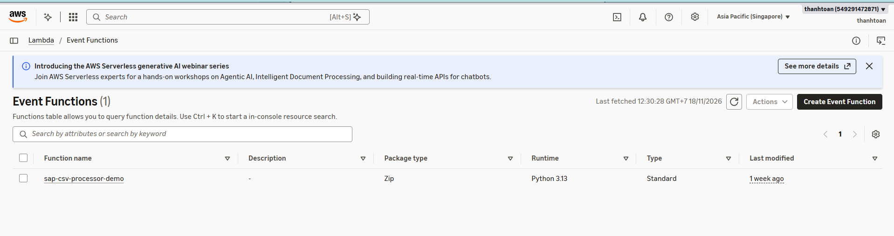
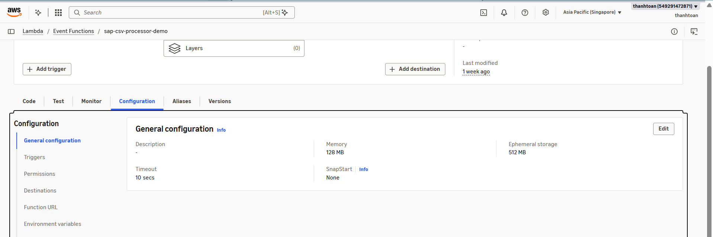
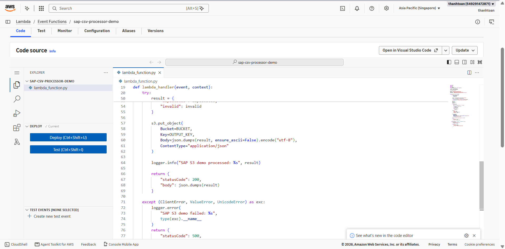

---
title: "Build the AWS Lambda CSV Processor"
date: 2026-11-09
weight: 3
chapter: false
pre: "<b>5.10.3.</b>"
---

## Build the AWS Lambda CSV Processor

In this section, we will develop an AWS Lambda Function to process student registration data stored in Amazon S3.

AWS Lambda enables code execution without directly managing servers.

The Function uses Python and boto3 to interact with Amazon S3.

#### 1. Understand the processing workflow

```text
Lambda Test Event
        |
        v
Lambda Handler
        |
        v
Get CSV Object from S3
        |
        v
Decode UTF-8 Content
        |
        v
Read CSV Records
        |
        +-- Missing Student ID
        |       -> Invalid
        |
        +-- Repeated Student ID
        |       -> Duplicate
        |
        +-- Valid Unique Student ID
                -> Valid
        |
        v
Generate JSON Summary
        |
        v
Put JSON Object to S3
        |
        v
Return Execution Result
```

This exercise focuses on input validation and summary report generation.

Lambda does not directly update FastAPI Registration records or write business data to DynamoDB.

#### 2. Open the AWS Lambda Console

1. Open the [AWS Lambda Console](https://console.aws.amazon.com/lambda/).
2. Select Asia Pacific (Singapore) - ap-southeast-1.
3. Select Functions.
4. Locate:

```text
sap-csv-processor-demo
```

<!--

-->

Reuse the existing Function if available.

#### 3. Create a Lambda Function if required

1. Choose Create function.
2. Choose Author from scratch.
3. Enter the Function name:

```text
sap-csv-processor-demo
```

4. Select an AWS-supported Python Runtime, such as Python 3.12.
5. Architecture: x86_64.
6. Under Execution role, select Use an existing role.
7. Select the Role configured in section 5.10.2.
8. Choose Create function.

<!--

-->

A Function URL is not required.

A VPC connection is not required for this exercise.

The Python Runtime above is a workshop reproduction choice, not a verified historical Runtime version.

#### 4. Configure Lambda resources

Open the Function.

1. Select Configuration.
2. Select General configuration.
3. Choose Edit.
4. Configure:

```text
Memory: 128 MB
Timeout: 10 seconds
```

5. Choose Save.

<!--

-->

These settings match the project's previous CSV Processor exercise.

The small test dataset does not require a large memory allocation.

#### 5. Configure environment variables

In the Lambda Console:

1. Select Configuration.
2. Select Environment variables.
3. Choose Edit.
4. Add:

| Key | Value |
| --- | --- |
| S3_BUCKET | sap-data-project-2026-huflit01 |
| INPUT_KEY | lambda-demo/input/registrations.csv |
| OUTPUT_KEY | lambda-demo/processed/registrations-result.json |

<!--

-->

These variables configure the Bucket and Object Keys in the reconstructed workshop implementation.

Do not store AWS Access Keys, Secret Access Keys, or passwords in these variables.

#### 6. Implement Lambda source code

Select the Code tab.

Open lambda_function.py.

Use the following code to reproduce the exercise.

```python
import os
import csv
import io
import json
import logging

import boto3


logger = logging.getLogger()
logger.setLevel(logging.INFO)

s3 = boto3.client("s3")


def lambda_handler(event, context):
    bucket = os.environ.get(
        "S3_BUCKET",
        "sap-data-project-2026-huflit01"
    )

    input_key = os.environ.get(
        "INPUT_KEY",
        "lambda-demo/input/registrations.csv"
    )

    output_key = os.environ.get(
        "OUTPUT_KEY",
        "lambda-demo/processed/registrations-result.json"
    )

    try:
        # Step 1: Read the input CSV from S3
        response = s3.get_object(
            Bucket=bucket,
            Key=input_key
        )

        content = response["Body"].read().decode("utf-8-sig")

        # Step 2: Parse CSV records
        reader = csv.DictReader(
            io.StringIO(content)
        )

        required_columns = {"mssv", "full_name"}

        if not required_columns.issubset(
            set(reader.fieldnames or [])
        ):
            raise ValueError(
                "CSV must contain mssv and full_name columns"
            )

        seen_students = set()

        total = 0
        valid = 0
        duplicates = 0
        invalid = 0

        # Step 3: Validate each record
        for row in reader:
            total += 1

            mssv = (row.get("mssv") or "").strip()

            full_name = (
                row.get("full_name") or ""
            ).strip()

            if not mssv or not full_name:
                invalid += 1
                continue

            if mssv in seen_students:
                duplicates += 1
                continue

            seen_students.add(mssv)
            valid += 1

        # Step 4: Generate JSON summary
        result = {
            "total": total,
            "valid": valid,
            "duplicates": duplicates,
            "invalid": invalid
        }

        # Step 5: Save the result to S3
        s3.put_object(
            Bucket=bucket,
            Key=output_key,
            Body=json.dumps(result).encode("utf-8"),
            ContentType="application/json"
        )

        # Step 6: Record processing information
        logger.info(
            "SAP S3 demo processed: %s",
            json.dumps(result)
        )

        return {
            "statusCode": 200,
            "body": json.dumps(result)
        }

    except Exception:
        logger.exception(
            "SAP CSV processing failed"
        )
        raise
```

Choose Deploy to save and deploy the source code.

<!--

-->

{}
This workshop implementation recreates the project's previously recorded CSV processing results. It is not a verbatim copy of the historical Lambda source code. Preserve the original working source before replacing it or use a separate test Function.
{}

#### 7. Understand the source code

##### Initialize the Amazon S3 Client

```python
s3 = boto3.client("s3")
```

boto3 is the AWS SDK for Python.

Lambda uses temporary credentials from its Execution Role rather than hardcoded AWS credentials.

##### Read the CSV file

```python
response = s3.get_object(
    Bucket=bucket,
    Key=input_key
)
```

get_object() retrieves the CSV Object from Amazon S3.

```python
content = response["Body"].read().decode("utf-8-sig")
```

utf-8-sig supports UTF-8 files with or without a Byte Order Mark.

##### Parse CSV records

```python
reader = csv.DictReader(
    io.StringIO(content)
)
```

DictReader converts CSV rows into Dictionaries using column headers.

The Function validates the mssv and full_name columns before processing records.

##### Validate records

```python
if not mssv or not full_name:
    invalid += 1
    continue
```

Records with missing required information are classified as invalid.

```python
if mssv in seen_students:
    duplicates += 1
    continue
```

Repeated student IDs are classified as duplicates when a valid record with that ID has already been processed.

```python
seen_students.add(mssv)
valid += 1
```

Valid unique records are counted and their identifiers are tracked.

This validation applies to the current CSV file, not the university's actual student database.

##### Generate and store JSON

```python
result = {
    "total": total,
    "valid": valid,
    "duplicates": duplicates,
    "invalid": invalid
}
```

The Function generates a summary Dictionary.

```python
s3.put_object(
    Bucket=bucket,
    Key=output_key,
    Body=json.dumps(result).encode("utf-8"),
    ContentType="application/json"
)
```

put_object() stores the JSON result in Amazon S3.

Subsequent successful invocations write a new result to the same configured Object Key.

#### 8. Verify the Handler

Inspect Runtime settings.

```text
Handler:
lambda_function.lambda_handler
```

Where:

* lambda_function: Python module name.
* lambda_handler: Function invoked by AWS Lambda.

Update the Handler if the module or Function name changes.

<!--

-->

#### 9. Create a Lambda Test Event

Select Test.

1. Choose Create new event.
2. Enter the Event name:

```text
SAPCSVProcessingTest
```

3. Use:

```json
{}
```

4. Save the Test Event.

<!--

-->

The reconstructed Function reads Bucket and Object Keys from environment variables, so an empty JSON Event is sufficient.

This is the Test Event for the workshop implementation, not a verified copy of the historical Test Event.

#### 10. Verify execution readiness

| Component | Requirement |
| --- | --- |
| Region | ap-southeast-1 |
| Function | sap-csv-processor-demo |
| Memory | 128 MB |
| Timeout | 10 seconds |
| Handler | lambda_function.lambda_handler |
| Execution Role | S3 and CloudWatch Logs permissions |
| Input | registrations.csv exists in S3 |
| Output | Correct JSON Object Key |
| Source Code | Deployed successfully |
| Test Event | Created |

#### Results

After completing this section, we have developed a Lambda Function that reads, validates, and processes CSV data from Amazon S3.

The Function classifies records as valid, duplicate, or invalid and stores a JSON summary.

In the next section, we will invoke the Function and inspect the results in Amazon S3 and CloudWatch Logs.

[Next: Test and Monitor with CloudWatch](../5.10.4-test-serverless/)
