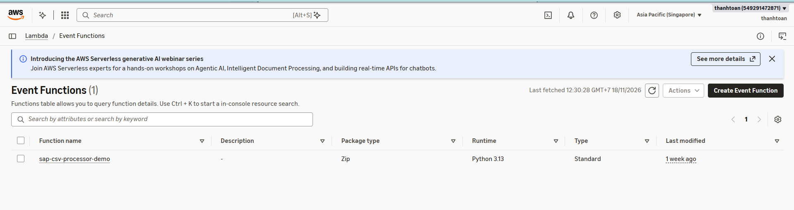
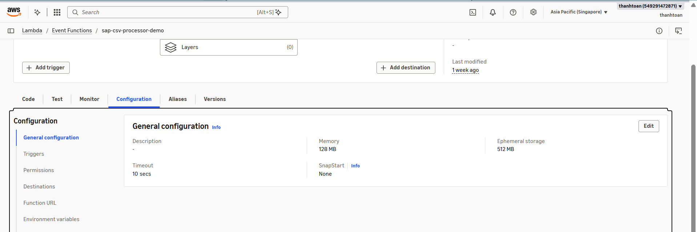
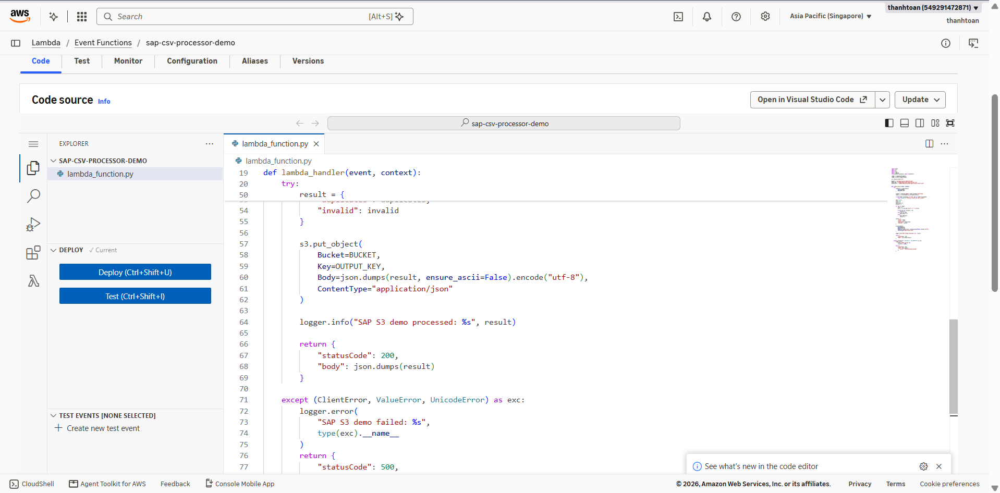

---
title: "Xây dựng AWS Lambda CSV Processor"
date: 2026-11-09
weight: 3
chapter: false
pre: "<b>5.10.3.</b>"
---

## Xây dựng AWS Lambda CSV Processor

Trong phần này, chúng ta sẽ xây dựng AWS Lambda Function để xử lý dữ liệu đăng ký sinh viên được lưu trên Amazon S3.

AWS Lambda cho phép chạy mã nguồn mà không cần trực tiếp quản lý máy chủ.

Function sử dụng Python và thư viện boto3 để tương tác với Amazon S3.

#### 1. Tìm hiểu luồng xử lý

```text
Lambda Test Event
        |
        v
Lambda Handler
        |
        v
Get CSV Object from S3
        |
        v
Decode UTF-8 Content
        |
        v
Read CSV Records
        |
        +-- Missing Student ID
        |       -> Invalid
        |
        +-- Repeated Student ID
        |       -> Duplicate
        |
        +-- Valid Unique Student ID
                -> Valid
        |
        v
Generate JSON Summary
        |
        v
Put JSON Object to S3
        |
        v
Return Execution Result
```

Bài thực hành tập trung vào kiểm tra dữ liệu và tạo báo cáo tổng hợp.

Lambda không trực tiếp cập nhật dữ liệu Registration của FastAPI hoặc ghi bản ghi vào DynamoDB.

#### 2. Mở AWS Lambda Console

1. Truy cập [AWS Lambda Console](https://console.aws.amazon.com/lambda/).
2. Chọn Region Asia Pacific (Singapore) - ap-southeast-1.
3. Chọn Functions.
4. Tìm Function:

```text
sap-csv-processor-demo
```

<!--

-->

Nếu Function đã tồn tại, sử dụng Function hiện tại.

#### 3. Tạo Lambda Function nếu chưa có

1. Chọn Create function.
2. Chọn Author from scratch.
3. Nhập Function name:

```text
sap-csv-processor-demo
```

4. Chọn Python Runtime đang được AWS hỗ trợ, ví dụ Python 3.12.
5. Architecture: x86_64.
6. Trong phần Execution role, chọn Use an existing role.
7. Chọn Role đã chuẩn bị tại phần 5.10.2.
8. Chọn Create function.

<!--

-->

Không cần bật Function URL.

Không cần kết nối Lambda với VPC cho bài thực hành này.

Python Runtime ở trên là lựa chọn để tái hiện Workshop, không khẳng định đây là phiên bản Runtime chính xác của Function lịch sử.

#### 4. Cấu hình tài nguyên Lambda

Mở Function vừa tạo.

1. Chọn Configuration.
2. Chọn General configuration.
3. Chọn Edit.
4. Thiết lập:

```text
Memory: 128 MB
Timeout: 10 seconds
```

5. Chọn Save.

<!--

-->

Đây là cấu hình đã được sử dụng trong bài thực hành CSV Processor của đồ án.

Với bộ dữ liệu nhỏ, Function không cần cấp tài nguyên quá lớn.

#### 5. Cấu hình biến môi trường

Trong Lambda Console:

1. Chọn Configuration.
2. Chọn Environment variables.
3. Chọn Edit.
4. Thêm các biến:

| Key | Value |
| --- | --- |
| S3_BUCKET | sap-data-project-2026-huflit01 |
| INPUT_KEY | lambda-demo/input/registrations.csv |
| OUTPUT_KEY | lambda-demo/processed/registrations-result.json |

<!--

-->

Các biến trên được sử dụng trong bản mã nguồn Workshop để cấu hình Bucket và Object Key.

Không lưu AWS Access Key, Secret Access Key hoặc mật khẩu trong các biến này.

#### 6. Viết mã nguồn Lambda

Chuyển sang tab Code.

Mở file lambda_function.py.

Sử dụng đoạn code dưới đây để tái hiện bài thực hành.

```python
import os
import csv
import io
import json
import logging

import boto3


logger = logging.getLogger()
logger.setLevel(logging.INFO)

s3 = boto3.client("s3")


def lambda_handler(event, context):
    bucket = os.environ.get(
        "S3_BUCKET",
        "sap-data-project-2026-huflit01"
    )

    input_key = os.environ.get(
        "INPUT_KEY",
        "lambda-demo/input/registrations.csv"
    )

    output_key = os.environ.get(
        "OUTPUT_KEY",
        "lambda-demo/processed/registrations-result.json"
    )

    try:
        # Step 1: Read the input CSV from S3
        response = s3.get_object(
            Bucket=bucket,
            Key=input_key
        )

        content = response["Body"].read().decode("utf-8-sig")

        # Step 2: Parse CSV records
        reader = csv.DictReader(
            io.StringIO(content)
        )

        required_columns = {"mssv", "full_name"}

        if not required_columns.issubset(
            set(reader.fieldnames or [])
        ):
            raise ValueError(
                "CSV must contain mssv and full_name columns"
            )

        seen_students = set()

        total = 0
        valid = 0
        duplicates = 0
        invalid = 0

        # Step 3: Validate each record
        for row in reader:
            total += 1

            mssv = (row.get("mssv") or "").strip()

            full_name = (
                row.get("full_name") or ""
            ).strip()

            if not mssv or not full_name:
                invalid += 1
                continue

            if mssv in seen_students:
                duplicates += 1
                continue

            seen_students.add(mssv)
            valid += 1

        # Step 4: Generate JSON summary
        result = {
            "total": total,
            "valid": valid,
            "duplicates": duplicates,
            "invalid": invalid
        }

        # Step 5: Save the result to S3
        s3.put_object(
            Bucket=bucket,
            Key=output_key,
            Body=json.dumps(result).encode("utf-8"),
            ContentType="application/json"
        )

        # Step 6: Record processing information
        logger.info(
            "SAP S3 demo processed: %s",
            json.dumps(result)
        )

        return {
            "statusCode": 200,
            "body": json.dumps(result)
        }

    except Exception:
        logger.exception(
            "SAP CSV processing failed"
        )
        raise
```

Chọn Deploy để lưu và triển khai mã nguồn.

<!--

-->

{}
Đây là bản mã nguồn Workshop được viết lại để tái hiện kết quả xử lý CSV đã thực hiện trong đồ án. Không phải bản sao nguyên văn Function lịch sử. Nếu Function hiện tại đang hoạt động tốt, lưu lại mã nguồn cũ trước khi thay đổi hoặc sử dụng Function kiểm thử riêng.
{}

#### 7. Giải thích mã nguồn

##### Khởi tạo Amazon S3 Client

```python
s3 = boto3.client("s3")
```

boto3 là AWS SDK dành cho Python.

Lambda sử dụng thông tin xác thực tạm thời của IAM Execution Role, không cần khai báo AWS Credentials trong mã nguồn.

##### Đọc file CSV

```python
response = s3.get_object(
    Bucket=bucket,
    Key=input_key
)
```

get_object() truy xuất file CSV từ Amazon S3.

```python
content = response["Body"].read().decode("utf-8-sig")
```

utf-8-sig giúp đọc dữ liệu CSV UTF-8, bao gồm trường hợp file có Byte Order Mark.

##### Phân tích CSV

```python
reader = csv.DictReader(
    io.StringIO(content)
)
```

DictReader chuyển mỗi dòng CSV thành một Dictionary dựa trên tên cột.

Function kiểm tra hai cột mssv và full_name trước khi xử lý.

##### Kiểm tra dữ liệu

```python
if not mssv or not full_name:
    invalid += 1
    continue
```

Nếu thiếu thông tin bắt buộc, bản ghi được tính vào nhóm invalid.

```python
if mssv in seen_students:
    duplicates += 1
    continue
```

Nếu MSSV đã xuất hiện trong một bản ghi hợp lệ trước đó, bản ghi được tính là duplicate.

```python
seen_students.add(mssv)
valid += 1
```

Nếu bản ghi hợp lệ và chưa trùng lặp, tăng số lượng valid.

Quy tắc này kiểm tra dữ liệu trong một file CSV. Nó không đối chiếu MSSV với cơ sở dữ liệu sinh viên thực tế.

##### Tạo và lưu JSON

```python
result = {
    "total": total,
    "valid": valid,
    "duplicates": duplicates,
    "invalid": invalid
}
```

Lambda tạo kết quả tổng hợp dưới dạng Dictionary.

```python
s3.put_object(
    Bucket=bucket,
    Key=output_key,
    Body=json.dumps(result).encode("utf-8"),
    ContentType="application/json"
)
```

put_object() lưu kết quả vào S3 dưới dạng JSON.

Nếu Object kết quả đã tồn tại với cùng Key, lần thực thi mới sẽ ghi kết quả mới vào Key đó.

#### 8. Kiểm tra cấu hình Handler

Trong tab Code hoặc Runtime settings, kiểm tra:

```text
Handler:
lambda_function.lambda_handler
```

Trong đó:

* lambda_function: Tên module Python.
* lambda_handler: Hàm được Lambda gọi khi thực thi.

Nếu đổi tên file hoặc tên hàm, cần cập nhật Handler phù hợp.

<!--

-->

#### 9. Tạo Lambda Test Event

Chọn tab Test.

1. Chọn Create new event.
2. Nhập Event name:

```text
SAPCSVProcessingTest
```

3. Sử dụng JSON:

```json
{}
```

4. Lưu Test Event.

<!--

-->

Function trong Workshop sử dụng Bucket và Object Key từ biến môi trường, vì vậy Test Event có thể là một JSON rỗng.

Đây là Test Event dành cho mã nguồn minh họa hiện tại, không phải nội dung Event lịch sử đã được xác minh.

#### 10. Kiểm tra trước khi thực thi

| Thành phần | Yêu cầu |
| --- | --- |
| Region | ap-southeast-1 |
| Function | sap-csv-processor-demo |
| Memory | 128 MB |
| Timeout | 10 giây |
| Handler | lambda_function.lambda_handler |
| Execution Role | Có quyền S3 và CloudWatch Logs |
| Input | registrations.csv tồn tại trên S3 |
| Output | Key JSON đúng cấu hình |
| Source Code | Đã chọn Deploy |
| Test Event | Đã được tạo |

#### Kết quả

Sau khi hoàn thành phần này, chúng ta đã xây dựng Lambda Function có khả năng đọc, kiểm tra và xử lý dữ liệu CSV từ Amazon S3.

Function có thể phân loại bản ghi thành valid, duplicates và invalid, sau đó lưu kết quả JSON.

Trong phần tiếp theo, chúng ta sẽ thực thi Function và kiểm tra kết quả trên Amazon S3 và CloudWatch Logs.

[Tiếp theo: Kiểm thử và giám sát bằng CloudWatch](../5.10.4-test-serverless/)
