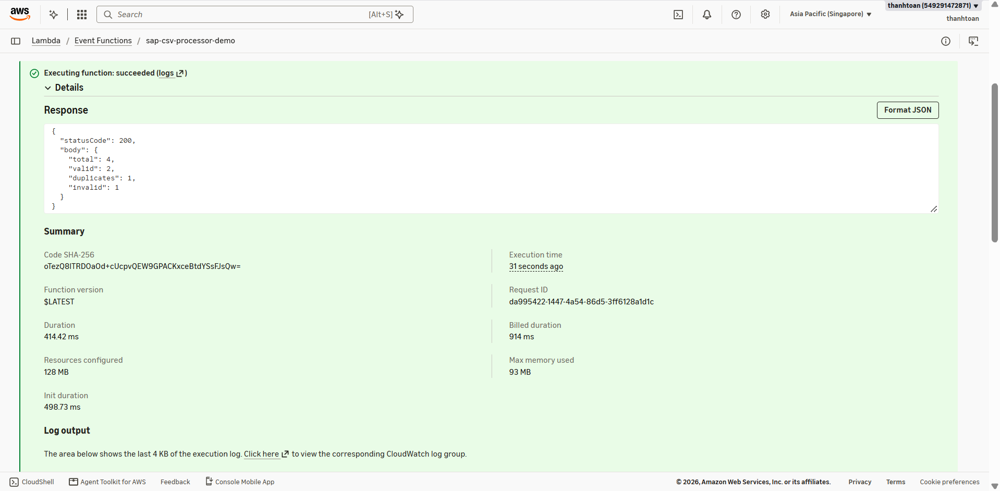
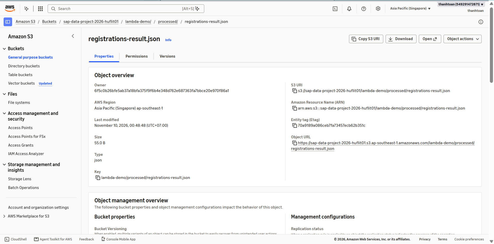
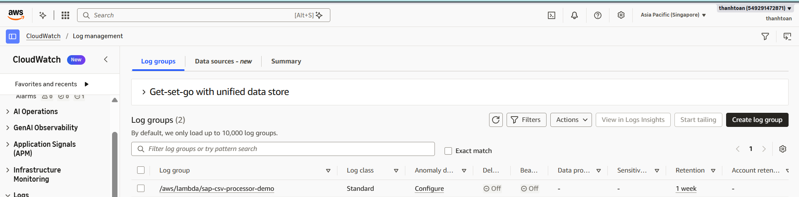
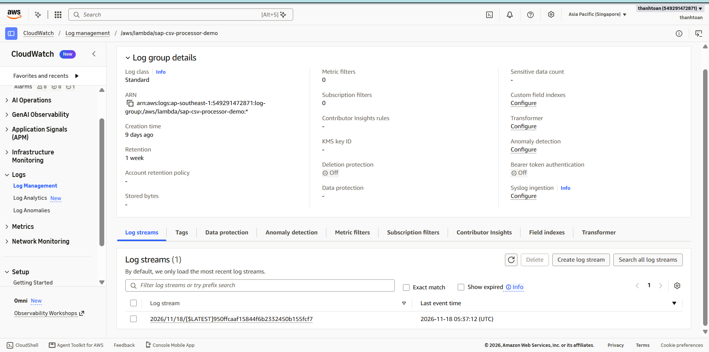
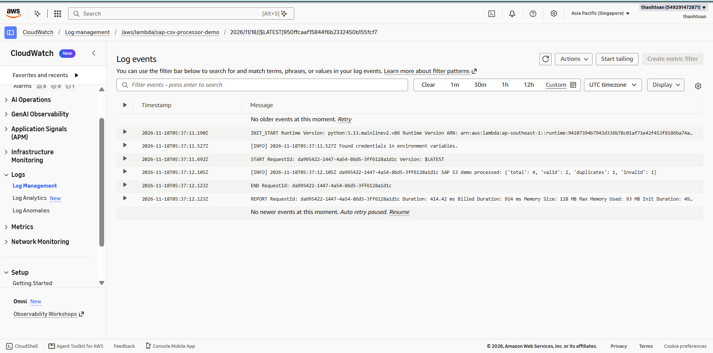
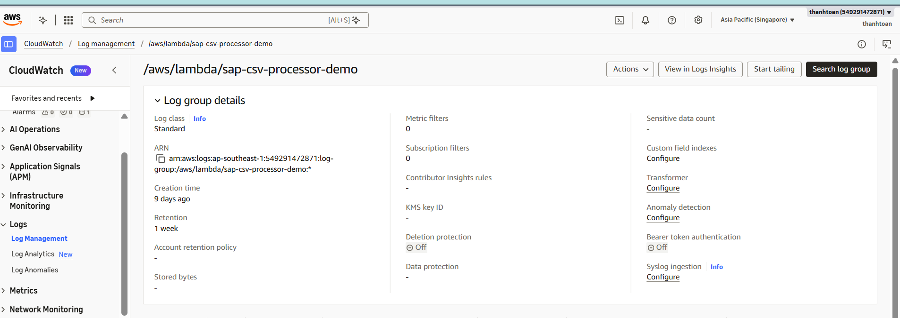

---
title: "Test and Monitor with CloudWatch"
date: 2026-11-09
weight: 4
chapter: false
pre: "<b>5.10.4.</b>"
---

## Test and Monitor with CloudWatch

In this section, we will invoke the AWS Lambda CSV Processor, verify the JSON result in Amazon S3, and use Amazon CloudWatch to inspect execution logs.

Amazon CloudWatch is an AWS monitoring and observability service that collects Metrics, Logs, and resource operation information.

For this exercise, CloudWatch Logs help determine whether Lambda processing succeeded or encountered an execution error.

#### 1. Prepare the testing environment

Complete:

* Section 5.10.1 - Set Up Amazon S3 and Prepare Data.
* Section 5.10.2 - Configure IAM Execution Role.
* Section 5.10.3 - Build the AWS Lambda CSV Processor.

Verify the resources:

```text
Region:
ap-southeast-1

Bucket:
sap-data-project-2026-huflit01

Lambda:
sap-csv-processor-demo

Input:
lambda-demo/input/registrations.csv

Output:
lambda-demo/processed/registrations-result.json
```

#### 2. Invoke Lambda using a Test Event

1. Open the AWS Lambda Console.
2. Select sap-csv-processor-demo.
3. Select Test.
4. Select the SAPCSVProcessingTest Event.
5. Choose Test to invoke the Function.

<!--

-->

Lambda retrieves the input CSV, processes the records, and writes a JSON result to Amazon S3.

#### 3. Inspect the Execution Result

Review the Execution result after invocation.

Expected response:

```json
{
    "statusCode": 200,
    "body": "{\"total\": 4, \"valid\": 2, \"duplicates\": 1, \"invalid\": 1}"
}
```

<!--

-->

Explanation:

* total: Number of processed records.
* valid: Number of valid unique records.
* duplicates: Number of duplicate student IDs.
* invalid: Number of records missing required information.

Actual results from the November 9, 2026 project exercise:

```text
Total records: 4
Valid records: 2
Duplicate records: 1
Invalid records: 1
```

Lambda returned statusCode 200.

This is the Function's Test Event response rather than an HTTP response from API Gateway or a Lambda Function URL.

#### 4. Compare results with the input CSV

Workshop input:

```csv
mssv,full_name
DEMO001,Student A
DEMO002,Student B
DEMO001,Student A
,Student C
```

Expected classifications:

| Record | Classification |
| --- | --- |
| DEMO001 - Student A | Valid |
| DEMO002 - Student B | Valid |
| DEMO001 - Student A | Duplicate |
| Missing Student ID - Student C | Invalid |

Verify:

```text
Total = Valid + Duplicates + Invalid
      = 2 + 1 + 1
      = 4
```

The summary should accurately reflect the input records.

#### 5. Verify the JSON result in Amazon S3

1. Open Amazon S3 Console.
2. Select sap-data-project-2026-huflit01.
3. Open lambda-demo/processed/.
4. Locate:

```text
registrations-result.json
```

<!--

-->

Download the Object and inspect its content.

Expected JSON:

```json
{
    "total": 4,
    "valid": 2,
    "duplicates": 1,
    "invalid": 1
}
```

<!--

-->

Inspect Last modified to confirm that the Object was created or updated during the current test.

If an output Object already exists, its presence alone does not demonstrate that the latest invocation succeeded.

#### 6. Verify using AWS CLI

Use PowerShell to inspect the JSON result:

```powershell
aws s3 cp s3://sap-data-project-2026-huflit01/lambda-demo/processed/registrations-result.json - --region ap-southeast-1 --profile sap-dev
```

Expected output:

```json
{"total": 4, "valid": 2, "duplicates": 1, "invalid": 1}
```

Inspect Object metadata:

```powershell
aws s3api head-object `
  --bucket sap-data-project-2026-huflit01 `
  --key lambda-demo/processed/registrations-result.json `
  --region ap-southeast-1 `
  --profile sap-dev
```

The AWS CLI Profile requires appropriate read permissions for the output Object.

<!--

-->

#### 7. Open CloudWatch Logs

In the Lambda Console:

1. Select sap-csv-processor-demo.
2. Select Monitor.
3. Choose View CloudWatch logs if available.

Alternatively, open:

[Amazon CloudWatch Console](https://console.aws.amazon.com/cloudwatch/)

In CloudWatch:

1. Select ap-southeast-1.
2. Select Logs.
3. Select Log groups.
4. Locate:

```text
/aws/lambda/sap-csv-processor-demo
```

<!--

-->

The Log Group is typically created when Lambda executes with appropriate CloudWatch Logs permissions.

#### 8. Inspect the Log Stream

1. Open the Function's Log Group.
2. Select the Log Stream associated with the latest invocation.
3. Inspect its Log Events.

<!--

-->

Typical execution log information:

```text
START RequestId: ...

SAP S3 demo processed:
{"total": 4, "valid": 2, "duplicates": 1, "invalid": 1}

END RequestId: ...

REPORT RequestId: ...
```

Explanation:

* START: Beginning of an invocation.
* RequestId: Invocation identifier.
* Application Log: Processing information recorded by the Function.
* END: End of execution.
* REPORT: Execution duration and memory information.

<!--

-->

#### 9. Analyze actual execution results

During the November 9, 2026 test, CloudWatch recorded:

| Metric | Result |
| --- | --- |
| Execution Duration | 404.97 ms |
| Billed Duration | 892 ms |
| Memory Size | 128 MB |
| Max Memory Used | 93 MB |

The historical output Object size was 55 B.

<!--

-->

##### Duration

The Function execution time recorded in the REPORT Log:

```text
404.97 ms
```

##### Billed Duration

The execution time used for Lambda billing calculations:

```text
892 ms
```

Billed Duration may include billable initialization time depending on the execution environment.

##### Memory Size

Configured Function memory:

```text
128 MB
```

##### Max Memory Used

Maximum recorded memory usage:

```text
93 MB
```

The configured 128 MB memory was sufficient for the small historical test dataset.

{}
These are historical project results. Execution duration, memory usage, and JSON Object size may differ when using the reconstructed workshop code, another Runtime, or different data. One successful invocation does not establish large-scale Production processing capacity.
{}

#### 10. Configure CloudWatch Log Retention

To manage log storage:

1. Open CloudWatch Console.
2. Select Logs → Log groups.
3. Select /aws/lambda/sap-csv-processor-demo.
4. Choose Actions or Edit retention setting.
5. Set retention to:

```text
7 days
```

6. Save the configuration.

<!--

-->

The project configured a seven-day retention period for its Lambda logs.

This helps limit unnecessary long-term log storage.

Expired log deletion follows CloudWatch's retention mechanism and may not occur immediately.

#### 11. Test error scenarios

##### Scenario 1: Missing input Object

In a dedicated test Function, temporarily configure INPUT_KEY to reference an Object that does not exist.

To specifically test NoSuchKey, the Function must be authorized to read that Key. Otherwise, S3 may return AccessDenied.

Invoke the Function and verify:

* Lambda reports an execution error.
* No successful result is returned.
* CloudWatch records error information.

Restore the original INPUT_KEY after testing.

##### Scenario 2: Missing CSV columns

Prepare a test CSV without mssv or full_name.

The Function should identify the invalid file structure and report an error.

Use a separate test Object and appropriate IAM permissions rather than overwriting active source data.

##### Scenario 3: Empty CSV dataset

A file containing only valid column headers should produce:

```json
{
    "total": 0,
    "valid": 0,
    "duplicates": 0,
    "invalid": 0
}
```

##### Scenario 4: Insufficient S3 permissions

Inspect AccessDenied when the Function does not have the required Object permissions.

Do not remove permissions from shared Roles used by other applications solely to create a test failure.

{}
These error scenarios are additional workshop tests. Do not report them as PASS until they have been performed and verified.
{}

#### 12. Explore future S3 Event Notification integration

The current exercise invokes Lambda using a Test Event.

An event-driven extension could automatically process new CSV uploads:

```text
Upload CSV
    |
    v
Amazon S3 - Input Prefix
    |
    | ObjectCreated Event
    v
AWS Lambda
    |
    v
Amazon S3 - Processed Prefix
```

This architecture would require:

* S3 Event Notification configuration.
* Permission for S3 to invoke Lambda.
* S3 Event processing in the Lambda Handler.
* Input Prefix filtering.
* Duplicate event handling and appropriate output generation.

Only Objects under the input Prefix should trigger processing.

Do not configure a broad Trigger for the entire Bucket when Lambda writes results back to that Bucket, because this may cause recursive invocations.

This is a future extension rather than verified functionality in the current Demo.

#### 13. Summarize the results

Results recorded during the November 9, 2026 exercise:

| Test | Result |
| --- | --- |
| S3 Input CSV | PASS |
| Lambda Execution Role | PASS |
| Lambda Test Event | PASS |
| CSV Processing | PASS |
| Total Records | 4 |
| Valid Records | 2 |
| Duplicate Records | 1 |
| Invalid Records | 1 |
| Lambda statusCode | 200 |
| S3 Output JSON | PASS |
| CloudWatch Logs | PASS |
| Log Retention | 7 days |

<!--

-->

#### 14. Evaluate the Serverless architecture

Advantages:

* No dedicated CSV processing server to manage.
* Separate input and output data in S3.
* Controlled resource access through IAM.
* Execution observability using CloudWatch.
* Suitable for independent data processing tasks.

Current Demo limitations:

* Lambda is manually invoked using Test Events.
* Output contains summary counts rather than a cleaned registration dataset.
* Registration records are not automatically written to DynamoDB.
* The CSV file is read entirely into memory.
* Large-file processing performance has not been validated.
* The output uses a fixed Object Key.

Future improvements:

* Automated S3 event-driven processing.
* Unique output Keys for individual input files.
* Idempotency mechanisms.
* More comprehensive business validation.
* Appropriate large-file processing architecture.
* Integration with the application Import workflow where required.

#### Conclusion

In this section, we implemented an AWS Serverless Data Processing workflow using Amazon S3, AWS Lambda, IAM, and CloudWatch.

Lambda read CSV data, classified valid, duplicate, and invalid records, and stored a JSON result in Amazon S3.

CloudWatch Logs provided execution information, processing duration, and memory usage evidence.

This exercise extends the Student Activity Management & Engagement Analytics Platform with an independent Serverless data processing component.

[Next: Clean Up AWS Resources](../../5.11-Clean-up/)
