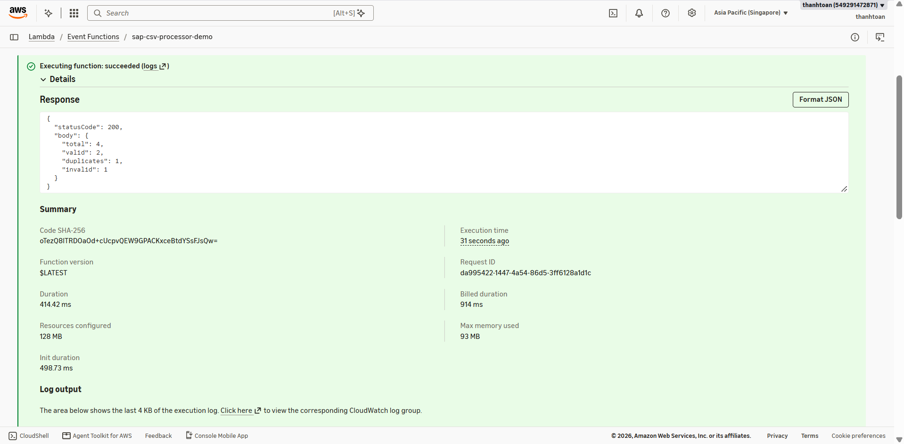
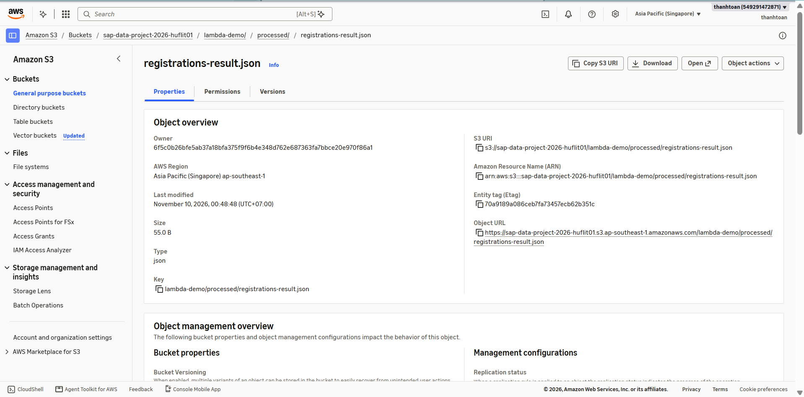
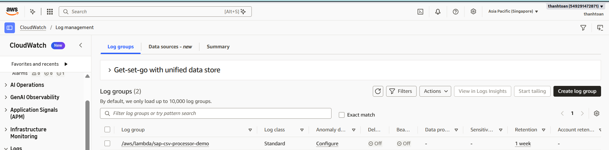
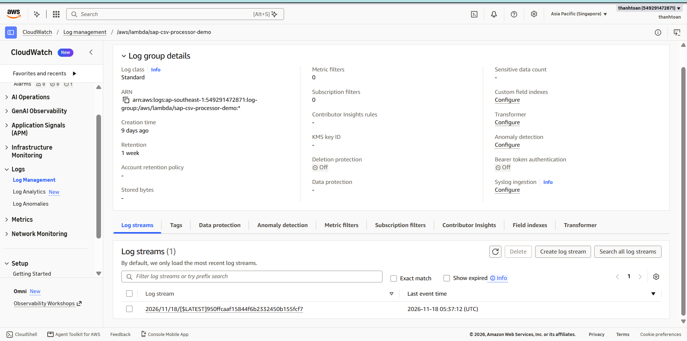
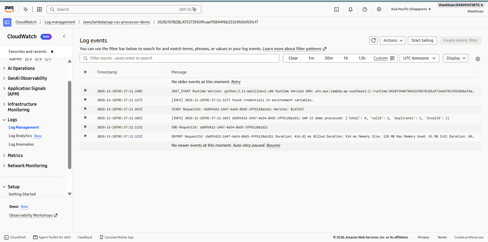
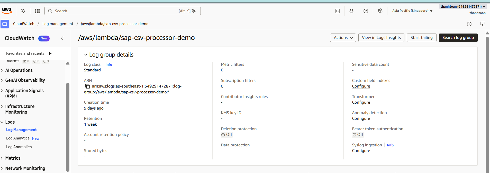

---
title: "Kiểm thử và giám sát bằng CloudWatch"
date: 2026-11-09
weight: 4
chapter: false
pre: "<b>5.10.4.</b>"
---

## Kiểm thử và giám sát bằng CloudWatch

Trong phần này, chúng ta sẽ thực thi AWS Lambda CSV Processor, xác minh file JSON kết quả trong Amazon S3 và sử dụng Amazon CloudWatch để kiểm tra nhật ký thực thi.

Amazon CloudWatch là dịch vụ giám sát và quan sát hệ thống trên AWS, hỗ trợ thu thập Metrics, Logs và các thông tin hoạt động của tài nguyên.

Trong bài thực hành, CloudWatch Logs giúp kiểm tra Lambda đã xử lý dữ liệu thành công hay gặp lỗi trong quá trình thực thi.

#### 1. Chuẩn bị môi trường kiểm thử

Đảm bảo đã hoàn thành:

* Phần 5.10.1 - Tạo Amazon S3 Bucket và chuẩn bị dữ liệu.
* Phần 5.10.2 - Cấu hình IAM Execution Role.
* Phần 5.10.3 - Xây dựng AWS Lambda CSV Processor.

Các tài nguyên cần kiểm tra:

```text
Region:
ap-southeast-1

Bucket:
sap-data-project-2026-huflit01

Lambda:
sap-csv-processor-demo

Input:
lambda-demo/input/registrations.csv

Output:
lambda-demo/processed/registrations-result.json
```

#### 2. Thực thi Lambda bằng Test Event

1. Mở AWS Lambda Console.
2. Chọn Function sap-csv-processor-demo.
3. Chọn tab Test.
4. Chọn Test Event SAPCSVProcessingTest đã tạo.
5. Chọn Test để thực thi Function.

<!--

-->

Lambda đọc file CSV từ Amazon S3, xử lý các bản ghi và ghi file JSON kết quả.

#### 3. Kiểm tra Execution Result

Sau khi Lambda thực thi, kiểm tra Execution result.

Kết quả mong đợi:

```json
{
    "statusCode": 200,
    "body": "{\"total\": 4, \"valid\": 2, \"duplicates\": 1, \"invalid\": 1}"
}
```

<!--

-->

Giải thích:

* total: Tổng số dòng dữ liệu đã xử lý.
* valid: Số bản ghi hợp lệ và không trùng lặp.
* duplicates: Số bản ghi trùng MSSV.
* invalid: Số bản ghi thiếu thông tin bắt buộc.

Kết quả thực tế của bài thực hành ngày 09/11/2026 là:

```text
Total records: 4
Valid records: 2
Duplicate records: 1
Invalid records: 1
```

Lambda trả về statusCode 200.

Đây là kết quả do Function trả về trong Test Event, không phải phản hồi của một HTTP API Gateway hoặc Lambda Function URL.

#### 4. Đối chiếu kết quả với file CSV đầu vào

File CSV sử dụng trong Workshop:

```csv
mssv,full_name
DEMO001,Student A
DEMO002,Student B
DEMO001,Student A
,Student C
```

Đối chiếu:

| Record | Classification |
| --- | --- |
| DEMO001 - Student A | Valid |
| DEMO002 - Student B | Valid |
| DEMO001 - Student A | Duplicate |
| Missing MSSV - Student C | Invalid |

Tổng số bản ghi phải thỏa mãn:

```text
Total = Valid + Duplicates + Invalid
      = 2 + 1 + 1
      = 4
```

Các chỉ số phản ánh đúng số lượng dữ liệu đầu vào.

#### 5. Kiểm tra file JSON trong Amazon S3

1. Mở Amazon S3 Console.
2. Chọn Bucket sap-data-project-2026-huflit01.
3. Mở Prefix lambda-demo/processed/.
4. Tìm Object:

```text
registrations-result.json
```

<!--

-->

Chọn Object và tải xuống để kiểm tra nội dung.

Kết quả:

```json
{
    "total": 4,
    "valid": 2,
    "duplicates": 1,
    "invalid": 1
}
```

<!--

-->

Kiểm tra Last modified để xác nhận Object vừa được tạo hoặc cập nhật bởi lần kiểm thử hiện tại.

Nếu Object đã tồn tại từ lần thực thi trước, cần xác minh thời gian cập nhật thay vì chỉ kiểm tra sự tồn tại của file.

#### 6. Xác minh kết quả bằng AWS CLI

Có thể kiểm tra file JSON trực tiếp từ PowerShell.

```powershell
aws s3 cp s3://sap-data-project-2026-huflit01/lambda-demo/processed/registrations-result.json - --region ap-southeast-1 --profile sap-dev
```

Kết quả mong đợi:

```json
{"total": 4, "valid": 2, "duplicates": 1, "invalid": 1}
```

Kiểm tra metadata:

```powershell
aws s3api head-object `
  --bucket sap-data-project-2026-huflit01 `
  --key lambda-demo/processed/registrations-result.json `
  --region ap-southeast-1 `
  --profile sap-dev
```

AWS CLI Profile cần có quyền đọc Object kết quả.

<!--

-->

#### 7. Mở CloudWatch Logs

Trong Lambda Console:

1. Chọn Function sap-csv-processor-demo.
2. Chọn Monitor.
3. Chọn View CloudWatch logs nếu có.

Hoặc truy cập trực tiếp:

[Amazon CloudWatch Console](https://console.aws.amazon.com/cloudwatch/)

Trong CloudWatch:

1. Chọn Region ap-southeast-1.
2. Trong thanh điều hướng, chọn Logs.
3. Chọn Log groups.
4. Tìm Log Group:

```text
/aws/lambda/sap-csv-processor-demo
```

<!--

-->

Log Group thường được tạo khi Lambda thực thi và có đủ quyền CloudWatch Logs.

#### 8. Kiểm tra Log Stream

1. Mở Log Group của Function.
2. Chọn Log Stream tương ứng với lần thực thi mới nhất.
3. Kiểm tra Log Events.

<!--

-->

Các thông tin nhật ký thường bao gồm:

```text
START RequestId: ...

SAP S3 demo processed:
{"total": 4, "valid": 2, "duplicates": 1, "invalid": 1}

END RequestId: ...

REPORT RequestId: ...
```

Giải thích:

* START: Bắt đầu một lần thực thi.
* RequestId: Mã định danh của lần thực thi.
* Application Log: Thông tin xử lý do chương trình ghi.
* END: Kết thúc phần thực thi.
* REPORT: Thông tin thời gian và bộ nhớ.

<!--

-->

#### 9. Phân tích kết quả thực thi thực tế

Trong lần kiểm thử ngày 09/11/2026, CloudWatch ghi nhận:

| Chỉ số | Kết quả |
| --- | --- |
| Execution Duration | 404.97 ms |
| Billed Duration | 892 ms |
| Memory Size | 128 MB |
| Max Memory Used | 93 MB |

Output Object có dung lượng 55 B trong bài kiểm thử trước đây.

<!--

-->

##### Duration

Thời gian thực thi Function được ghi nhận trong REPORT Log.

```text
Duration: 404.97 ms
```

##### Billed Duration

Khoảng thời gian được AWS sử dụng trong tính toán chi phí thực thi theo cơ chế tính phí Lambda.

```text
Billed Duration: 892 ms
```

Billed Duration có thể bao gồm thời gian khởi tạo được tính phí tùy theo môi trường thực thi.

##### Memory Size

Dung lượng bộ nhớ được cấu hình cho Function:

```text
128 MB
```

##### Max Memory Used

Dung lượng bộ nhớ tối đa được ghi nhận:

```text
93 MB
```

Kết quả cho thấy cấu hình 128 MB đủ để xử lý bộ dữ liệu nhỏ trong lần kiểm thử này.

{}
Các chỉ số trên là kết quả lịch sử của đồ án. Thời gian thực thi, bộ nhớ và kích thước JSON có thể thay đổi khi sử dụng mã nguồn Workshop, Runtime hoặc dữ liệu khác. Một lần kiểm thử thành công không chứng minh khả năng xử lý dữ liệu lớn trong môi trường Production.
{}

#### 10. Cấu hình CloudWatch Log Retention

Để quản lý thời gian lưu trữ nhật ký:

1. Mở CloudWatch Console.
2. Chọn Logs → Log groups.
3. Chọn /aws/lambda/sap-csv-processor-demo.
4. Chọn Actions hoặc Edit retention setting.
5. Đặt thời gian lưu trữ:

```text
7 days
```

6. Lưu cấu hình.

<!--

-->

Trong bài thực hành của đồ án, Log Retention được cấu hình là 7 ngày.

Thiết lập này giúp giới hạn thời gian lưu Log và giảm dữ liệu lưu trữ không cần thiết.

Việc xóa Log hết hạn được CloudWatch xử lý theo cơ chế của dịch vụ và không nhất thiết diễn ra ngay lập tức.

#### 11. Kiểm thử các trường hợp lỗi

##### Trường hợp 1: Input Object không tồn tại

Trong Function kiểm thử riêng, tạm thời cấu hình INPUT_KEY thành một Object không tồn tại.

Nếu muốn kiểm tra lỗi NoSuchKey, IAM cần có quyền đọc Key đó. Nếu không, S3 có thể trả về AccessDenied.

Thực hiện Test Event và kiểm tra:

* Lambda báo lỗi.
* Không trả về kết quả thành công.
* CloudWatch ghi nhận thông tin lỗi.

Sau khi kiểm thử, khôi phục INPUT_KEY ban đầu.

##### Trường hợp 2: CSV thiếu cột bắt buộc

Chuẩn bị file kiểm thử không chứa cột mssv hoặc full_name.

Function cần phát hiện cấu trúc không hợp lệ và ghi lỗi.

Sử dụng Object kiểm thử riêng và quyền IAM phù hợp, không ghi đè dữ liệu đang được sử dụng.

##### Trường hợp 3: Dữ liệu CSV rỗng

Nếu file chỉ chứa dòng tiêu đề hợp lệ, kết quả mong đợi:

```json
{
    "total": 0,
    "valid": 0,
    "duplicates": 0,
    "invalid": 0
}
```

##### Trường hợp 4: Không đủ quyền S3

Kiểm tra thông báo AccessDenied nếu Function không có quyền đối với Object cần truy cập.

Không xóa hoặc thay đổi quyền của Role đang được sử dụng bởi ứng dụng khác chỉ để tạo lỗi kiểm thử.

{}
Các trường hợp lỗi là bài kiểm thử bổ sung dành cho Workshop. Không ghi nhận chúng là PASS nếu chưa thực hiện và chưa có minh chứng.
{}

#### 12. Tìm hiểu hướng mở rộng S3 Event Notification

Trong bài thực hành hiện tại, Lambda được gọi bằng Test Event.

Một kiến trúc mở rộng có thể tự động xử lý CSV khi file mới được upload:

```text
Upload CSV
    |
    v
Amazon S3 - Input Prefix
    |
    | ObjectCreated Event
    v
AWS Lambda
    |
    v
Amazon S3 - Processed Prefix
```

Để xây dựng mô hình Event-driven, cần bổ sung:

* S3 Event Notification.
* Quyền cho S3 kích hoạt Lambda.
* Xử lý cấu trúc Event trong Lambda Handler.
* Giới hạn Prefix đầu vào.
* Quy tắc xử lý sự kiện lặp và ghi kết quả phù hợp.

Cần đảm bảo Lambda chỉ được kích hoạt bởi Object trong Prefix input/.

Không cấu hình Trigger cho toàn bộ Bucket khi Lambda ghi Output trở lại cùng Bucket vì có thể tạo vòng lặp thực thi.

Đây là hướng phát triển tiếp theo, chưa phải chức năng đã được xác minh trong bài Demo hiện tại.

#### 13. Tổng hợp kết quả

Kết quả ghi nhận trong bài thực hành ngày 09/11/2026:

| Nội dung kiểm thử | Kết quả |
| --- | --- |
| S3 Input CSV | PASS |
| Lambda Execution Role | PASS |
| Lambda Test Event | PASS |
| CSV Processing | PASS |
| Total Records | 4 |
| Valid Records | 2 |
| Duplicate Records | 1 |
| Invalid Records | 1 |
| Lambda statusCode | 200 |
| S3 Output JSON | PASS |
| CloudWatch Logs | PASS |
| Log Retention | 7 ngày |

<!--

-->

#### 14. Đánh giá kiến trúc Serverless

Ưu điểm:

* Không cần trực tiếp quản lý máy chủ xử lý CSV.
* Tách riêng dữ liệu đầu vào và đầu ra trong S3.
* Kiểm soát quyền truy cập thông qua IAM.
* Có thể quan sát quá trình thực thi bằng CloudWatch.
* Phù hợp với các tác vụ xử lý dữ liệu độc lập.

Hạn chế của Demo hiện tại:

* Lambda được thực thi thủ công bằng Test Event.
* Kết quả chỉ là báo cáo tổng hợp, chưa phải danh sách bản ghi đã làm sạch.
* Chưa tự động ghi dữ liệu Registration vào DynamoDB.
* Mã nguồn đọc toàn bộ CSV vào bộ nhớ.
* Chưa kiểm thử hiệu năng với file có kích thước lớn.
* Output Object sử dụng Key cố định.

Hướng phát triển:

* Xử lý sự kiện S3 tự động.
* Tạo Output Key riêng cho mỗi file đầu vào.
* Bổ sung cơ chế idempotency.
* Kiểm tra dữ liệu theo quy tắc nghiệp vụ thực tế.
* Xử lý file lớn bằng kiến trúc phù hợp.
* Tích hợp quy trình Import của ứng dụng khi cần.

#### Kết luận

Trong phần này, chúng ta đã thực hiện một quy trình Serverless Data Processing trên AWS sử dụng Amazon S3, AWS Lambda, IAM và CloudWatch.

Lambda đã đọc dữ liệu CSV, phát hiện các bản ghi hợp lệ, trùng lặp và không hợp lệ, sau đó lưu kết quả JSON trở lại Amazon S3.

CloudWatch Logs cung cấp minh chứng về quá trình thực thi, thời gian xử lý và tài nguyên bộ nhớ.

Bài thực hành giúp mở rộng Student Activity Management & Engagement Analytics Platform từ một Web Application quản lý dữ liệu sang một kiến trúc có thêm thành phần xử lý dữ liệu Serverless độc lập.

[Tiếp theo: Dọn dẹp tài nguyên AWS](../../5.11-Clean-up/)
