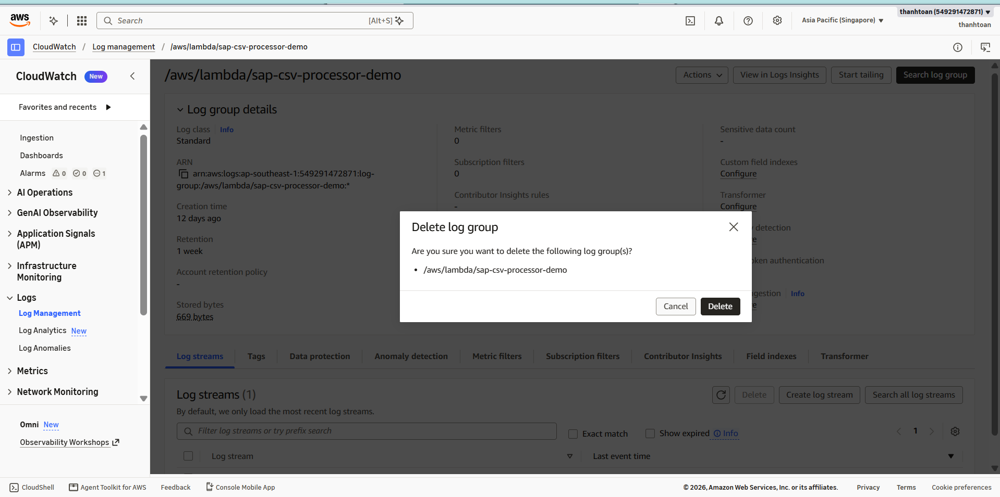

---
title: "Clean Up AWS Test Resources"
date: 2026-11-09
weight: 3
chapter: false
pre: "<b>5.11.3.</b>"
---

## Clean Up AWS Test Resources

In this section, we will review how to manage and clean up AWS test resources after completing the Workshop.

The objective is to avoid unnecessary costs while preserving resources required by the Student Activity Management & Engagement Analytics Platform.

{}
The deletion procedures below are conditional guidance. Do not delete resources that are still used by the application or do not have an appropriate backup.
{}

#### 1. Classify resources

Resources can be divided into three groups.

**Group 1: Retain**

* Amplify App used for Frontend demonstrations.
* Five SAP DynamoDB Tables.
* Project S3 Bucket.
* Required backups and evidence.

**Group 2: Potentially disposable**

* Temporary CSV files no longer required.
* Temporary JSON processing outputs.
* Independent test Lambda Functions.
* Execution Roles and Policies used exclusively by deleted Functions.
* CloudWatch Log Groups no longer needed.

**Group 3: Require further review**

* Deployed Amplify Apps and branches.
* DynamoDB Tables with business data.
* S3 Buckets containing multiple Prefixes.
* IAM Roles shared by several services.

#### 2. Review DynamoDB backups

Open the [Amazon DynamoDB Console](https://console.aws.amazon.com/dynamodb/).

1. Select ap-southeast-1.
2. Choose the table to review.
3. Open Backups.
4. Inspect On-demand Backup or Point-in-time Recovery settings.
5. Create an appropriate backup if the data must be retained.

<!--

-->

DynamoDB supports On-demand Backup and Point-in-time Recovery.

Restoring a backup creates a new table rather than overwriting an existing table.

Backup storage may incur charges.

#### 3. Retain the five DynamoDB Tables

Project tables:

```text
SAP-Activities
SAP-Registrations
SAP-Attendance
SAP-Evidence
SAP-Participation
```

Current workshop recommendation:

```text
Action: RETAIN
```

Reasons:

* Support AWS Integration evidence.
* May be required for future tests.
* May contain Demo or business records.
* Form part of the existing project architecture.

Consider deleting only independent test tables that no longer have dependencies and contain no data requiring retention.

<!--

-->

#### 4. Review Amazon S3 Objects

Open the [Amazon S3 Console](https://console.aws.amazon.com/s3/).

Select:

```text
sap-data-project-2026-huflit01
```

Review:

```text
lambda-demo/input/registrations.csv
lambda-demo/processed/registrations-result.json
```

Retain these Objects if they are needed for screenshots or continued Lambda testing.

If they are confirmed to be disposable:

1. Save copies if required.
2. Verify the Object Keys.
3. Inspect Bucket Versioning.
4. Select only the intended test Objects.
5. Use Delete in the S3 Console.
6. Verify the result.

<!--

-->

{}
For versioned S3 Buckets, ordinary deletion may create a Delete Marker rather than permanently remove existing Object Versions. Inspect Versions and storage costs during clean-up.
{}

#### 5. Retain the project S3 Bucket

Project Bucket:

```text
sap-data-project-2026-huflit01
```

Recommendation:

```text
Action: RETAIN
```

Do not delete the entire Bucket solely to remove two Lambda Demo Objects.

The Bucket may contain data required by other project components.

Deleting the Bucket releases its name and does not guarantee that the same name will be available later.

#### 6. Manage AWS Lambda

Open the [AWS Lambda Console](https://console.aws.amazon.com/lambda/).

Select:

```text
sap-csv-processor-demo
```

If the Function is required for section 5.10 demonstrations:

```text
Action: RETAIN
```

If an independent test Function is no longer required:

1. Verify the Function name.
2. Inspect Triggers and dependencies.
3. Save the source code and configuration if needed.
4. Select the appropriate Function.
5. Choose Actions → Delete.
6. Review the confirmation dialog.

<!--

-->

Do not delete a Function that is still required or has not been backed up.

#### 7. Review IAM Roles and Policies

Existing resources:

```text
Role:
sap-csv-processor-demo-role-9ui2ib5d

Policy:
SAP-Lambda-S3-Demo-Access
```

Retain the Execution Role and required Policies while Lambda uses them.

If a separate disposable Function has been deleted:

1. Verify whether its Role is used by other Functions.
2. Inspect other Policy attachments.
3. Remove only permissions that are no longer required.
4. Verify that remaining applications still have the correct access.

<!--

-->

Do not delete Roles or Policies shared with other resources.

#### 8. Manage CloudWatch Logs

Open the [Amazon CloudWatch Console](https://console.aws.amazon.com/cloudwatch/).

Inspect:

```text
/aws/lambda/sap-csv-processor-demo
```

If execution evidence is still required, retain the Log Group with its configured retention:

```text
7 days
```

If a Log Group belongs exclusively to a deleted test Function and its logs are no longer required:

1. Confirm that the logs are not needed for troubleshooting or reporting.
2. Select the appropriate Log Group.
3. Choose Actions.
4. Choose Delete log group(s).
5. Review the confirmation dialog.

<!--

-->

Deleting a Lambda Function does not automatically mean its CloudWatch Logs have been deleted.

#### 9. Manage AWS Amplify Hosting

Open the [AWS Amplify Console](https://console.aws.amazon.com/amplify/).

Review the project's Frontend application.

If the Website is still needed:

```text
Action: RETAIN
```

If Hosting is no longer required and the application has been approved for removal, use the Amplify Console's Delete app function.

Before deletion:

* Review the App and Branch.
* Preserve required Build Settings.
* Record necessary non-sensitive Environment variables.
* Verify that GitHub retains the source code.
* Confirm that the Website is no longer required.

<!--

-->

Do not delete the Amplify App while its Website URL is still needed for demonstrations or reporting.

#### 10. Review costs after clean-up

Open AWS Billing and Cost Management.

Review:

* Service-level charges.
* Remaining storage resources.
* Pending billing updates.
* Stopped or deleted services.
* Resources requiring continued monitoring.

<!--

-->

Billing and Cost Explorer data may be delayed.

Do not assume that charges immediately become zero after stopping or deleting a resource.

#### 11. Summarize the clean-up plan

| Resource | Recommended Action |
| --- | --- |
| Amplify Frontend | RETAIN |
| SAP-Activities | RETAIN |
| SAP-Registrations | RETAIN |
| SAP-Attendance | RETAIN |
| SAP-Evidence | RETAIN |
| SAP-Participation | RETAIN |
| Project S3 Bucket | RETAIN |
| Lambda CSV Processor | RETAIN if needed |
| IAM Execution Role | RETAIN while required |
| CloudWatch Logs | RETAIN as needed |
| Cloudflare Quick Tunnel | STOP |
| FastAPI Demo | STOP |

#### Results

After completing this section, we have reviewed AWS resource lifecycle management.

Resources required for demonstrations and future testing are prioritized for retention, while independent test resources can be cleaned up after appropriate verification.

[Next: Verify Clean-up and Review Workshop](../5.11.4-verify-cleanup/)
