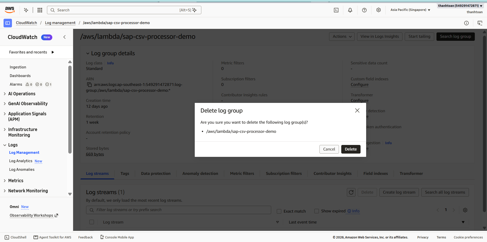

---
title: "Dọn dẹp tài nguyên thử nghiệm AWS"
date: 2026-11-09
weight: 3
chapter: false
pre: "<b>5.11.3.</b>"
---

## Dọn dẹp tài nguyên thử nghiệm AWS

Trong phần này, chúng ta sẽ tìm hiểu cách quản lý và dọn dẹp các tài nguyên thử nghiệm trên AWS sau khi kết thúc Workshop.

Mục tiêu là tránh phát sinh chi phí không cần thiết mà vẫn bảo toàn những tài nguyên còn phục vụ cho đồ án.

{}
Các bước xóa bên dưới chỉ mang tính hướng dẫn. Không thực hiện xóa tài nguyên đang được sử dụng trong Student Activity Management & Engagement Analytics Platform hoặc chưa có bản sao lưu phù hợp.
{}

#### 1. Phân loại tài nguyên

Có ba nhóm tài nguyên cần xem xét.

**Nhóm 1: Cần giữ lại**

* Amplify App đang dùng để Demo Frontend.
* Năm bảng DynamoDB của đồ án.
* S3 Bucket chứa dữ liệu dự án.
* Các bản sao lưu và minh chứng cần thiết.

**Nhóm 2: Có thể dọn dẹp khi không còn sử dụng**

* File CSV thử nghiệm không cần lưu.
* File JSON kết quả thử nghiệm không cần lưu.
* Lambda Function thử nghiệm độc lập.
* IAM Role hoặc Policy chỉ dành cho Function đã xóa.
* CloudWatch Log Group không còn cần giữ.

**Nhóm 3: Cần kiểm tra trước khi quyết định**

* Amplify App và Branch đã triển khai.
* DynamoDB Tables có dữ liệu nghiệp vụ.
* S3 Bucket có nhiều Prefix.
* IAM Role đang được nhiều dịch vụ sử dụng.

#### 2. Kiểm tra bản sao lưu DynamoDB

Mở [Amazon DynamoDB Console](https://console.aws.amazon.com/dynamodb/).

1. Chọn Region ap-southeast-1.
2. Chọn bảng cần kiểm tra.
3. Kiểm tra mục Backups.
4. Xác định có On-demand Backup hoặc Point-in-time Recovery hay không.
5. Nếu dữ liệu cần được giữ lại, chuẩn bị bản sao lưu theo nhu cầu.

<!--

-->

Amazon DynamoDB hỗ trợ On-demand Backup và Point-in-time Recovery.

Việc khôi phục từ bản sao lưu sẽ tạo một bảng mới thay vì ghi đè bảng đang tồn tại.

Không xem bản sao lưu là miễn phí; dữ liệu backup có thể phát sinh chi phí lưu trữ.

#### 3. Quản lý năm bảng DynamoDB

Các bảng của đồ án:

```text
SAP-Activities
SAP-Registrations
SAP-Attendance
SAP-Evidence
SAP-Participation
```

Đề xuất đối với Workshop hiện tại:

```text
Action: RETAIN
```

Lý do:

* Phục vụ minh chứng AWS Integration.
* Có thể cần kiểm thử lại.
* Có thể chứa dữ liệu Demo và dữ liệu nghiệp vụ.
* Là thành phần của kiến trúc đã xây dựng.

Chỉ xem xét xóa một bảng thử nghiệm riêng sau khi xác nhận không còn ứng dụng phụ thuộc và dữ liệu không cần giữ lại.

<!--

-->

#### 4. Kiểm tra và dọn dẹp Amazon S3

Mở [Amazon S3 Console](https://console.aws.amazon.com/s3/).

Chọn Bucket:

```text
sap-data-project-2026-huflit01
```

Kiểm tra các Object thuộc Lambda Demo:

```text
lambda-demo/input/registrations.csv
lambda-demo/processed/registrations-result.json
```

Nếu cần giữ ảnh minh chứng hoặc tiếp tục kiểm thử Lambda, hãy giữ các Object này.

Nếu xác nhận chỉ là dữ liệu thử nghiệm không còn cần thiết:

1. Lưu bản sao nếu cần.
2. Kiểm tra Object Key.
3. Kiểm tra Bucket Versioning.
4. Chọn đúng Object thử nghiệm.
5. Sử dụng chức năng Delete trong S3 Console.
6. Xác minh kết quả sau thao tác.

<!--

-->

{}
Nếu S3 Bucket bật Versioning, thao tác xóa thông thường có thể tạo Delete Marker thay vì xóa vĩnh viễn các phiên bản dữ liệu. Cần kiểm tra Object Versions và chi phí lưu trữ khi dọn dẹp.
{}

#### 5. Giữ lại S3 Bucket của đồ án

Đối với Bucket:

```text
sap-data-project-2026-huflit01
```

Đề xuất:

```text
Action: RETAIN
```

Không xóa toàn bộ Bucket chỉ để dọn dẹp hai Object thuộc Lambda Demo.

Bucket có thể chứa dữ liệu phục vụ những phần khác của đồ án.

Ngoài ra, xóa Bucket làm mất tên Bucket đang sử dụng và không đảm bảo có thể tạo lại cùng tên sau này.

#### 6. Quản lý AWS Lambda

Mở [AWS Lambda Console](https://console.aws.amazon.com/lambda/).

Chọn Function:

```text
sap-csv-processor-demo
```

Nếu Function còn cần để trình diễn mục 5.10:

```text
Action: RETAIN
```

Nếu Function chỉ thuộc một môi trường thử nghiệm độc lập và không còn cần thiết:

1. Kiểm tra Function name.
2. Kiểm tra Triggers và các dịch vụ phụ thuộc.
3. Sao lưu mã nguồn và cấu hình nếu cần.
4. Chọn Function cần dọn dẹp.
5. Chọn Actions → Delete.
6. Đọc thông báo xác nhận và hoàn thành thao tác theo Console.

<!--

-->

Không xóa Function đang được sử dụng cho Demo hoặc chưa được sao lưu.

#### 7. Quản lý IAM Execution Role và Policy

Các tài nguyên đã sử dụng:

```text
Role:
sap-csv-processor-demo-role-9ui2ib5d

Policy:
SAP-Lambda-S3-Demo-Access
```

Nếu Lambda Function vẫn tồn tại, giữ lại Execution Role và các Policy cần thiết.

Nếu một Function thử nghiệm độc lập đã được xóa:

1. Kiểm tra Role có đang được Function khác sử dụng không.
2. Kiểm tra Policy có được gắn vào Role hoặc Identity khác không.
3. Chỉ dọn dẹp quyền không còn được sử dụng.
4. Xác minh các ứng dụng còn lại vẫn có quyền cần thiết.

<!--

-->

Không xóa Role hoặc Policy được chia sẻ với tài nguyên khác.

#### 8. Quản lý CloudWatch Logs

Mở [Amazon CloudWatch Console](https://console.aws.amazon.com/cloudwatch/).

Kiểm tra:

```text
/aws/lambda/sap-csv-processor-demo
```

Nếu còn cần minh chứng thực thi, có thể giữ Log Group với Retention đã cấu hình:

```text
7 days
```

Nếu Log Group thuộc Function thử nghiệm đã xóa và không còn cần lưu dữ liệu:

1. Xác nhận không cần Log để kiểm tra lỗi hoặc báo cáo.
2. Chọn Log Group phù hợp.
3. Chọn Actions.
4. Chọn Delete log group(s).
5. Xác nhận thao tác theo Console.

<!--

-->

Việc xóa Lambda Function không đồng nghĩa với toàn bộ CloudWatch Logs đã được xóa.

#### 9. Quản lý AWS Amplify Hosting

Mở [AWS Amplify Console](https://console.aws.amazon.com/amplify/).

Kiểm tra ứng dụng Frontend của đồ án.

Nếu vẫn cần Website để Demo:

```text
Action: RETAIN
```

Nếu đã kết thúc hoàn toàn quá trình Hosting và xác nhận không còn cần sử dụng App, có thể sử dụng chức năng Delete app trong Amplify Console.

Trước khi thực hiện:

* Kiểm tra App và Branch.
* Lưu các Build Settings cần thiết.
* Ghi lại Environment variables không nhạy cảm.
* Đảm bảo source code vẫn được lưu trong GitHub.
* Xác nhận Website không còn cần thiết.

<!--

-->

Không xóa Amplify App khi đường dẫn Website vẫn cần được sử dụng trong báo cáo hoặc phần trình diễn.

#### 10. Kiểm tra chi phí sau Clean-up

Mở AWS Billing and Cost Management.

Kiểm tra lại:

* Chi phí theo dịch vụ.
* Tài nguyên còn lưu trữ.
* Các khoản phí chưa được cập nhật.
* Những dịch vụ đã dừng hoặc xóa.
* Những tài nguyên cần tiếp tục theo dõi.

<!--

-->

Dữ liệu Cost Explorer và Billing có thể cập nhật trễ.

Do đó, không khẳng định chi phí bằng 0 ngay sau khi dừng hoặc xóa một tài nguyên.

#### 11. Tổng hợp kế hoạch Clean-up

| Tài nguyên | Trạng thái đề xuất |
| --- | --- |
| Amplify Frontend | RETAIN |
| SAP-Activities | RETAIN |
| SAP-Registrations | RETAIN |
| SAP-Attendance | RETAIN |
| SAP-Evidence | RETAIN |
| SAP-Participation | RETAIN |
| S3 Project Bucket | RETAIN |
| Lambda CSV Processor | RETAIN nếu còn Demo |
| IAM Execution Role | RETAIN khi Lambda còn sử dụng |
| CloudWatch Logs | RETAIN theo nhu cầu minh chứng |
| Cloudflare Quick Tunnel | STOP |
| FastAPI Demo | STOP |

#### Kết quả

Sau khi hoàn thành phần này, chúng ta đã xác định các thao tác quản lý tài nguyên AWS theo vòng đời sử dụng.

Các thành phần cần cho Demo và kiểm thử tiếp theo được ưu tiên giữ lại, trong khi tài nguyên thử nghiệm độc lập có thể được dọn dẹp sau khi xác minh các điều kiện an toàn.

[Tiếp theo: Xác minh và tổng kết Workshop](../5.11.4-verify-cleanup/)
