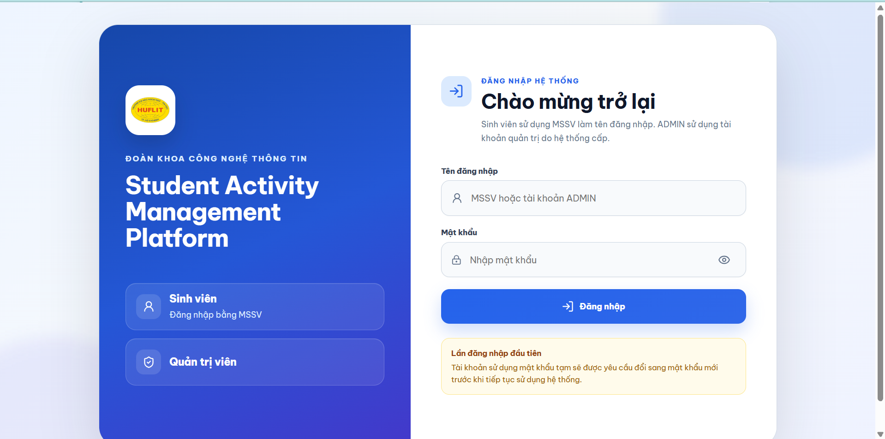

---
title: "Set up and run the React/Vite Frontend"
date: 2026-11-09
weight: 1
chapter: false
pre: "<b>5.5.1.</b>"
---

## Set Up and Run the React/Vite Frontend

In this section, we will prepare the Frontend environment, install Node.js dependencies, and run the Web Application interface of the Student Activity Management & Engagement Analytics Platform.

{}
Complete section 5.2 - Prerequisite and section 5.3 - Backend Development before proceeding.
{}

#### 1. Open the project source code

1. Open Visual Studio Code.
2. Select File → Open Folder.
3. Open the project directory:

```text
C:\Projects\student-activity-platform
```

Main Frontend structure:

```text
student-activity-platform/
├── backend/
└── frontend/
    ├── src/
    │   ├── services/
    │   │   └── api.js
    │   └── ...
    ├── package.json
    └── ...
```

Important components:

* src/: Contains the React application source code.
* src/services/: Contains Backend communication components.
* src/services/api.js: Manages application API requests.
* package.json: Defines dependencies and application scripts.
* Vite configuration: Manages development and build settings.

Other directories follow the current project implementation.

<!--

-->

#### 2. Verify Node.js and npm

Open the Terminal in Visual Studio Code.

Run:

```powershell
node --version
npm --version
```

Verify the installed Node.js and npm versions.

Use a Node.js version compatible with the project's package.json and Vite configuration.

If Node.js is not installed, visit:

[Node.js Downloads](https://nodejs.org/)

#### 3. Navigate to the Frontend directory

In PowerShell, run:

```powershell
cd C:\Projects\student-activity-platform\frontend
```

Inspect the directory:

```powershell
Get-ChildItem
```

Ensure that the current directory contains package.json.

<!--

-->

#### 4. Install dependencies

Run:

```powershell
npm install
```

npm reads package.json and installs the required dependencies into the node_modules directory.

If the repository contains package-lock.json and reproducible installation is required, you can use:

```powershell
npm ci
```

The dependencies support functionality such as:

* React interface development.
* Navigation between pages.
* HTTP requests to the Backend.
* Data and Dashboard visualization.
* Forms and user interactions.

Review package.json for the exact dependencies used by the project.

<!--

-->

{}
You do not need to create a new React/Vite project using npm create vite when working with the existing project source code.
{}

#### 5. Resolve PowerShell npm execution errors

On Windows, PowerShell may display the following error:

```text
npm.ps1 cannot be loaded because running scripts
is disabled on this system.
```

You can use npm.cmd instead of npm:

```powershell
npm.cmd install
npm.cmd run dev
```

Alternatively, use Command Prompt in Visual Studio Code.

If permitted by your computer's security policy, configure the Execution Policy for the current PowerShell session:

```powershell
Set-ExecutionPolicy -Scope Process -ExecutionPolicy Bypass
```

Then run the npm command again.

#### 6. Start the FastAPI Backend

Before starting the Frontend, ensure that the Backend is running.

Open a separate Terminal:

```powershell
cd C:\Projects\student-activity-platform\backend

.\.venv\Scripts\Activate.ps1

$env:SAP_DEMO_MODE="1"

python -m uvicorn app.main:app --reload
```

Verify the Backend:

[http://127.0.0.1:8000/docs](http://127.0.0.1:8000/docs)

Keep the Backend Terminal running during Frontend testing.

For DynamoDB integration tests, use the AWS configuration prepared in section 5.4.

#### 7. Start the React/Vite Frontend

Return to the Frontend Terminal.

Run:

```powershell
npm run dev
```

After successful startup, the Terminal should display an address similar to:

```text
VITE ready

Local: http://localhost:5173/
```

<!--

-->

Open your browser:

[http://localhost:5173](http://localhost:5173)

If port 5173 is unavailable, use the actual address displayed in the Terminal.

#### 8. Verify the login interface

After opening the Frontend, verify that:

* The login page is displayed.
* Interface components are functional.
* No critical JavaScript errors occur.
* Login input fields are available.
* The Frontend can communicate with the Backend.

<!--

-->

Press F12 to open Developer Tools and inspect the Console and Network tabs.

#### 9. Verify the Frontend build

Open another Terminal in the frontend directory:

```powershell
npm run build
```

After a successful build, Vite generates the following directory:

```text
frontend/dist/
```

The dist directory contains the built HTML, CSS, and JavaScript resources required for deployment.

<!--

-->

#### Results

After completing this section:

* Frontend dependencies are installed.
* FastAPI is available on port 8000.
* The React/Vite Frontend runs locally.
* The login interface is accessible.
* The Frontend can be built for deployment.

In the next section, we will explore how the Frontend communicates with Backend REST APIs and configure the application's API Endpoint.

[Next: Connect the Frontend to FastAPI REST APIs](../5.5.2-connect-api/)
