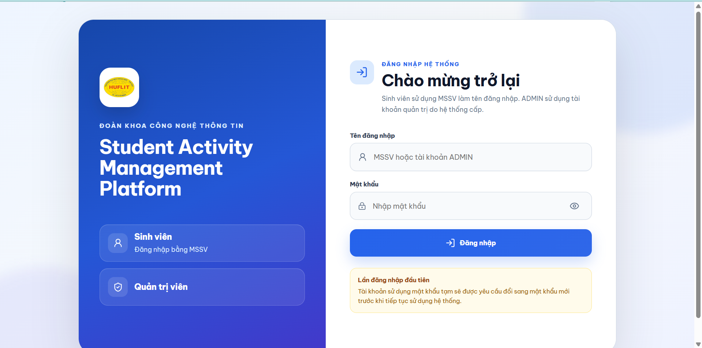

---
title: "Cài đặt và khởi chạy Frontend React/Vite"
date: 2026-11-09
weight: 1
chapter: false
pre: "<b>5.5.1.</b>"
---

## Cài đặt và khởi chạy Frontend React/Vite

Trong phần này, chúng ta sẽ chuẩn bị môi trường Frontend, cài đặt các thư viện Node.js và khởi chạy giao diện Web của Student Activity Management & Engagement Analytics Platform.

{}
Bạn cần hoàn thành phần 5.2 - Các bước chuẩn bị và phần 5.3 - Backend FastAPI trước khi thực hiện bài thực hành này.
{}

#### 1. Mở source code của đồ án

1. Mở Visual Studio Code.
2. Chọn File → Open Folder.
3. Mở thư mục:

```text
C:\Projects\student-activity-platform
```

Cấu trúc Frontend chính:

```text
student-activity-platform/
├── backend/
└── frontend/
    ├── src/
    │   ├── services/
    │   │   └── api.js
    │   └── ...
    ├── package.json
    └── ...
```

Các thành phần cần tìm hiểu:

* src/: Chứa mã nguồn giao diện React.
* src/services/: Chứa các thành phần giao tiếp với Backend.
* src/services/api.js: Quản lý các API Request của ứng dụng.
* package.json: Khai báo thư viện và các lệnh chạy Frontend.
* Cấu hình Vite: Quản lý môi trường phát triển và quá trình build.

Các thư mục khác được tổ chức theo source code hiện tại của đồ án.

<!--

-->

#### 2. Kiểm tra Node.js và npm

Mở Terminal trong Visual Studio Code.

Thực hiện:

```powershell
node --version
npm --version
```

Kiểm tra phiên bản Node.js và npm đã được cài đặt.

Sử dụng phiên bản Node.js tương thích với package.json và Vite của dự án.

Nếu chưa cài đặt Node.js, truy cập:

[Node.js Downloads](https://nodejs.org/)

#### 3. Di chuyển đến thư mục Frontend

Trong PowerShell, thực hiện:

```powershell
cd C:\Projects\student-activity-platform\frontend
```

Kiểm tra các file trong thư mục:

```powershell
Get-ChildItem
```

Đảm bảo thư mục hiện tại chứa package.json.

<!--

-->

#### 4. Cài đặt các thư viện

Thực hiện:

```powershell
npm install
```

npm sẽ đọc package.json và cài đặt các thư viện cần thiết vào thư mục node_modules.

Nếu repository có package-lock.json và cần cài đặt đúng các phiên bản đã khóa, có thể sử dụng:

```powershell
npm ci
```

Các nhóm thư viện phục vụ:

* Xây dựng giao diện React.
* Điều hướng giữa các trang.
* Gửi HTTP Request đến Backend.
* Hiển thị dữ liệu và Dashboard.
* Xử lý biểu mẫu và tương tác người dùng.

Các thư viện cụ thể cần được kiểm tra trong package.json của đồ án.

<!--

-->

{}
Không cần tạo một dự án React/Vite mới bằng npm create vite nếu bạn đã có source code hoàn chỉnh của đồ án.
{}

#### 5. Xử lý lỗi PowerShell khi chạy npm

Trên Windows, PowerShell có thể hiển thị lỗi:

```text
npm.ps1 cannot be loaded because running scripts
is disabled on this system.
```

Bạn có thể sử dụng npm.cmd thay cho npm:

```powershell
npm.cmd install
npm.cmd run dev
```

Hoặc sử dụng Command Prompt trong Visual Studio Code.

Nếu chính sách của máy tính cho phép, có thể cấu hình Execution Policy chỉ cho phiên PowerShell hiện tại:

```powershell
Set-ExecutionPolicy -Scope Process -ExecutionPolicy Bypass
```

Sau đó thực hiện lại lệnh npm.

#### 6. Khởi chạy Backend FastAPI

Trước khi chạy Frontend, cần đảm bảo Backend đang hoạt động.

Mở một Terminal riêng:

```powershell
cd C:\Projects\student-activity-platform\backend

.\.venv\Scripts\Activate.ps1

$env:SAP_DEMO_MODE="1"

python -m uvicorn app.main:app --reload
```

Kiểm tra Backend:

[http://127.0.0.1:8000/docs](http://127.0.0.1:8000/docs)

Giữ Terminal Backend hoạt động trong quá trình kiểm thử Frontend.

Nếu cần thực hiện các chức năng tích hợp DynamoDB, sử dụng thêm cấu hình AWS đã được chuẩn bị trong phần 5.4.

#### 7. Khởi chạy Frontend React/Vite

Quay lại Terminal Frontend.

Thực hiện:

```powershell
npm run dev
```

Sau khi khởi chạy thành công, Terminal sẽ hiển thị địa chỉ tương tự:

```text
VITE ready

Local: http://localhost:5173/
```

<!--

-->

Mở trình duyệt:

[http://localhost:5173](http://localhost:5173)

Nếu port 5173 đang được sử dụng, truy cập địa chỉ thực tế được hiển thị trong Terminal.

#### 8. Kiểm tra giao diện đăng nhập

Sau khi mở Frontend, kiểm tra:

* Trang đăng nhập được hiển thị.
* Các thành phần giao diện hoạt động.
* Không xuất hiện lỗi JavaScript nghiêm trọng.
* Các trường nhập thông tin đăng nhập có thể sử dụng.
* Frontend có thể kết nối với Backend.

<!--

-->

Có thể mở Developer Tools bằng phím F12 để kiểm tra Console và Network.

#### 9. Kiểm tra khả năng build Frontend

Mở Terminal mới tại thư mục frontend:

```powershell
npm run build
```

Nếu build thành công, Vite sẽ tạo thư mục:

```text
frontend/dist/
```

Thư mục dist chứa các tài nguyên HTML, CSS và JavaScript đã được build, phục vụ quá trình triển khai Frontend.

<!--

-->

#### Kết quả

Sau khi hoàn thành phần này:

* Các thư viện Frontend đã được cài đặt.
* Backend FastAPI hoạt động tại port 8000.
* Frontend React/Vite hoạt động trên môi trường local.
* Trang đăng nhập có thể được truy cập.
* Frontend có thể được build để chuẩn bị triển khai.

Trong phần tiếp theo, chúng ta sẽ tìm hiểu cách Frontend gửi REST API Request đến Backend và cấu hình API Endpoint của ứng dụng.

[Tiếp theo: Kết nối Frontend với FastAPI REST API](../5.5.2-connect-api/)
