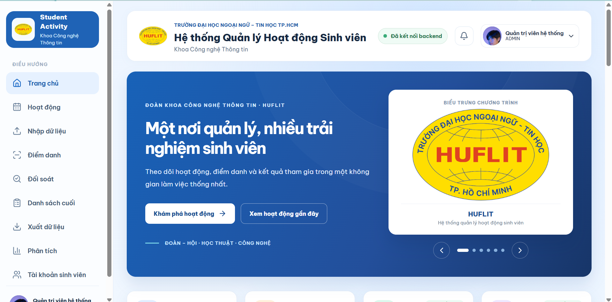

---
title: "ADMIN/STUDENT Authentication and Authorization"
date: 2026-11-09
weight: 3
chapter: false
pre: "<b>5.5.3.</b>"
---

## ADMIN/STUDENT Authentication and Authorization

In this section, we will explore how the Student Activity Management & Engagement Analytics Platform manages user authentication, login sessions, and access permissions.

The system uses two main roles:

* ADMIN: Administrators and activity organizers.
* STUDENT: Students who access activities and their participation results.

Authentication and Authorization are handled by the FastAPI Backend. The Frontend uses authentication results to display the appropriate interface.

The current Demo does not use Amazon Cognito.

#### 1. Understand Authentication and Authorization

**Authentication**

Authentication verifies a user's identity.

For example, a user enters a username and password. The Backend validates the credentials and returns an Access Token when the credentials are valid.

**Authorization**

Authorization determines whether a user is permitted to perform a specific operation.

For example:

* ADMIN users can manage student accounts.
* STUDENT users cannot access other students' account management information.

Authentication identifies the user, while Authorization determines what the user can do.

#### 2. Understand the login workflow

```text
ADMIN / STUDENT
       |
       | Username + Password
       v
React Login Interface
       |
       | POST /auth/login
       v
FastAPI Authentication
       |
       | Validate Credentials
       v
Access Token + User Information
       |
       v
Frontend Session Storage
       |
       v
Role-based User Interface
```

The login workflow includes:

1. The user opens the login page.
2. The user enters a username and password.
3. The Frontend sends a request to POST /auth/login.
4. The Backend validates the credentials and account status.
5. The Backend returns authentication information after successful login.
6. The Frontend stores the login session.
7. The Frontend displays functionality appropriate for the user's Role.

#### 3. Review Authentication APIs

Open Swagger UI:

[http://127.0.0.1:8000/docs](http://127.0.0.1:8000/docs)

Relevant Authentication APIs include:

| Endpoint | Method | Purpose |
| --- | --- | --- |
| /auth/login | POST | User login |
| /auth/me | GET | Retrieve current user information |
| /auth/logout | POST | User logout |
| /auth/change-password | POST | Change password |

Profile and avatar functionality uses the corresponding APIs in the Backend's Authentication/Profile group.

Review each API's HTTP Method and Request Schema in Swagger UI before sending a request.

<!--

-->

#### 4. Understand Access Token management

The project's Frontend uses two localStorage keys for authentication sessions:

```text
sap_access_token
sap_current_user
```

Where:

* sap_access_token: Stores the Access Token received from the Backend.
* sap_current_user: Stores information about the current user.

An illustrative session storage function:

```javascript
function saveSession(token, user) {
  localStorage.setItem("sap_access_token", token);

  localStorage.setItem(
    "sap_current_user",
    JSON.stringify(user)
  );

  window.dispatchEvent(
    new Event("sap-auth-change")
  );
}
```

The sap-auth-change event helps interface components detect authentication state changes.

The project uses subscribeAuthChange to observe authentication changes and update related session information and interface components.

This example demonstrates the underlying mechanism. Preserve the existing authentication functions when working with the project source code.

#### 5. Inspect the browser login session

1. Open the Frontend.
2. Sign in using an ADMIN Demo account.
3. Press F12.
4. Select the Application tab.
5. Open Local Storage.
6. Select the http://localhost:5173 origin.

Verify that the following keys exist:

```text
sap_access_token
sap_current_user
```

<!--

-->

The complete Token value does not need to be displayed in the internship report.

{}
localStorage is the session storage mechanism used in the current Demo. JavaScript running on the same origin can access these values, so XSS prevention is important. Never store passwords or AWS credentials in localStorage. A Production architecture may consider more secure session mechanisms, such as HttpOnly Cookies with appropriate CSRF protection.
{}

#### 6. Verify current user information

After login, the Backend provides:

```text
GET /auth/me
```

The Frontend can use this API to verify the current authentication session.

Workflow:

```text
Stored Access Token
        |
        v
GET /auth/me
        |
        v
FastAPI Token Validation
        |
        v
Current User Information
        |
        v
Update Frontend Session
```

Review the returned user information and Role.

The Role provided by the Backend determines which operations the user is authorized to perform.

Changing the Role in localStorage must not grant additional Backend permissions.

<!--

-->

#### 7. ADMIN and STUDENT authorization

The system uses only two main roles.

| Feature | ADMIN | STUDENT |
| --- | --- | --- |
| Sign in | Yes | Yes |
| View personal profile | Yes | Yes |
| View authorized activities | Yes | Yes |
| Create and manage activities | Yes | No |
| Manage student accounts | Yes | No |
| Import registration records | Yes | No |
| Administrative attendance recording | Yes | No |
| Import evidence files | Yes | No |
| Reconcile participation data | Yes | No |
| Confirm participation results | Yes | No |
| View personal participation results | As authorized | Yes |
| View administrative reports | Yes | No |

Actual access must follow the application's business rules and Backend API authorization.

STAFF is not an independent user Role in the current implementation.

#### 8. Test the ADMIN interface

Sign in using an ADMIN Demo account.

Inspect the administrative functionality available on the Home page or Sidebar.

ADMIN users can access:

* Activity Management.
* Student Account Management.
* Registration Import.
* Attendance Management.
* Evidence Import.
* Reconciliation and Participation Confirmation.
* Analytics and Export.

<!--

-->

Open Student Account Management.

Administrative operations include:

* View student accounts.
* Lock and unlock accounts.
* Reset passwords.
* Synchronize student accounts.

<!--

-->

Use a dedicated synthetic student account when testing account locking or password resets.

#### 9. Test the STUDENT interface

Sign out of the ADMIN account.

Sign in using a STUDENT Demo account.

Verify that:

* The student Home page is displayed.
* Authorized personal functionality is accessible.
* Students can view activity information and their own participation results.
* Student Account Management is not displayed.
* ADMIN-only features are not displayed.

<!--

-->

Hiding administrative features improves the user interface, but it is not the only security mechanism.

#### 10. Verify Backend authorization

Use a STUDENT Access Token to test the administrative API:

```text
GET /admin/students
```

Send the request through Swagger UI or an API Client.

Expected result:

```text
HTTP 403 Forbidden
```

If the Token is invalid or authentication is missing, the Backend may return HTTP 401.

Next, test the same Endpoint using an ADMIN account.

Expected result:

```text
HTTP 200 OK
```

<!--


-->

{}
The Frontend displays functionality according to user roles. FastAPI enforces actual resource access permissions. Administrative APIs must verify ADMIN permissions through Backend Authorization.
{}

#### 11. Test the personal profile

Sign in using a Demo account.

Open the personal profile page.

Verify the functionality available in the current Frontend:

* View user information.
* Update permitted profile fields.
* Change the avatar if the feature is enabled.
* Change the password.

Profile-related APIs are managed by the Backend, including the /auth/profile and /auth/avatar API groups.

Perform operations according to the current interface and API Schema.

<!--

-->

#### 12. Test logout

Select Logout in the user interface.

The Frontend should handle the authentication session according to the existing implementation, including clearing local authentication information and updating the interface state.

Illustrative example:

```javascript
function clearLocalSession() {
  localStorage.removeItem("sap_access_token");
  localStorage.removeItem("sap_current_user");

  window.dispatchEvent(
    new Event("sap-auth-change")
  );
}
```

If the application calls POST /auth/logout, also verify the Backend response.

After logout:

* The login interface is displayed.
* Protected functionality is no longer available through the previous Frontend session.
* Local authentication information has been removed.

<!--

-->

#### 13. Summarize authentication test results

| Test | Expected Result |
| --- | --- |
| ADMIN Login | Successful login |
| STUDENT Login | Successful login |
| Invalid Credentials | Login failure message |
| Access Token | Managed within the authentication session |
| ADMIN Interface | Administrative functionality displayed |
| STUDENT Interface | Only authorized functionality displayed |
| Protected API | Access Token validation |
| Admin API with STUDENT Token | Access denied |
| Personal Profile | Current user information displayed |
| Logout | Local login session cleared |

#### Conclusion

In this section, we explored Authentication and Authorization in the Student Activity Management & Engagement Analytics Platform.

The React/Vite Frontend uses Access Tokens and user information to manage authentication state and display the appropriate interface. FastAPI verifies user identity and enforces resource access permissions.

Clear separation between ADMIN and STUDENT permissions helps protect student data and ensures administrative operations remain within their authorized scope.

[Next: Test the interface and system functionality](../5.5.4-test-interface/)
