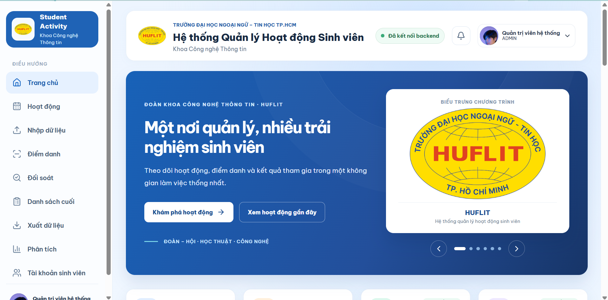

---
title: "Xác thực và phân quyền ADMIN/STUDENT"
date: 2026-11-09
weight: 3
chapter: false
pre: "<b>5.5.3.</b>"
---

## Xác thực và phân quyền ADMIN/STUDENT

Trong phần này, chúng ta sẽ tìm hiểu cách Student Activity Management & Engagement Analytics Platform quản lý đăng nhập, phiên làm việc và quyền truy cập của người dùng.

Hệ thống sử dụng hai Role chính:

* ADMIN: Quản trị viên và Ban Tổ chức hoạt động.
* STUDENT: Sinh viên sử dụng hệ thống để theo dõi hoạt động và kết quả tham gia.

Authentication và Authorization được xử lý bởi Backend FastAPI. Frontend sử dụng kết quả xác thực để hiển thị giao diện phù hợp.

Hệ thống không sử dụng Amazon Cognito trong phiên bản Demo hiện tại.

#### 1. Phân biệt Authentication và Authorization

**Authentication**

Authentication là quá trình xác minh danh tính của người dùng.

Ví dụ, người dùng nhập tên đăng nhập và mật khẩu. Backend kiểm tra thông tin và trả về Access Token nếu thông tin hợp lệ.

**Authorization**

Authorization là quá trình kiểm tra người dùng có được phép thực hiện một thao tác cụ thể hay không.

Ví dụ:

* ADMIN có quyền quản lý tài khoản sinh viên.
* STUDENT không được phép truy cập danh sách tài khoản của các sinh viên khác.

Authentication xác định người dùng là ai, trong khi Authorization xác định người dùng được phép thực hiện những gì.

#### 2. Tìm hiểu luồng đăng nhập

```text
ADMIN / STUDENT
       |
       | Username + Password
       v
React Login Interface
       |
       | POST /auth/login
       v
FastAPI Authentication
       |
       | Validate Credentials
       v
Access Token + User Information
       |
       v
Frontend Session Storage
       |
       v
Role-based User Interface
```

Quá trình đăng nhập:

1. Người dùng mở trang đăng nhập.
2. Nhập tên đăng nhập và mật khẩu.
3. Frontend gửi yêu cầu đến POST /auth/login.
4. Backend kiểm tra thông tin đăng nhập và trạng thái tài khoản.
5. Backend trả về thông tin xác thực nếu đăng nhập thành công.
6. Frontend lưu phiên đăng nhập.
7. Frontend hiển thị các chức năng tương ứng với Role.

#### 3. Kiểm tra API Authentication

Mở Swagger UI:

[http://127.0.0.1:8000/docs](http://127.0.0.1:8000/docs)

Các API Authentication liên quan:

| Endpoint | Method | Chức năng |
| --- | --- | --- |
| /auth/login | POST | Đăng nhập |
| /auth/me | GET | Lấy thông tin người dùng hiện tại |
| /auth/logout | POST | Đăng xuất |
| /auth/change-password | POST | Đổi mật khẩu |

Các chức năng hồ sơ và ảnh đại diện sử dụng những API tương ứng trong nhóm Authentication/Profile của Backend.

Kiểm tra HTTP Method và Request Schema của từng API trên Swagger UI trước khi thực hiện Request.

<!--

-->

#### 4. Tìm hiểu cơ chế quản lý Access Token

Trong Frontend của đồ án, phiên đăng nhập sử dụng hai khóa localStorage:

```text
sap_access_token
sap_current_user
```

Trong đó:

* sap_access_token: Lưu Access Token nhận được từ Backend.
* sap_current_user: Lưu thông tin người dùng hiện tại.

Ví dụ minh họa cách lưu thông tin xác thực:

```javascript
function saveSession(token, user) {
  localStorage.setItem("sap_access_token", token);

  localStorage.setItem(
    "sap_current_user",
    JSON.stringify(user)
  );

  window.dispatchEvent(
    new Event("sap-auth-change")
  );
}
```

Sự kiện sap-auth-change giúp các thành phần giao diện nhận biết khi trạng thái xác thực thay đổi.

Đồ án sử dụng cơ chế theo dõi thay đổi xác thực thông qua subscribeAuthChange để cập nhật phiên đăng nhập và giao diện liên quan.

Đây là ví dụ giải thích nguyên lý. Khi sử dụng source code của đồ án, giữ nguyên các hàm quản lý xác thực hiện có.

#### 5. Kiểm tra phiên đăng nhập trên trình duyệt

1. Mở Frontend.
2. Đăng nhập bằng tài khoản ADMIN Demo.
3. Nhấn F12.
4. Chọn tab Application.
5. Mở Local Storage.
6. Chọn origin http://localhost:5173.

Kiểm tra sự tồn tại của hai khóa:

```text
sap_access_token
sap_current_user
```

<!--

-->

Không cần hiển thị toàn bộ giá trị Token trong báo cáo.

{}
localStorage là cơ chế lưu phiên được sử dụng trong phiên bản Demo hiện tại. JavaScript trên cùng origin có thể truy cập các giá trị này, vì vậy cần chú ý phòng chống XSS và không lưu mật khẩu hoặc AWS Credentials trong localStorage. Kiến trúc Production có thể nghiên cứu cơ chế phiên bảo mật hơn, chẳng hạn HttpOnly Cookie kết hợp các biện pháp chống CSRF phù hợp.
{}

#### 6. Kiểm tra thông tin người dùng hiện tại

Sau khi đăng nhập, Backend cung cấp API:

```text
GET /auth/me
```

Frontend có thể sử dụng API này để xác minh thông tin phiên đăng nhập.

Luồng thực hiện:

```text
Stored Access Token
        |
        v
GET /auth/me
        |
        v
FastAPI Token Validation
        |
        v
Current User Information
        |
        v
Update Frontend Session
```

Kiểm tra thông tin người dùng và Role trong Response.

Thông tin Role từ Backend là cơ sở để xác định các chức năng mà người dùng được phép truy cập.

Không sử dụng việc chỉnh sửa Role trong localStorage như một phương thức cấp quyền.

<!--

-->

#### 7. Phân quyền ADMIN và STUDENT

Hệ thống chỉ sử dụng hai Role chính.

| Chức năng | ADMIN | STUDENT |
| --- | --- | --- |
| Đăng nhập hệ thống | Có | Có |
| Xem hồ sơ cá nhân | Có | Có |
| Xem hoạt động phù hợp | Có | Có |
| Tạo và quản lý hoạt động | Có | Không |
| Quản lý tài khoản sinh viên | Có | Không |
| Nhập danh sách đăng ký | Có | Không |
| Ghi nhận điểm danh quản trị | Có | Không |
| Nhập minh chứng từ file | Có | Không |
| Đối soát dữ liệu | Có | Không |
| Xác nhận kết quả tham gia | Có | Không |
| Xem kết quả tham gia cá nhân | Theo quyền | Có |
| Xem báo cáo quản trị | Có | Không |

Việc truy cập cụ thể cần tuân theo quy tắc nghiệp vụ và API Authorization của đồ án.

Trong phiên bản hiện tại, không sử dụng STAFF như một Role độc lập.

#### 8. Kiểm tra giao diện ADMIN

Đăng nhập bằng tài khoản ADMIN Demo.

Kiểm tra các chức năng quản trị trên Trang chủ hoặc Sidebar.

ADMIN có thể truy cập:

* Quản lý hoạt động.
* Quản lý tài khoản sinh viên.
* Registration Import.
* Attendance Management.
* Evidence Import.
* Reconciliation và Participation Confirmation.
* Analytics và Export.

<!--

-->

Mở chức năng quản lý tài khoản sinh viên.

Các thao tác quản trị bao gồm:

* Xem danh sách tài khoản.
* Khóa và mở khóa tài khoản.
* Reset mật khẩu.
* Đồng bộ tài khoản sinh viên.

<!--

-->

Sử dụng tài khoản sinh viên Demo riêng khi kiểm thử khóa tài khoản hoặc reset mật khẩu.

#### 9. Kiểm tra giao diện STUDENT

Đăng xuất khỏi tài khoản ADMIN.

Đăng nhập bằng tài khoản STUDENT Demo.

Kiểm tra:

* Trang chủ của sinh viên được hiển thị.
* Có thể truy cập các chức năng cá nhân được cấp quyền.
* Có thể xem thông tin hoạt động và kết quả tham gia của bản thân.
* Không hiển thị mục quản lý tài khoản sinh viên.
* Không hiển thị các chức năng quản trị chỉ dành cho ADMIN.

<!--

-->

Việc ẩn chức năng quản trị giúp giao diện phù hợp với người dùng. Tuy nhiên, đây không phải cơ chế bảo mật duy nhất.

#### 10. Kiểm tra phân quyền tại Backend

Sử dụng Access Token của tài khoản STUDENT để kiểm thử API quản trị:

```text
GET /admin/students
```

Thực hiện thông qua Swagger UI hoặc API Client.

Kết quả mong đợi:

```text
HTTP 403 Forbidden
```

Nếu Token không hợp lệ hoặc chưa được xác thực, Backend có thể trả về HTTP 401.

Sau đó, kiểm tra cùng Endpoint bằng tài khoản ADMIN.

Kết quả mong đợi:

```text
HTTP 200 OK
```

<!--


-->

{}
Frontend chỉ đảm nhiệm việc hiển thị giao diện theo Role. Backend FastAPI mới là thành phần thực thi quyền truy cập thực tế. Các API quản trị phải kiểm tra quyền ADMIN thông qua cơ chế Authorization của Backend.
{}

#### 11. Kiểm tra hồ sơ cá nhân

Đăng nhập bằng tài khoản Demo.

Mở trang hồ sơ cá nhân.

Kiểm tra các chức năng có trong phiên bản Frontend:

* Xem thông tin người dùng.
* Cập nhật các thông tin được phép thay đổi.
* Thay đổi ảnh đại diện nếu chức năng đã được bật.
* Đổi mật khẩu.

Các API liên quan đến hồ sơ được quản lý tại Backend, bao gồm nhóm /auth/profile và /auth/avatar.

Thực hiện các thao tác phù hợp với giao diện và API Schema hiện tại.

<!--

-->

#### 12. Kiểm tra chức năng đăng xuất

Chọn chức năng Logout trên giao diện.

Frontend cần xử lý phiên đăng nhập theo cơ chế hiện tại, bao gồm xóa dữ liệu xác thực local và cập nhật trạng thái giao diện.

Ví dụ minh họa:

```javascript
function clearLocalSession() {
  localStorage.removeItem("sap_access_token");
  localStorage.removeItem("sap_current_user");

  window.dispatchEvent(
    new Event("sap-auth-change")
  );
}
```

Nếu ứng dụng gọi POST /auth/logout, cần kiểm tra thêm kết quả xử lý của Backend.

Sau khi đăng xuất:

* Người dùng được đưa về giao diện đăng nhập.
* Các chức năng được bảo vệ không còn truy cập thông qua phiên cũ của giao diện.
* Dữ liệu phiên đăng nhập local đã được xóa.

<!--

-->

#### 13. Tổng hợp kết quả kiểm thử

| Nội dung | Kết quả mong đợi |
| --- | --- |
| ADMIN Login | Đăng nhập thành công |
| STUDENT Login | Đăng nhập thành công |
| Invalid Credentials | Thông báo đăng nhập thất bại |
| Access Token | Được quản lý theo phiên xác thực |
| ADMIN Interface | Hiển thị chức năng quản trị |
| STUDENT Interface | Chỉ hiển thị chức năng được cấp quyền |
| Protected API | Kiểm tra Access Token |
| Admin API with STUDENT Token | Từ chối truy cập |
| Personal Profile | Hiển thị thông tin của người dùng |
| Logout | Xóa phiên đăng nhập local |

#### Kết luận

Trong phần này, chúng ta đã tìm hiểu cơ chế Authentication và Authorization của Student Activity Management & Engagement Analytics Platform.

Frontend React/Vite sử dụng Access Token và thông tin người dùng để quản lý trạng thái đăng nhập và hiển thị giao diện phù hợp. Backend FastAPI thực hiện xác minh danh tính và kiểm tra quyền truy cập tài nguyên.

Việc phân quyền rõ ràng giữa ADMIN và STUDENT giúp bảo vệ dữ liệu sinh viên và đảm bảo các thao tác quản trị được thực hiện đúng phạm vi.

[Tiếp theo: Kiểm thử giao diện và chức năng hệ thống](../5.5.4-test-interface/)
