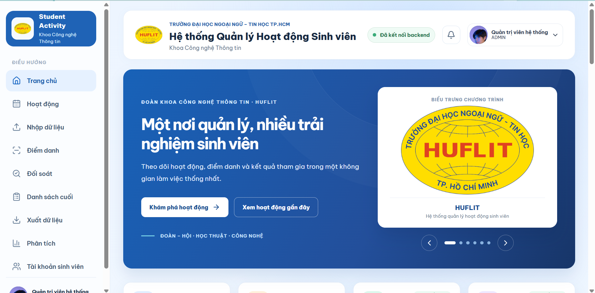

---
title: "Test the Interface and System Functionality"
date: 2026-11-09
weight: 4
chapter: false
pre: "<b>5.5.4.</b>"
---

## Test the Interface and System Functionality

In this section, we will test the React/Vite interface and its communication with the FastAPI Backend of the Student Activity Management & Engagement Analytics Platform.

The objective is to verify that users can perform business operations through the Web interface and inspect consistency between the Frontend, Backend, and stored data.

#### 1. Prepare the testing environment

Ensure that the following components are available:

* FastAPI Backend on port 8000.
* React/Vite Frontend running locally.
* SQLite Local Persistence.
* Amazon DynamoDB Integration when testing AWS Pilot functionality.
* ADMIN and STUDENT Demo accounts.

Use synthetic student data to avoid affecting real student information.

Open the application:

[http://localhost:5173](http://localhost:5173)

#### 2. Test the login interface

On the login page, perform the following tests:

* Sign in using valid ADMIN credentials.
* Sign in using valid STUDENT credentials.
* Enter an incorrect password.
* Leave required fields empty.

Expected results:

* Valid users can access the system.
* Invalid input is handled with an appropriate message.
* The interface displayed after login matches the user's Role.

<!--

-->

#### 3. Test the ADMIN Home page

Sign in using an ADMIN account.

Review the system's Home page and Sidebar.

Verify the following functionality groups:

* Activity Management.
* Student Account Management.
* Registration and Attendance Management.
* Evidence Management.
* Reconciliation and Participation Confirmation.
* Analytics Dashboard.
* Personal Profile.

<!--

-->

Navigate between pages to verify interface stability and appropriate data loading.

#### 4. Test Activity Management

##### Step 1: Open the activity list

From the ADMIN interface, open Activity Management.

Verify the activity list retrieved from the Backend.

<!--

-->

##### Step 2: Create a Demo activity

Select the function for creating a new activity.

Enter sample information:

```text
Activity Name: AWS Workshop Demo

Location: University Hall

Description:
Student Activity Management Platform Testing
```

Enter the scheduled time and required fields according to the current application form.

Save the activity.

<!--

-->

##### Step 3: Verify the result

After successful creation:

* The activity appears in the activity list.
* Activity information is displayed correctly.
* The activity details page is accessible.
* An Activity ID is available for subsequent tests.

If the activity is created in DRAFT status, apply the appropriate state transition before testing registration or attendance operations.

<!--

-->

##### Step 4: Verify Backend data

Open Developer Tools and inspect the activity creation API request.

If the Activities AWS Pilot is enabled, verify the item in SAP-Activities according to section 5.4.

If using Local Demo mode, inspect the data through the current persistence mechanism.

#### 5. Test Student Account Management

From the ADMIN interface, open Student Account Management.

Verify:

* The student account list.
* Search or filtering if supported by the interface.
* Account status information.
* Account locking and unlocking.
* Password reset functionality.
* Student account synchronization.

<!--

-->

##### Test account locking and unlocking

Use a dedicated synthetic student account:

1. Select the test account.
2. Lock the account.
3. Verify the updated account status.
4. Attempt to sign in using the locked account in a separate browser window.
5. Verify that the Backend denies login or access according to the account rules.
6. Return to the ADMIN interface and unlock the account.
7. Verify that the account can sign in again.

<!--


-->

##### Test password reset

Use a dedicated Demo account.

* Select the password reset function.
* Enter a temporary password that satisfies Backend requirements.
* Confirm the operation.
* Verify login using the new password.

Do not capture or disclose temporary passwords in the internship report.

{}
Only test account status changes and password resets using Demo accounts. Do not use real student accounts or synchronize real student data without authorization.
{}

#### 6. Test business operation interfaces

Verify that the business operation pages are accessible through the Frontend.

##### Registration Import

* Open the registration import interface.
* Inspect the CSV/XLSX file selection area.
* Verify the selected activity information.
* Ensure that the interface accepts appropriate files.

<!--

-->

##### Attendance Management

* Open the Check-in/Check-out interface.
* Verify manual student ID input or input from a compatible scanner.
* Inspect student and activity information.
* Review the attendance result display.

<!--

-->

Attendance is recorded in real time through REST APIs. Importing attendance spreadsheets after an activity is not the primary recording mechanism.

##### Evidence Import

* Open the participation evidence import interface.
* Inspect the CSV/XLSX upload area.
* Verify activity information and data processing controls.

<!--

-->

##### Reconciliation and Participation

* Open the data reconciliation interface.
* Review student records and data status information.
* Inspect participation confirmation controls available to ADMIN users.

<!--

-->

Detailed exercises covering Registration, Attendance, Evidence, and Participation will be presented in sections 5.6 and 5.7.

#### 7. Test the Analytics Dashboard

Open the Analytics Dashboard using an ADMIN account.

Review indicators available in the current system:

* Total Activities.
* Total Registrations.
* Attendance information.
* Participation results.
* Activity-based statistics.

Change available filters if supported by the interface.

Verify that displayed data updates according to the selected activity or filter.

<!--

-->

The Dashboard is developed using React/Vite and consumes data provided by FastAPI.

Amazon QuickSight is not used as the Dashboard implementation in the current project.

#### 8. Test the STUDENT interface

Sign out of the ADMIN account and sign in using a STUDENT Demo account.

Verify:

* Student Home page.
* Authorized activity information.
* Personal participation results.
* Personal profile.
* Logout functionality.

<!--

-->

In particular, confirm that Student Account Management does not appear in the STUDENT interface.

Attempt to access a known administrative route from the ADMIN interface.

Expected results:

* The Frontend restricts unauthorized access or redirects to an appropriate page.
* The Backend rejects administrative API requests using a STUDENT Access Token.

#### 9. Test session behavior after reloading

Sign in using a Demo account.

Perform the following steps:

1. Open Activity Management or the personal profile page.
2. Press F5 to reload the page.
3. Verify the login session.
4. Verify current user information.
5. Verify data retrieval from the Backend.

Expected results:

* A valid authentication session is restored according to the existing implementation.
* The interface reflects the appropriate Role.
* Data is retrieved again.
* No JavaScript errors occur due to uninitialized authentication state.

#### 10. Test responsive interface behavior

Open Developer Tools.

Select Toggle Device Toolbar to simulate different screen sizes.

Test the application on:

* Desktop screen sizes.
* Tablet screen sizes.
* Mobile screen sizes.

Inspect:

* Login page.
* Sidebar and navigation.
* Activity creation forms.
* Student data tables.
* Analytics Dashboard.

<!--


-->

Record any layout limitations for future interface improvements.

#### 11. Inspect Frontend errors

Use Developer Tools:

* Console: Inspect JavaScript errors.
* Network: Inspect failed HTTP requests.
* Application: Inspect authentication session state.
* Elements: Inspect interface layout.

If the Frontend does not display data, verify:

* Backend availability.
* API_BASE_URL configuration.
* Access Token validity.
* Compatibility between API Responses and the Frontend data model.
* User Role and permissions.

During development, prioritize actual API-based data and authentication instead of obsolete Mock Authentication mechanisms.

#### 12. Summarize interface test results

| Test Case | Expected Result |
| --- | --- |
| Login | Successful login with valid credentials |
| ADMIN Dashboard | Administrative functionality displayed |
| Create Activity | Activity created and displayed |
| Student Accounts | ADMIN can manage student accounts |
| Lock/Unlock | Account status updated |
| Reset Password | New password is usable |
| Registration Interface | Activity and file selection available |
| Attendance Interface | Attendance operations available |
| Evidence Interface | Evidence file imports available |
| Reconciliation | Reconciliation data displayed |
| Analytics Dashboard | Statistical information displayed |
| STUDENT Dashboard | Only authorized functionality displayed |
| Page Reload | Valid authentication session restored |
| Logout | Authentication state cleared |
| Responsive Layout | Interface usable at tested screen sizes |

This table defines testing criteria. Workshop participants should record actual results and capture corresponding evidence.

#### 13. Prepare the Frontend for the next stage

After completing the tests, run:

```powershell
cd C:\Projects\student-activity-platform\frontend

npm run build
```

Verify successful compilation and creation of the dist directory.

<!--

-->

The Frontend is ready for further exercises involving activity management, data imports, attendance, and reconciliation.

Frontend deployment using AWS Amplify Hosting will be covered in the Application Deployment section.

#### Conclusion

In this section, we tested the interface and main functionality groups of the Student Activity Management & Engagement Analytics Platform.

The React/Vite Frontend communicates with FastAPI through REST APIs, manages authentication sessions, and displays features appropriate for ADMIN and STUDENT users.

User-oriented testing helps identify interface, connectivity, authentication, and data issues before deploying the application on AWS.

In the next section, we will explore the detailed registration import and real-time Check-in/Check-out workflows.

[Next: Registration and Attendance Management](../../5.6-Registration-Attendance/)
