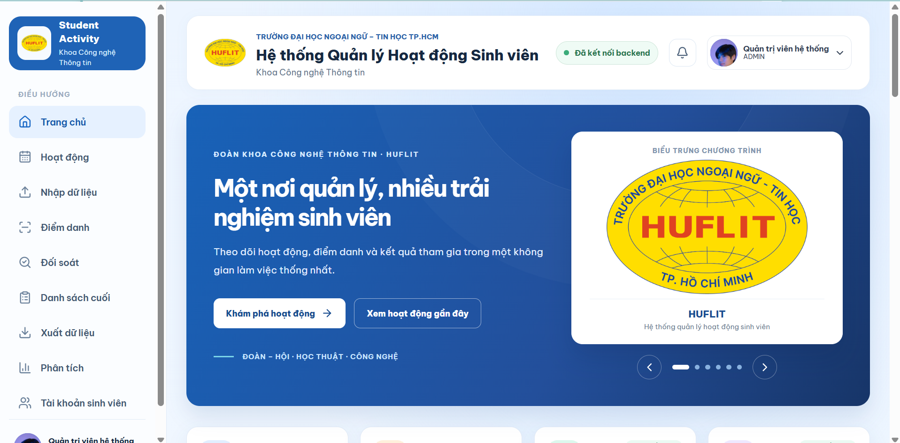

---
title: "Kiểm thử giao diện và chức năng hệ thống"
date: 2026-11-09
weight: 4
chapter: false
pre: "<b>5.5.4.</b>"
---

## Kiểm thử giao diện và chức năng hệ thống

Trong phần này, chúng ta sẽ kiểm thử giao diện React/Vite và khả năng kết nối với Backend FastAPI của Student Activity Management & Engagement Analytics Platform.

Mục tiêu là xác nhận người dùng có thể thực hiện các thao tác nghiệp vụ thông qua giao diện Web, đồng thời kiểm tra tính nhất quán giữa Frontend, Backend và dữ liệu được lưu trữ.

#### 1. Chuẩn bị môi trường kiểm thử

Đảm bảo các thành phần sau đang hoạt động:

* FastAPI Backend tại port 8000.
* React/Vite Frontend trên môi trường local.
* SQLite Local Persistence.
* Amazon DynamoDB Integration nếu kiểm thử các chức năng AWS Pilot.
* Tài khoản ADMIN và STUDENT Demo.

Sử dụng dữ liệu sinh viên giả lập để tránh ảnh hưởng đến dữ liệu thực tế.

Mở ứng dụng:

[http://localhost:5173](http://localhost:5173)

#### 2. Kiểm thử giao diện đăng nhập

Tại trang đăng nhập, thực hiện các trường hợp:

* Đăng nhập bằng tài khoản ADMIN hợp lệ.
* Đăng nhập bằng tài khoản STUDENT hợp lệ.
* Nhập sai mật khẩu.
* Để trống các trường bắt buộc.

Kết quả mong đợi:

* Tài khoản hợp lệ có thể truy cập hệ thống.
* Thông tin không hợp lệ được xử lý bằng thông báo phù hợp.
* Giao diện sau đăng nhập phù hợp với Role của người dùng.

<!--

-->

#### 3. Kiểm thử trang chủ ADMIN

Đăng nhập bằng tài khoản ADMIN.

Kiểm tra Trang chủ và Sidebar của hệ thống.

Các nhóm chức năng cần kiểm tra:

* Quản lý hoạt động.
* Quản lý tài khoản sinh viên.
* Quản lý đăng ký và điểm danh.
* Quản lý minh chứng.
* Đối soát và xác nhận tham gia.
* Analytics Dashboard.
* Hồ sơ cá nhân.

<!--

-->

Thử điều hướng giữa các trang để đảm bảo giao diện hoạt động ổn định và dữ liệu được tải phù hợp.

#### 4. Kiểm thử quản lý hoạt động

##### Bước 1: Mở danh sách hoạt động

Từ giao diện ADMIN, truy cập chức năng quản lý hoạt động.

Kiểm tra danh sách hoạt động được lấy từ Backend.

<!--

-->

##### Bước 2: Tạo hoạt động Demo

Chọn chức năng tạo hoạt động mới.

Nhập thông tin mẫu:

```text
Activity Name: AWS Workshop Demo

Location: University Hall

Description:
Student Activity Management Platform Testing
```

Điền thời gian tổ chức và các trường bắt buộc theo biểu mẫu hiện tại của hệ thống.

Chọn lưu hoạt động.

<!--

-->

##### Bước 3: Kiểm tra kết quả

Sau khi lưu thành công:

* Hoạt động xuất hiện trong danh sách.
* Thông tin hoạt động hiển thị đúng.
* Có thể mở trang chi tiết của hoạt động.
* Có Activity ID để phục vụ các bài kiểm thử tiếp theo.

Nếu hoạt động được tạo ở trạng thái DRAFT, thực hiện thao tác chuyển trạng thái phù hợp trước khi kiểm thử các nghiệp vụ đăng ký hoặc điểm danh.

<!--

-->

##### Bước 4: Kiểm tra dữ liệu Backend

Mở Developer Tools và kiểm tra API Request tạo hoạt động.

Nếu đang bật AWS Pilot cho Activities, có thể xác minh thêm dữ liệu trong SAP-Activities theo hướng dẫn phần 5.4.

Nếu đang sử dụng Local Demo, kiểm tra dữ liệu theo cơ chế persistence hiện tại.

#### 5. Kiểm thử quản lý tài khoản sinh viên

Từ giao diện ADMIN, mở chức năng quản lý tài khoản sinh viên.

Kiểm tra:

* Danh sách tài khoản sinh viên.
* Tìm kiếm hoặc lọc tài khoản nếu giao diện hỗ trợ.
* Thông tin trạng thái hoạt động của tài khoản.
* Chức năng khóa và mở khóa tài khoản.
* Chức năng reset mật khẩu.
* Chức năng đồng bộ tài khoản.

<!--

-->

##### Kiểm thử khóa và mở khóa

Sử dụng một tài khoản sinh viên Demo:

1. Chọn tài khoản cần kiểm thử.
2. Thực hiện thao tác khóa tài khoản.
3. Kiểm tra trạng thái tài khoản sau khi cập nhật.
4. Thử đăng nhập bằng tài khoản vừa bị khóa trong một cửa sổ trình duyệt khác.
5. Kiểm tra Backend từ chối đăng nhập hoặc truy cập theo quy tắc tài khoản.
6. Quay lại ADMIN và mở khóa tài khoản.
7. Kiểm tra khả năng đăng nhập trở lại.

<!--


-->

##### Kiểm thử reset mật khẩu

Thực hiện trên tài khoản Demo được chuẩn bị riêng.

* Chọn chức năng reset mật khẩu.
* Nhập mật khẩu tạm thời phù hợp với quy định của Backend.
* Xác nhận thao tác.
* Kiểm tra đăng nhập bằng mật khẩu mới.

Không chụp hoặc công khai mật khẩu tạm thời trong báo cáo.

{}
Chỉ kiểm thử các thao tác thay đổi trạng thái và mật khẩu trên tài khoản Demo. Không sử dụng tài khoản sinh viên thật hoặc đồng bộ dữ liệu thực tế khi chưa được cấp phép.
{}

#### 6. Kiểm thử các giao diện nghiệp vụ

Kiểm tra khả năng truy cập các trang nghiệp vụ trên Frontend.

##### Registration Import

* Mở giao diện nhập danh sách đăng ký.
* Kiểm tra khu vực chọn file CSV/XLSX.
* Kiểm tra thông tin hoạt động cần nhập dữ liệu.
* Đảm bảo giao diện có thể tiếp nhận file phù hợp.

<!--

-->

##### Attendance Management

* Mở giao diện Check-in/Check-out.
* Kiểm tra khả năng nhập hoặc tiếp nhận MSSV từ thiết bị quét tương thích.
* Kiểm tra thông tin sinh viên và hoạt động.
* Kiểm tra khu vực hiển thị kết quả điểm danh.

<!--

-->

Hệ thống ghi nhận điểm danh thông qua REST API theo thời gian thực. Không thực hiện quy trình nhập file điểm danh sau hoạt động như phương thức chính.

##### Evidence Import

* Mở giao diện nhập minh chứng.
* Kiểm tra khu vực tải file CSV/XLSX.
* Kiểm tra thông tin hoạt động và dữ liệu cần xử lý.

<!--

-->

##### Reconciliation và Participation

* Mở giao diện đối soát dữ liệu.
* Kiểm tra danh sách sinh viên và các trạng thái dữ liệu.
* Kiểm tra các chức năng xác nhận kết quả theo quyền ADMIN.

<!--

-->

Các bài thực hành chi tiết về Registration, Attendance, Evidence và Participation sẽ được trình bày trong phần 5.6 và 5.7.

#### 7. Kiểm thử giao diện Analytics Dashboard

Truy cập Analytics Dashboard bằng tài khoản ADMIN.

Kiểm tra các chỉ số có trong phiên bản hệ thống:

* Tổng số hoạt động.
* Tổng số lượt đăng ký.
* Thông tin điểm danh.
* Kết quả tham gia.
* Các chỉ số thống kê theo hoạt động.

Thử thay đổi bộ lọc nếu giao diện hỗ trợ.

Kiểm tra dữ liệu hiển thị được cập nhật theo hoạt động hoặc điều kiện đã chọn.

<!--

-->

Dashboard được phát triển bằng React/Vite và sử dụng dữ liệu do FastAPI cung cấp.

Không sử dụng Amazon QuickSight để hiển thị Dashboard trong phiên bản hiện tại.

#### 8. Kiểm thử giao diện STUDENT

Đăng xuất khỏi tài khoản ADMIN và đăng nhập bằng tài khoản STUDENT Demo.

Kiểm tra:

* Trang chủ sinh viên.
* Danh sách hoạt động có thể truy cập.
* Kết quả tham gia cá nhân.
* Hồ sơ cá nhân.
* Chức năng đăng xuất.

<!--

-->

Đặc biệt, kiểm tra mục quản lý tài khoản sinh viên không xuất hiện trên giao diện STUDENT.

Thử truy cập một đường dẫn quản trị đã xác định từ giao diện ADMIN.

Kết quả mong đợi:

* Frontend không cho phép truy cập trái quyền hoặc điều hướng về trang phù hợp.
* Backend từ chối các API quản trị khi sử dụng Access Token của STUDENT.

#### 9. Kiểm thử trạng thái sau khi tải lại trang

Đăng nhập vào hệ thống bằng tài khoản Demo.

Thực hiện:

1. Mở trang quản lý hoạt động hoặc hồ sơ.
2. Nhấn F5 để tải lại trang.
3. Kiểm tra trạng thái đăng nhập.
4. Kiểm tra thông tin người dùng.
5. Kiểm tra dữ liệu được tải lại từ Backend.

Kết quả mong đợi:

* Phiên đăng nhập hợp lệ được khôi phục theo cơ chế xác thực hiện tại.
* Giao diện được cập nhật phù hợp với Role.
* Dữ liệu được truy xuất lại.
* Không xuất hiện lỗi JavaScript do trạng thái xác thực chưa được khởi tạo.

#### 10. Kiểm thử giao diện Responsive

Mở Developer Tools.

Chọn Toggle Device Toolbar để mô phỏng các kích thước màn hình.

Kiểm tra trên:

* Màn hình Desktop.
* Màn hình Tablet.
* Màn hình điện thoại.

Các thành phần cần kiểm tra:

* Trang đăng nhập.
* Sidebar và thanh điều hướng.
* Biểu mẫu tạo hoạt động.
* Bảng dữ liệu sinh viên.
* Analytics Dashboard.

<!--


-->

Ghi nhận những điểm chưa tối ưu để điều chỉnh giao diện trong các giai đoạn tiếp theo.

#### 11. Kiểm tra lỗi Frontend

Sử dụng Developer Tools:

* Console: Kiểm tra lỗi JavaScript.
* Network: Kiểm tra Request bị thất bại.
* Application: Kiểm tra phiên đăng nhập.
* Elements: Kiểm tra bố cục và giao diện.

Nếu Frontend không hiển thị dữ liệu, kiểm tra:

* Backend có đang hoạt động không.
* API_BASE_URL có chính xác không.
* Access Token có hợp lệ không.
* API Response có phù hợp với dữ liệu mà giao diện đang sử dụng không.
* Người dùng có đúng Role không.

Trong quá trình phát triển, cần ưu tiên sử dụng dữ liệu thực tế từ API thay vì các cơ chế Mock Authentication cũ.

#### 12. Tổng hợp kết quả kiểm thử

| Test Case | Kết quả mong đợi |
| --- | --- |
| Login | Đăng nhập thành công với tài khoản hợp lệ |
| ADMIN Dashboard | Hiển thị chức năng quản trị |
| Create Activity | Hoạt động được tạo và hiển thị |
| Student Accounts | ADMIN có thể quản lý tài khoản |
| Lock/Unlock | Trạng thái tài khoản được cập nhật |
| Reset Password | Mật khẩu mới có thể sử dụng |
| Registration Interface | Có thể chọn hoạt động và file dữ liệu |
| Attendance Interface | Có thể thực hiện nghiệp vụ điểm danh |
| Evidence Interface | Có thể nhập file minh chứng |
| Reconciliation | Hiển thị dữ liệu phục vụ đối soát |
| Analytics Dashboard | Hiển thị dữ liệu thống kê |
| STUDENT Dashboard | Chỉ hiển thị chức năng được cấp quyền |
| Page Reload | Khôi phục phiên đăng nhập hợp lệ |
| Logout | Xóa trạng thái đăng nhập |
| Responsive Layout | Giao diện có thể sử dụng ở các kích thước được kiểm thử |

Bảng trên là các tiêu chí kiểm thử. Người thực hiện Workshop cần ghi nhận kết quả thực tế và bổ sung ảnh minh chứng tương ứng.

#### 13. Chuẩn bị Frontend cho giai đoạn tiếp theo

Sau khi hoàn thành kiểm thử, chạy:

```powershell
cd C:\Projects\student-activity-platform\frontend

npm run build
```

Kiểm tra quá trình build thành công và thư mục dist được tạo.

<!--

-->

Frontend đã sẵn sàng để tiếp tục thực hành các nghiệp vụ quản lý hoạt động, nhập dữ liệu, điểm danh và đối soát.

Việc triển khai Frontend lên AWS Amplify Hosting sẽ được thực hiện trong phần Application Deployment.

#### Kết luận

Trong phần này, chúng ta đã kiểm thử giao diện và các nhóm chức năng chính của Student Activity Management & Engagement Analytics Platform.

Frontend React/Vite có thể giao tiếp với Backend FastAPI thông qua REST API, quản lý phiên đăng nhập và hiển thị các chức năng phù hợp với quyền ADMIN và STUDENT.

Việc kiểm thử từ góc nhìn người dùng giúp xác định các vấn đề về giao diện, kết nối, trạng thái xác thực và dữ liệu trước khi triển khai ứng dụng lên AWS.

Trong phần tiếp theo, chúng ta sẽ thực hành chi tiết quy trình nhập danh sách đăng ký và ghi nhận Check-in/Check-out theo thời gian thực.

[Tiếp theo: Quản lý đăng ký và điểm danh](../../5.6-Registration-Attendance/)
