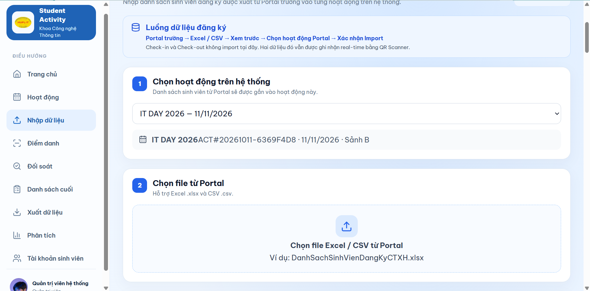

---
title: "Import Student Registration Data"
date: 2026-11-09
weight: 1
chapter: false
pre: "<b>5.6.1.</b>"
---

## Import Student Registration Data

In this section, we will import student registration data from CSV/XLSX files into the Student Activity Management & Engagement Analytics Platform.

Registration data helps organizers identify students registered for each activity and provides a foundation for attendance recording and post-event reconciliation.

#### 1. Prepare the environment

Ensure that the following components are available:

* FastAPI Backend at http://127.0.0.1:8000.
* React/Vite Frontend at http://localhost:5173.
* An ADMIN Demo account.
* An existing activity in the system.
* A sample registration file.

For AWS storage testing, prepare the DynamoDB integration settings described in section 5.4.

#### 2. Understand the registration data source

In practice, students register for university activities through the University Portal.

Organizers can export registration lists as Excel or CSV files and import them into the activity management platform.

Workflow:

```text
University Portal
        |
        v
Export Registration List
        |
        v
CSV / XLSX File
        |
        v
ADMIN Import Interface
        |
        v
FastAPI Validation
        |
        v
Registration Records
```

The current implementation uses file-based imports and does not require direct API integration with the University Portal.

#### 3. Prepare a CSV/XLSX file

Create a sample CSV file named:

```text
registrations-demo.csv
```

Example content:

```csv
mssv,full_name,class_name
0818000001,Student A,DS01
0818000002,Student B,DS01
0818000003,Student C,DS02
0818000004,Student D,DS02
```

Illustrative fields include:

* mssv: Student ID.
* full_name: Student full name.
* class_name: Student class.

{}
This is synthetic data for the workshop. Column names must match the Import Template supported by the current Backend. If the application provides a downloadable template, use that template.
{}

Microsoft Excel can be used to prepare the file and save it in XLSX or CSV UTF-8 format.

Format student ID columns as Text in Excel to preserve leading zeros.

<!--

-->

#### 4. Sign in as ADMIN

1. Open the React/Vite application.
2. Sign in using an ADMIN Demo account.
3. Open Activity Management.
4. Select the activity for which registration data will be imported.

<!--

-->

Verify the activity name and Activity ID to avoid importing records into the wrong activity.

Example:

```text
Activity Name: AWS Workshop Demo
Activity ID: Use the system-generated identifier
```

#### 5. Perform Registration Import

From the activity management interface:

1. Open the registration import functionality.
2. Select the target activity.
3. Select registrations-demo.csv or the corresponding XLSX file.
4. Review the selected file information.
5. Execute the Import operation.

<!--

-->

The Frontend sends the file and relevant activity information to FastAPI.

The Backend reads the file, validates its records, and stores valid registration data according to the current business rules.

If a data preview is available, review the records before confirming the Import.

#### 6. Validate input data

The following scenarios should be considered:

* Missing student IDs.
* Unsupported student ID formats.
* Duplicate students within the same registration list.
* Missing required columns.
* Unsupported file formats.
* Invalid Activity IDs.
* Student data that does not satisfy business requirements.

Example test file:

```csv
mssv,full_name,class_name
0818000001,Student A,DS01
0818000002,Student B,DS01
0818000001,Student A,DS01
,Student C,DS02
```

This file contains four records:

* Two valid and distinct student IDs.
* One duplicate student ID.
* One record with a missing student ID.

The expected behavior is that invalid records are identified and duplicate registrations are not created for the same student and activity.

Depending on the implementation, the Backend may reject the file, skip invalid records, or update existing records. Review the actual Import Response to determine the implemented behavior.

#### 7. Verify the Import result

After the Import finishes:

1. Open the activity's registration list.
2. Inspect the number of stored registrations.
3. Verify student IDs and student information.
4. Compare the records with the original file.
5. Inspect invalid or duplicate record information if available.

<!--

-->

Each registration must be associated with the correct Activity ID and Student ID.

Example:

```text
Activity ID: ACT-DEMO-001
Student ID: 0818000001
Registration: Recorded
```

The Activity ID is illustrative. Use the actual identifier generated by the Backend.

#### 8. Inspect the Registration Import REST API

Open Developer Tools by pressing F12.

* Select the Network tab.
* Select the Fetch/XHR filter.
* Import a test file.
* Select the corresponding HTTP request.
* Review its HTTP Method, Request URL, and Response.

The file is submitted to the Backend through the application's Import API.

Use Swagger UI to inspect the current Endpoint and Request Schema:

[http://127.0.0.1:8000/docs](http://127.0.0.1:8000/docs)

<!--

-->

{}
Do not expose Access Tokens, login credentials, or real student information in Network or Swagger UI screenshots.
{}

#### 9. Verify Registration data in Amazon DynamoDB

If the Registration AWS Pilot is enabled:

1. Open the Amazon DynamoDB Console.
2. Select Singapore - ap-southeast-1.
3. Select SAP-Registrations.
4. Choose Explore table items.
5. Query items by activity_id.
6. Inspect records corresponding to the imported student IDs.

<!--

-->

The integration uses the following key structure:

| Key | Type | Purpose |
| --- | --- | --- |
| activity_id | String | Identifies the activity |
| mssv | String | Identifies a student within the activity |

Verify the actual table Key Schema according to section 5.4 before querying.

If AWS Pilot integration is disabled, data may only be processed in the local Demo environment. An empty DynamoDB result does not automatically indicate an Import failure.

#### 10. Summarize test cases

| Test Case | Expected Result |
| --- | --- |
| Valid CSV file | Registration data accepted and processed |
| Valid XLSX file | Registration data accepted and processed |
| Missing Student ID | Invalid record reported or handled |
| Duplicate Student ID | No duplicate registration for the same activity |
| Unsupported file format | Appropriate error message |
| STUDENT attempts Import | Backend denies unauthorized access |
| Registration list | Records match the Import results |
| DynamoDB Integration | Corresponding Cloud records when AWS Pilot is enabled |

#### Results

After completing this section, we have prepared and imported student registration data into the system.

The Backend can receive CSV/XLSX files, validate input data, and store records for activity management.

Registration data provides an important foundation for attendance recording, evidence imports, and participation reconciliation.

[Next: Prepare Activity and Attendance](../5.6.2-prepare-attendance/)
