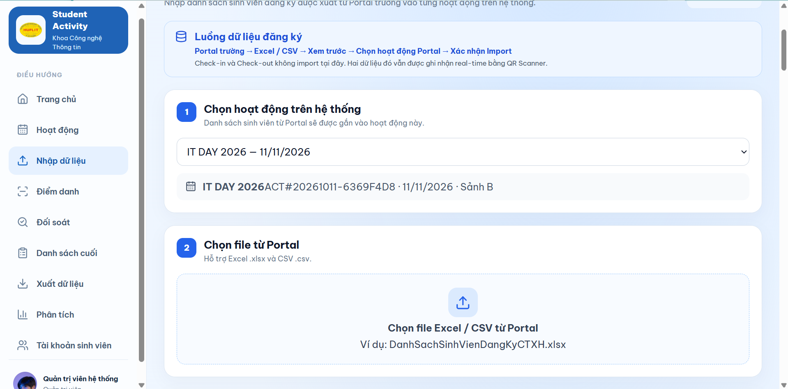

---
title: "Nhập danh sách sinh viên đăng ký"
date: 2026-11-09
weight: 1
chapter: false
pre: "<b>5.6.1.</b>"
---

## Nhập danh sách sinh viên đăng ký

Trong phần này, chúng ta sẽ nhập dữ liệu đăng ký sinh viên từ file CSV/XLSX vào hệ thống Student Activity Management & Engagement Analytics Platform.

Dữ liệu đăng ký là cơ sở để Ban Tổ chức xác định những sinh viên đã đăng ký tham gia từng hoạt động, phục vụ quá trình điểm danh và đối soát sau chương trình.

#### 1. Chuẩn bị môi trường

Đảm bảo các thành phần sau đang hoạt động:

* FastAPI Backend tại http://127.0.0.1:8000.
* React/Vite Frontend tại http://localhost:5173.
* Tài khoản ADMIN Demo.
* Một hoạt động đã được tạo trong hệ thống.
* File danh sách đăng ký mẫu.

Nếu cần kiểm thử dữ liệu trên AWS, chuẩn bị thêm cấu hình DynamoDB theo phần 5.4.

#### 2. Tìm hiểu nguồn dữ liệu đăng ký

Trong thực tế, sinh viên đăng ký tham gia hoạt động thông qua University Portal.

Ban Tổ chức có thể xuất danh sách đăng ký dưới dạng Excel hoặc CSV, sau đó nhập dữ liệu vào hệ thống quản lý hoạt động.

Quy trình:

```text
University Portal
        |
        v
Export Registration List
        |
        v
CSV / XLSX File
        |
        v
ADMIN Import Interface
        |
        v
FastAPI Validation
        |
        v
Registration Records
```

Phiên bản hiện tại sử dụng phương thức nhập file, không yêu cầu kết nối trực tiếp đến API của University Portal.

#### 3. Chuẩn bị file CSV/XLSX

Tạo một file CSV mẫu với tên:

```text
registrations-demo.csv
```

Ví dụ nội dung:

```csv
mssv,full_name,class_name
0818000001,Student A,DS01
0818000002,Student B,DS01
0818000003,Student C,DS02
0818000004,Student D,DS02
```

Các thông tin minh họa bao gồm:

* mssv: Mã số sinh viên.
* full_name: Họ và tên sinh viên.
* class_name: Lớp sinh viên.

{}
Đây là dữ liệu giả lập dùng để thực hành. Tên cột cần điều chỉnh theo Import Template mà Backend hiện tại hỗ trợ. Nếu hệ thống cung cấp chức năng tải file mẫu, hãy ưu tiên sử dụng file mẫu đó.
{}

Có thể sử dụng Microsoft Excel để chuẩn bị dữ liệu và lưu dưới dạng XLSX hoặc CSV UTF-8.

Khi nhập MSSV trong Excel, cần định dạng cột MSSV là Text để giữ nguyên các chữ số 0 ở đầu.

<!--

-->

#### 4. Đăng nhập bằng tài khoản ADMIN

1. Mở ứng dụng React/Vite.
2. Đăng nhập bằng tài khoản ADMIN Demo.
3. Truy cập chức năng quản lý hoạt động.
4. Chọn hoạt động cần nhập danh sách đăng ký.

<!--

-->

Kiểm tra tên hoạt động và Activity ID để tránh nhập nhầm danh sách sang hoạt động khác.

Ví dụ:

```text
Activity Name: AWS Workshop Demo
Activity ID: Sử dụng mã do hệ thống tạo
```

#### 5. Thực hiện Registration Import

Tại giao diện quản lý hoạt động:

1. Mở chức năng nhập danh sách đăng ký.
2. Chọn hoạt động cần nhập dữ liệu.
3. Chọn file registrations-demo.csv hoặc file XLSX tương ứng.
4. Kiểm tra thông tin file đã chọn.
5. Thực hiện thao tác Import.

<!--

-->

Frontend sẽ gửi file và thông tin liên quan đến hoạt động cho Backend FastAPI.

Backend thực hiện đọc file, kiểm tra dữ liệu và lưu các bản ghi hợp lệ theo quy tắc nghiệp vụ hiện tại.

Nếu giao diện hỗ trợ bước xem trước dữ liệu, hãy kiểm tra danh sách trước khi xác nhận Import.

#### 6. Kiểm tra dữ liệu đầu vào

Trong quá trình nhập file, cần quan tâm đến các trường hợp:

* MSSV bị bỏ trống.
* MSSV không đúng định dạng được hỗ trợ.
* Một sinh viên xuất hiện nhiều lần trong cùng danh sách.
* Thiếu các cột bắt buộc.
* File không đúng định dạng.
* Activity ID không hợp lệ.
* Dữ liệu sinh viên không phù hợp với quy tắc nghiệp vụ.

Ví dụ file kiểm thử:

```csv
mssv,full_name,class_name
0818000001,Student A,DS01
0818000002,Student B,DS01
0818000001,Student A,DS01
,Student C,DS02
```

File có bốn dòng dữ liệu:

* Hai MSSV hợp lệ và không trùng lặp.
* Một dòng lặp lại MSSV đã xuất hiện.
* Một dòng thiếu MSSV.

Kết quả mong đợi là hệ thống nhận diện được dữ liệu không hợp lệ và không tạo nhiều bản ghi đăng ký cho cùng một sinh viên trong cùng hoạt động.

Tùy theo cách triển khai, Backend có thể từ chối file, bỏ qua bản ghi lỗi hoặc cập nhật bản ghi đã tồn tại. Cần kiểm tra Response và thông báo Import thực tế để xác định hành vi của hệ thống.

#### 7. Kiểm tra kết quả Import

Sau khi Import hoàn thành:

1. Mở danh sách sinh viên đăng ký của hoạt động.
2. Kiểm tra số lượng sinh viên được lưu.
3. Kiểm tra MSSV và thông tin sinh viên.
4. Đối chiếu với file dữ liệu ban đầu.
5. Kiểm tra các bản ghi lỗi hoặc trùng lặp nếu có.

<!--

-->

Mỗi bản ghi đăng ký cần được liên kết với đúng Activity ID và MSSV.

Ví dụ:

```text
Activity ID: ACT-DEMO-001
MSSV: 0818000001
Registration: Recorded
```

Activity ID trên chỉ là ví dụ. Khi thực hành, sử dụng mã hoạt động do Backend tạo.

#### 8. Kiểm tra REST API của Registration Import

Mở Developer Tools bằng phím F12.

* Chọn tab Network.
* Chọn Fetch/XHR.
* Thực hiện Import một file thử nghiệm.
* Chọn Request tương ứng.
* Kiểm tra HTTP Method, Request URL và Response.

File được gửi đến Backend để xử lý thông qua API Import của hệ thống.

Có thể mở Swagger UI để xác định Endpoint và Request Schema hiện tại:

[http://127.0.0.1:8000/docs](http://127.0.0.1:8000/docs)

<!--

-->

{}
Không công khai Access Token, thông tin đăng nhập hoặc dữ liệu sinh viên thật trong ảnh chụp Network và Swagger UI.
{}

#### 9. Xác minh Registration trên Amazon DynamoDB

Nếu AWS Pilot dành cho Registration đã được bật:

1. Mở Amazon DynamoDB Console.
2. Chọn Region Singapore - ap-southeast-1.
3. Chọn bảng SAP-Registrations.
4. Chọn Explore table items.
5. Thực hiện Query theo activity_id.
6. Kiểm tra các item tương ứng với MSSV đã Import.

<!--

-->

Cấu trúc khóa sử dụng trong phần tích hợp:

| Key | Type | Purpose |
| --- | --- | --- |
| activity_id | String | Xác định hoạt động |
| mssv | String | Xác định sinh viên trong hoạt động |

Cần xác nhận Key Schema thực tế theo phần 5.4 trước khi truy vấn.

Nếu chưa bật AWS Pilot, dữ liệu có thể chỉ được xử lý trong môi trường Demo local. Không kết luận rằng Import thất bại chỉ vì chưa có item trên DynamoDB.

#### 10. Tổng hợp kết quả kiểm thử

| Test Case | Kết quả mong đợi |
| --- | --- |
| File CSV hợp lệ | Dữ liệu được tiếp nhận và xử lý |
| File XLSX hợp lệ | Dữ liệu được tiếp nhận và xử lý |
| Thiếu MSSV | Bản ghi được báo lỗi hoặc xử lý theo quy tắc |
| Trùng MSSV | Không tạo đăng ký trùng trong cùng hoạt động |
| Sai định dạng file | Hiển thị thông báo phù hợp |
| STUDENT thực hiện Import | Backend từ chối nếu không có quyền |
| Kiểm tra danh sách đăng ký | Dữ liệu khớp với kết quả Import |
| DynamoDB Integration | Có bản ghi Cloud tương ứng nếu AWS Pilot được bật |

#### Kết quả

Sau khi hoàn thành phần này, chúng ta đã chuẩn bị và nhập danh sách sinh viên đăng ký vào hệ thống.

Backend có thể tiếp nhận file CSV/XLSX, kiểm tra dữ liệu và lưu các bản ghi phục vụ quá trình quản lý hoạt động.

Danh sách đăng ký là nguồn dữ liệu quan trọng để thực hiện các bước điểm danh, nhập minh chứng và đối soát trong những phần tiếp theo.

[Tiếp theo: Chuẩn bị hoạt động và điểm danh](../5.6.2-prepare-attendance/)
