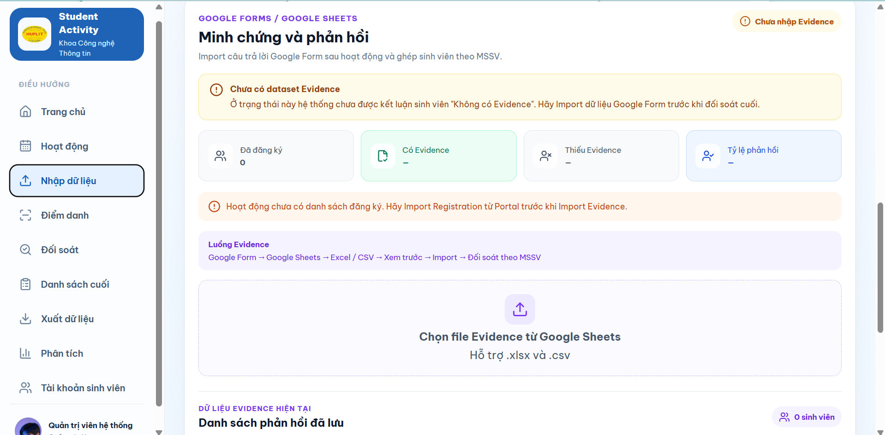

---
title: "Import Participation Evidence"
date: 2026-11-09
weight: 1
chapter: false
pre: "<b>5.7.1.</b>"
---

## Import Participation Evidence

In this section, we will import student participation evidence into the Student Activity Management & Engagement Analytics Platform.

Participation evidence may be collected through Google Forms or Google Sheets, depending on the requirements of each activity.

For example, after a seminar or technology event, students may be required to submit a confirmation form, provide participation information, or submit evidence links.

ADMIN users can use these records to verify participation alongside registration and attendance data.

#### 1. Prepare the environment

Complete section 5.6 - Registration and Attendance Management.

Prepare the following:

* A running FastAPI Backend.
* A running React/Vite Frontend.
* An ADMIN Demo account.
* An activity with existing registration records.
* Check-in and Check-out data.
* A CSV/XLSX evidence file.

For cloud storage verification, prepare the DynamoDB configuration described in section 5.4.

#### 2. Understand the evidence data source

Evidence collection and import workflow:

```text
Student
   |
   v
Google Forms
   |
   v
Google Sheets
   |
   | Export CSV / XLSX
   v
ADMIN Import Interface
   |
   v
FastAPI Evidence Processing
   |
   v
Evidence Records
```

The current implementation uses file-based imports.

Direct integration with the Google Forms API or Google Sheets API is not required.

#### 3. Prepare Google Forms data

A Google Forms evidence collection form may include:

* Student full name.
* Student ID.
* Student class.
* Activity name.
* Participation evidence information.
* Evidence link when required.

These are illustrative form fields. Actual data must follow the organizers' requirements and the application's Import Template.

Student ID is essential for matching evidence with Registration and Attendance records.

<!--

-->

#### 4. Export data from Google Sheets

1. Open the Google Forms used to collect evidence.
2. Select the Responses tab.
3. Open the associated Google Sheets document.
4. Review the collected responses.
5. In Google Sheets, select File → Download.
6. Select Microsoft Excel (.xlsx) or Comma-separated values (.csv).

<!--


-->

CSV export includes the current worksheet.

Ensure that the selected worksheet contains the intended activity responses.

{}
When Google Forms collects image uploads in Google Drive, exported CSV/XLSX files generally contain information or links associated with the uploaded files. Importing evidence records does not automatically copy the original images to Amazon S3.
{}

#### 5. Prepare a sample evidence file

Create:

```text
evidence-demo.csv
```

Example content:

```csv
mssv,evidence_url
0818000001,https://example.com/evidence-01
0818000002,https://example.com/evidence-02
0818000003,https://example.com/evidence-03
```

Where:

* mssv: Student ID.
* evidence_url: Illustrative evidence URL.

The example.com URLs are synthetic placeholders, not actual participation evidence images.

{}
Column names and file formats must match the current Backend's Import Template. If the application provides a downloadable template, use that template.
{}

When preparing Excel files, format Student ID columns as Text to preserve leading zeros.

<!--

-->

#### 6. Validate data before importing

Before importing, verify:

* Student IDs are not missing.
* Student IDs use supported formats.
* Required columns are present.
* Records belong to the correct activity.
* Duplicate records are identified.
* Evidence information satisfies the relevant requirements.

Example invalid dataset:

```csv
mssv,evidence_url
0818000001,https://example.com/evidence-01
0818000002,https://example.com/evidence-02
0818000001,https://example.com/evidence-03
,https://example.com/evidence-04
```

This dataset includes a duplicate Student ID and a missing Student ID.

The Backend should handle these cases according to its current Import rules and avoid inconsistent evidence records.

The presence of an evidence URL does not automatically prove that an image has been reviewed or approved.

#### 7. Perform Evidence Import

1. Open the Web Application.
2. Sign in using an ADMIN account.
3. Select the target activity.
4. Open Evidence Import.
5. Select evidence-demo.csv or the corresponding XLSX file.
6. Review the selected activity and file information.
7. Execute the Import operation.

<!--

-->

The Frontend submits the file to the FastAPI Backend.

The Backend reads the file, validates required data, and stores evidence records according to the current business rules.

If a preview is available, inspect the records before confirming the Import.

#### 8. Verify the Import results

After importing:

1. Open the activity's evidence list.
2. Inspect the number of records.
3. Verify individual student IDs.
4. Compare the records with the original file.
5. Inspect invalid or duplicate record information if available.

<!--

-->

Example:

| Student ID | Evidence |
| --- | --- |
| 0818000001 | Available |
| 0818000002 | Available |
| 0818000003 | Available |
| 0818000004 | Not available |

This table illustrates a testing scenario.

Having Evidence does not automatically mean that participation has been confirmed.

#### 9. Inspect the Evidence Import REST API

Press F12 to open Developer Tools.

* Select Network.
* Select Fetch/XHR.
* Import a sample evidence file.
* Inspect the corresponding request.
* Review the Request URL, HTTP Method, and Response.

Use Swagger UI to identify the actual Endpoint and Request Schema:

[http://127.0.0.1:8000/docs](http://127.0.0.1:8000/docs)

<!--

-->

Do not replace existing Endpoints when the current Import functionality already works.

#### 10. Verify Evidence in Amazon DynamoDB

If the Evidence AWS Pilot is enabled:

1. Open the Amazon DynamoDB Console.
2. Select Singapore - ap-southeast-1.
3. Select SAP-Evidence.
4. Choose Explore table items.
5. Select Query.
6. Enter the activity_id of the selected activity.
7. Inspect evidence records by Student ID.

<!--

-->

Verify the table Key Schema according to section 5.4:

| Key | Type |
| --- | --- |
| activity_id | String |
| mssv | String |

Compare DynamoDB records with the Backend Import results.

In the Demo environment, records may still be processed through local storage when the AWS Pilot is disabled.

#### 11. Summarize test cases

| Test | Expected Result |
| --- | --- |
| Valid CSV/XLSX | Evidence data accepted |
| Missing Student ID | Record reported or handled |
| Duplicate Student ID | No inconsistent evidence records |
| Incorrect Activity ID | No data written to an unrelated activity |
| STUDENT Import | Access denied when unauthorized |
| Evidence List | Import results displayed |
| DynamoDB | Corresponding items when AWS Pilot is enabled |

{}
Use synthetic or authorized data only. Do not expose personal information, student photographs, private Google Drive links, or Access Tokens in the internship report.
{}

#### Results

After completing this section, we have prepared and imported evidence records from Google Forms/Google Sheets.

Evidence data will be combined with Registration and Attendance to reconcile student participation results.

[Next: Reconcile Student Participation Data](../5.7.2-reconciliation/)
