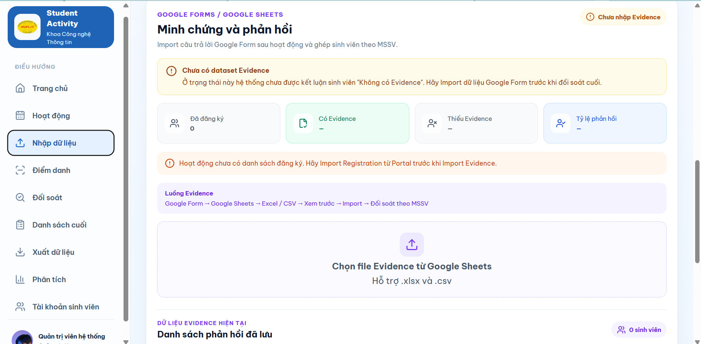

---
title: "Nhập minh chứng tham gia"
date: 2026-11-09
weight: 1
chapter: false
pre: "<b>5.7.1.</b>"
---

## Nhập minh chứng tham gia

Trong phần này, chúng ta sẽ thực hành nhập dữ liệu minh chứng tham gia hoạt động của sinh viên vào hệ thống Student Activity Management & Engagement Analytics Platform.

Minh chứng tham gia có thể được thu thập thông qua Google Forms hoặc Google Sheets, tùy theo yêu cầu của từng hoạt động.

Ví dụ, sau một hội thảo hoặc ngày hội công nghệ, sinh viên có thể được yêu cầu điền biểu mẫu xác nhận tham gia, gửi thông tin minh chứng hoặc nộp đường dẫn hình ảnh.

ADMIN sẽ sử dụng dữ liệu từ các biểu mẫu này để đối chiếu với danh sách đăng ký và điểm danh.

#### 1. Chuẩn bị môi trường

Đảm bảo đã hoàn thành phần 5.6 - Quản lý đăng ký và điểm danh.

Các thành phần cần chuẩn bị:

* FastAPI Backend đang hoạt động.
* React/Vite Frontend đang hoạt động.
* Tài khoản ADMIN Demo.
* Một hoạt động đã có danh sách đăng ký.
* Dữ liệu Check-in và Check-out.
* File minh chứng CSV/XLSX.

Nếu muốn kiểm tra dữ liệu trên AWS, cần chuẩn bị cấu hình DynamoDB theo phần 5.4.

#### 2. Tìm hiểu nguồn dữ liệu minh chứng

Quy trình thu thập và nhập minh chứng:

```text
Student
   |
   v
Google Forms
   |
   v
Google Sheets
   |
   | Export CSV / XLSX
   v
ADMIN Import Interface
   |
   v
FastAPI Evidence Processing
   |
   v
Evidence Records
```

Trong phiên bản hiện tại, hệ thống sử dụng phương thức Import file.

Không yêu cầu kết nối trực tiếp với Google Forms API hoặc Google Sheets API.

#### 3. Chuẩn bị dữ liệu Google Forms

Nếu sử dụng Google Forms để thu thập minh chứng, biểu mẫu có thể bao gồm:

* Họ và tên sinh viên.
* Mã số sinh viên.
* Lớp.
* Tên hoạt động.
* Thông tin minh chứng tham gia.
* Đường dẫn minh chứng nếu hoạt động yêu cầu.

Các trường trên là ví dụ thiết kế biểu mẫu. Dữ liệu thực tế cần tuân theo quy định của Ban Tổ chức và Import Template của hệ thống.

MSSV là thông tin quan trọng để liên kết minh chứng với dữ liệu Registration và Attendance.

<!--

-->

#### 4. Xuất dữ liệu từ Google Sheets

1. Mở Google Forms được sử dụng để thu thập minh chứng.
2. Chọn tab Responses - Câu trả lời.
3. Mở Google Sheets liên kết với biểu mẫu.
4. Kiểm tra dữ liệu phản hồi đã thu thập.
5. Trong Google Sheets, chọn File → Download.
6. Chọn Microsoft Excel (.xlsx) hoặc Comma-separated values (.csv).

<!--


-->

Khi xuất CSV, Google Sheets chỉ xuất trang tính hiện tại.

Đảm bảo chọn đúng trang chứa dữ liệu phản hồi của hoạt động.

{}
Nếu biểu mẫu cho phép sinh viên tải hình ảnh lên Google Drive, file CSV/XLSX thường chỉ chứa thông tin hoặc đường dẫn liên quan đến file đã tải lên. Import danh sách minh chứng không đồng nghĩa với việc toàn bộ hình ảnh đã được sao chép vào Amazon S3.
{}

#### 5. Chuẩn bị file minh chứng mẫu

Tạo file:

```text
evidence-demo.csv
```

Ví dụ nội dung:

```csv
mssv,evidence_url
0818000001,https://example.com/evidence-01
0818000002,https://example.com/evidence-02
0818000003,https://example.com/evidence-03
```

Trong đó:

* mssv: Mã số sinh viên.
* evidence_url: Đường dẫn minh chứng minh họa.

Các đường dẫn example.com chỉ là dữ liệu giả lập, không phải hình ảnh minh chứng thực tế.

{}
Tên cột và định dạng file phải được điều chỉnh theo Import Template mà Backend hiện tại hỗ trợ. Nếu hệ thống có chức năng tải file mẫu, hãy sử dụng file mẫu đó.
{}

Khi làm việc với Excel, cần giữ MSSV dưới dạng Text để tránh mất các chữ số 0 ở đầu.

<!--

-->

#### 6. Kiểm tra dữ liệu trước khi Import

Trước khi nhập dữ liệu, cần kiểm tra:

* MSSV không bị bỏ trống.
* MSSV có định dạng phù hợp.
* Các cột bắt buộc có đầy đủ.
* Dữ liệu thuộc đúng hoạt động.
* Các bản ghi trùng lặp được xác định.
* Thông tin minh chứng phù hợp với yêu cầu.

Ví dụ một file có dữ liệu chưa hợp lệ:

```csv
mssv,evidence_url
0818000001,https://example.com/evidence-01
0818000002,https://example.com/evidence-02
0818000001,https://example.com/evidence-03
,https://example.com/evidence-04
```

File trên có một MSSV xuất hiện nhiều lần và một bản ghi thiếu MSSV.

Backend cần xử lý các trường hợp này theo quy tắc Import hiện tại, tránh tạo dữ liệu minh chứng không nhất quán.

Không tự động xem một đường dẫn tồn tại trong file là bằng chứng hình ảnh đã được kiểm duyệt.

#### 7. Thực hiện Evidence Import

1. Mở Web Application.
2. Đăng nhập bằng tài khoản ADMIN.
3. Chọn hoạt động cần nhập minh chứng.
4. Mở chức năng Evidence Import.
5. Chọn file evidence-demo.csv hoặc file XLSX tương ứng.
6. Kiểm tra thông tin hoạt động và file đã chọn.
7. Thực hiện Import.

<!--

-->

Frontend gửi file dữ liệu đến FastAPI Backend.

Backend thực hiện đọc file, kiểm tra các trường cần thiết và lưu dữ liệu minh chứng theo quy tắc nghiệp vụ.

Nếu giao diện hỗ trợ xem trước dữ liệu, kiểm tra các bản ghi trước khi xác nhận Import.

#### 8. Kiểm tra kết quả Import

Sau khi hoàn thành thao tác:

1. Mở danh sách minh chứng của hoạt động.
2. Kiểm tra số lượng bản ghi.
3. Kiểm tra MSSV của từng sinh viên.
4. Đối chiếu dữ liệu với file ban đầu.
5. Kiểm tra thông tin lỗi hoặc bản ghi trùng lặp nếu có.

<!--

-->

Ví dụ dữ liệu:

| MSSV | Evidence |
| --- | --- |
| 0818000001 | Có dữ liệu |
| 0818000002 | Có dữ liệu |
| 0818000003 | Có dữ liệu |
| 0818000004 | Chưa có dữ liệu |

Bảng trên chỉ minh họa tình huống kiểm thử.

Có Evidence không đồng nghĩa với sinh viên đã được xác nhận tham gia.

#### 9. Kiểm tra REST API của Evidence Import

Mở Developer Tools bằng phím F12.

* Chọn tab Network.
* Chọn Fetch/XHR.
* Thực hiện Import file minh chứng.
* Chọn Request tương ứng.
* Kiểm tra Request URL, HTTP Method và Response.

Có thể sử dụng Swagger UI để xác định Endpoint và Request Schema:

[http://127.0.0.1:8000/docs](http://127.0.0.1:8000/docs)

<!--

-->

Không thay đổi Endpoint hoặc tạo API mới khi chức năng Import hiện tại đã hoạt động.

#### 10. Xác minh Evidence trên Amazon DynamoDB

Nếu AWS Pilot dành cho Evidence được bật:

1. Mở Amazon DynamoDB Console.
2. Chọn Region Singapore - ap-southeast-1.
3. Chọn bảng SAP-Evidence.
4. Chọn Explore table items.
5. Chọn Query.
6. Nhập activity_id của hoạt động.
7. Kiểm tra các bản ghi minh chứng theo MSSV.

<!--

-->

Cấu trúc khóa của bảng cần được xác minh theo phần 5.4:

| Key | Type |
| --- | --- |
| activity_id | String |
| mssv | String |

Đối chiếu dữ liệu trên DynamoDB với kết quả Import của Backend.

Trong môi trường Demo, dữ liệu có thể vẫn được xử lý thông qua cơ chế local nếu AWS Pilot chưa được bật.

#### 11. Tổng hợp kết quả kiểm thử

| Nội dung | Kết quả mong đợi |
| --- | --- |
| CSV/XLSX hợp lệ | Dữ liệu được tiếp nhận |
| Thiếu MSSV | Bản ghi được báo lỗi hoặc xử lý theo quy tắc |
| MSSV trùng lặp | Không tạo dữ liệu minh chứng không nhất quán |
| Sai Activity ID | Không ghi dữ liệu vào hoạt động khác |
| STUDENT Import | Bị từ chối nếu không đủ quyền |
| Evidence List | Hiển thị kết quả Import |
| DynamoDB | Có item tương ứng khi AWS Pilot được bật |

{}
Chỉ sử dụng dữ liệu giả lập hoặc dữ liệu được phép xử lý. Không công khai thông tin cá nhân, ảnh sinh viên, đường dẫn Google Drive riêng tư hoặc Access Token trong báo cáo thực tập.
{}

#### Kết quả

Sau khi hoàn thành phần này, chúng ta đã chuẩn bị và nhập dữ liệu minh chứng từ Google Forms/Google Sheets.

Dữ liệu Evidence sẽ được kết hợp với Registration và Attendance để thực hiện đối soát kết quả tham gia.

[Tiếp theo: Đối soát dữ liệu sinh viên](../5.7.2-reconciliation/)
