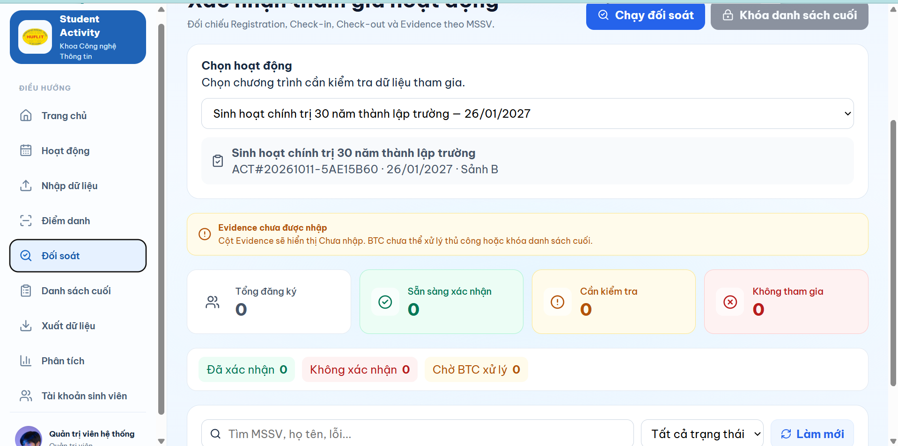

---
title: "Reconcile Student Participation Data"
date: 2026-11-09
weight: 2
chapter: false
pre: "<b>5.7.2.</b>"
---

## Reconcile Student Participation Data

In this section, we will reconcile Registration, Attendance, and Evidence records in the Student Activity Management & Engagement Analytics Platform.

Data Reconciliation is the process of comparing information from multiple sources to verify consistency, identify missing data, and support student participation decisions.

This functionality reduces manual verification workloads after university activities.

#### 1. Understand the reconciliation problem

Assume four students register for an activity.

Registration records imported from the University Portal:

| Student ID | Full Name |
| --- | --- |
| 0818000001 | Student A |
| 0818000002 | Student B |
| 0818000003 | Student C |
| 0818000004 | Student D |

Real-time attendance records:

| Student ID | Check-in | Check-out |
| --- | --- | --- |
| 0818000001 | 08:05 | 11:30 |
| 0818000002 | 08:10 | Not recorded |
| 0818000004 | 08:15 | 11:35 |

Evidence records imported from Google Forms:

| Student ID | Evidence |
| --- | --- |
| 0818000001 | Available |
| 0818000002 | Available |
| 0818000003 | Available |

Reviewing each file independently makes it difficult to identify complete participation records efficiently.

Reconciliation combines information from all three sources.

These records are synthetic workshop data.

#### 2. Identify data matching keys

The system uses two important identifiers:

* activity_id: Identifies the activity.
* mssv: Identifies the student.

A student can participate in multiple activities.

Matching records using only Student ID across the entire system may incorrectly associate data from different activities.

Example:

```text
Activity ID: ACT-DEMO-001
Student ID: 0818000001
```

Registration, Attendance, and Evidence records must be matched within the correct Activity ID.

#### 3. Understand the reconciliation workflow

```text
Registration
     |
     v
Normalize Student ID
     |
     +----------------+
                      |
Attendance ----------> Match by Activity ID + MSSV
                      |
Evidence ------------>|
                      v
              Reconciliation Result
                      |
                      v
                 ADMIN Review
```

The Backend performs the following operations:

1. Retrieve registration records.
2. Retrieve Check-in and Check-out information.
3. Retrieve evidence records.
4. Standardize and match student IDs.
5. Identify available and missing information.
6. Consolidate results for administrative review.

The project's current reconciliation workflow is implemented using Python/FastAPI.

AWS Glue and Amazon Athena are not required for this functionality.

#### 4. Prepare reconciliation data

Before proceeding:

* Complete Registration Import in section 5.6.1.
* Complete Check-in and Check-out in section 5.6.3.
* Complete Evidence Import in section 5.7.1.
* Use the same Demo activity for all three data sources.

Verify Activity ID and Student ID before continuing.

<!--

-->

#### 5. Open the reconciliation interface

1. Open the Web Application.
2. Sign in using an ADMIN account.
3. Navigate to Activity Management.
4. Select the Demo activity.
5. Open Reconciliation.

<!--

-->

Review the activity and its source datasets.

If a dataset is missing, determine whether this represents a valid business scenario or an input problem.

#### 6. Perform reconciliation

Execute the reconciliation or data consolidation operation provided by the current interface.

The Frontend sends the request to the Backend.

The Backend retrieves relevant datasets and processes results according to the current business rules.

<!--

-->

Example results:

| Student ID | Registration | Check-in | Check-out | Evidence |
| --- | --- | --- | --- | --- |
| 0818000001 | Yes | Yes | Yes | Yes |
| 0818000002 | Yes | Yes | No | Yes |
| 0818000003 | Yes | No | No | Yes |
| 0818000004 | Yes | Yes | Yes | No |

This consolidated view helps ADMIN users identify records requiring additional review.

#### 7. Analyze business scenarios

##### Scenario 1: Complete records

Student 0818000001 has Registration, Check-in, Check-out, and Evidence records.

Result:

* All input data is available in this example.
* The record may be eligible for confirmation if the activity requirements are satisfied.

##### Scenario 2: Missing Check-out

Student 0818000002 has Check-in and Evidence but no Check-out.

Result:

* Attendance data is incomplete.
* ADMIN should review the record according to activity rules.

##### Scenario 3: Evidence without attendance

Student 0818000003 has Registration and Evidence but no Attendance records.

Result:

* Evidence alone does not establish that the student attended the activity.
* The record requires evaluation according to missing-attendance rules.

During an earlier AWS Pilot test, some project records contained NO_ATTENDANCE even though evidence_status was YES.

##### Scenario 4: Missing evidence

Student 0818000004 has Registration and complete attendance but no Evidence.

Result:

* Attendance information is complete.
* ADMIN should determine whether evidence is required for the activity.

{}
These scenarios illustrate reconciliation logic. Exact status values and eligibility rules must follow the current Reconciliation Service implementation. Do not introduce new Backend statuses based only on these examples.
{}

#### 8. Illustrate reconciliation using Python

The following example demonstrates key-based data matching.

```python
registrations = [
    {"activity_id": "ACT-DEMO-001", "mssv": "0818000001"},
    {"activity_id": "ACT-DEMO-001", "mssv": "0818000002"},
    {"activity_id": "ACT-DEMO-001", "mssv": "0818000003"},
    {"activity_id": "ACT-DEMO-001", "mssv": "0818000004"},
]

attendance = {
    ("ACT-DEMO-001", "0818000001"): {
        "check_in": "08:05",
        "check_out": "11:30"
    },
    ("ACT-DEMO-001", "0818000002"): {
        "check_in": "08:10",
        "check_out": None
    },
    ("ACT-DEMO-001", "0818000004"): {
        "check_in": "08:15",
        "check_out": "11:35"
    }
}

evidence = {
    ("ACT-DEMO-001", "0818000001"),
    ("ACT-DEMO-001", "0818000002"),
    ("ACT-DEMO-001", "0818000003")
}

results = []

for student in registrations:
    key = (
        student["activity_id"],
        student["mssv"]
    )

    record = attendance.get(key, {})

    result = {
        "activity_id": student["activity_id"],
        "mssv": student["mssv"],
        "registered": True,
        "checked_in": bool(record.get("check_in")),
        "checked_out": bool(record.get("check_out")),
        "has_evidence": key in evidence
    }

    results.append(result)

for result in results:
    print(result)
```

This example uses dictionaries and sets to retrieve records by Activity ID and Student ID.

It is a standalone learning example rather than the complete project's Reconciliation Service.

The algorithm uses Registration as its primary dataset. If the business requirements include identifying students with Attendance or Evidence but no Registration, additional checks must inspect keys that appear only in the other datasets.

#### 9. Inspect reconciliation results

After reconciliation:

* Review the student list.
* Verify Registration status.
* Verify Check-in and Check-out.
* Inspect Evidence availability.
* Review the displayed business evaluation results.
* Identify records requiring administrative review.

<!--

-->

Use status filters or Student ID search if supported by the current interface.

Appearing in a reconciliation result does not automatically establish final participation confirmation.

#### 10. Inspect the REST API

Open Developer Tools and select Network.

Perform the reconciliation operation again.

Inspect:

* The Endpoint called by the Frontend.
* Activity ID in the Request.
* HTTP Status Code.
* Consolidated Response data.
* Student-level status information.

Use Swagger UI to identify the actual Reconciliation or Participation Endpoint.

<!--

-->

#### 11. Handle inconsistent data

| Scenario | Recommended Action |
| --- | --- |
| Missing leading zeros | Verify String/Text formatting |
| Incorrect Activity ID | Verify the selected activity |
| Duplicate Registration | Review Import rules |
| Missing Evidence | Inspect Evidence Import results |
| Missing Attendance | Review Check-in/Check-out records |
| Inconsistent source data | Compare individual records |
| Outdated results | Review API responses and rerun supported reconciliation |

Do not arbitrarily modify attendance or evidence records to make participation appear valid.

Changes must be based on accurate information and authorized operations.

#### 12. Summarize test cases

| Test Case | Expected Result |
| --- | --- |
| Complete source records | Complete reconciliation information |
| Missing Check-out | Incomplete attendance detected |
| No Attendance | Missing attendance detected |
| Missing Evidence | Missing evidence identified |
| Incorrect Activity ID | No cross-activity mismatching |
| STUDENT calls admin API | Access denied when unauthorized |
| Reconciliation rerun | Results reflect updated data according to current rules |

#### Conclusion

In this section, we combined Registration, Attendance, and Evidence to generate student-level reconciliation results.

This workflow transforms separate datasets into meaningful information for activity management.

ADMIN users will review the reconciliation results before performing final participation confirmation.

[Next: Confirm Participation Results](../5.7.3-confirm-participation/)
