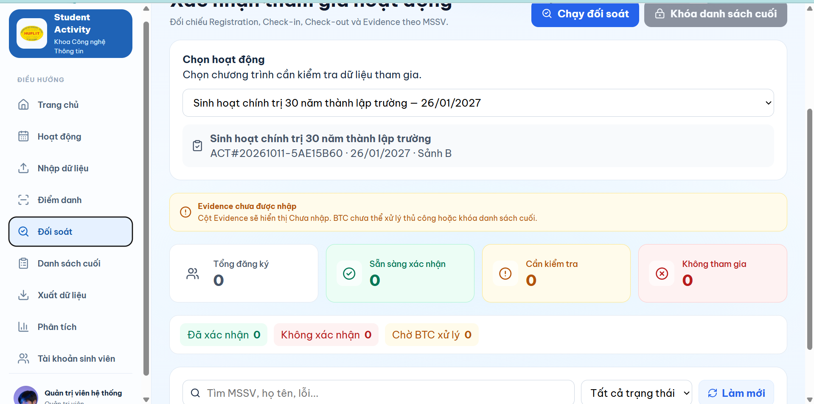

---
title: "Đối soát dữ liệu sinh viên"
date: 2026-11-09
weight: 2
chapter: false
pre: "<b>5.7.2.</b>"
---

## Đối soát dữ liệu sinh viên

Trong phần này, chúng ta sẽ thực hiện đối soát dữ liệu Registration, Attendance và Evidence của hệ thống Student Activity Management & Engagement Analytics Platform.

Đối soát dữ liệu (Data Reconciliation) là quá trình so sánh thông tin từ nhiều nguồn để kiểm tra tính nhất quán, phát hiện dữ liệu thiếu và hỗ trợ xác định kết quả tham gia của sinh viên.

Đây là một chức năng quan trọng giúp Ban Tổ chức giảm thời gian kiểm tra thủ công sau khi hoạt động kết thúc.

#### 1. Tìm hiểu bài toán đối soát

Giả sử một hoạt động có bốn sinh viên đăng ký.

Dữ liệu đăng ký được nhập từ University Portal:

| MSSV | Họ tên |
| --- | --- |
| 0818000001 | Student A |
| 0818000002 | Student B |
| 0818000003 | Student C |
| 0818000004 | Student D |

Dữ liệu điểm danh được ghi nhận theo thời gian thực:

| MSSV | Check-in | Check-out |
| --- | --- | --- |
| 0818000001 | 08:05 | 11:30 |
| 0818000002 | 08:10 | Chưa ghi nhận |
| 0818000004 | 08:15 | 11:35 |

Dữ liệu minh chứng được nhập từ Google Forms:

| MSSV | Evidence |
| --- | --- |
| 0818000001 | Có |
| 0818000002 | Có |
| 0818000003 | Có |

Nếu kiểm tra từng file riêng biệt, ADMIN khó xác định nhanh sinh viên nào có đầy đủ dữ liệu.

Quá trình đối soát sẽ kết hợp ba nguồn thông tin thành một bảng tổng hợp.

Các dữ liệu trên là giả lập phục vụ Workshop.

#### 2. Xác định khóa liên kết dữ liệu

Hệ thống sử dụng hai thông tin quan trọng:

* activity_id: Xác định hoạt động.
* mssv: Xác định sinh viên.

Một sinh viên có thể tham gia nhiều hoạt động khác nhau.

Do đó, chỉ sử dụng MSSV để đối soát trên toàn bộ hệ thống có thể dẫn đến việc ghép nhầm dữ liệu giữa các hoạt động.

Ví dụ:

```text
Activity ID: ACT-DEMO-001
MSSV: 0818000001
```

Dữ liệu Registration, Attendance và Evidence của cùng một sinh viên cần được kiểm tra trong đúng phạm vi Activity ID.

#### 3. Tìm hiểu luồng xử lý đối soát

```text
Registration
     |
     v
Normalize Student ID
     |
     +----------------+
                      |
Attendance ----------> Match by Activity ID + MSSV
                      |
Evidence ------------>|
                      v
              Reconciliation Result
                      |
                      v
                 ADMIN Review
```

Backend thực hiện các bước:

1. Truy xuất dữ liệu đăng ký của hoạt động.
2. Truy xuất dữ liệu Check-in và Check-out.
3. Truy xuất dữ liệu minh chứng.
4. Chuẩn hóa và đối chiếu MSSV.
5. Xác định những thông tin đã có và còn thiếu.
6. Tổng hợp kết quả phục vụ ADMIN xem xét.

Trong đồ án, quy trình này được xử lý bằng Python/FastAPI.

Không yêu cầu AWS Glue hoặc Amazon Athena để thực hiện chức năng đối soát hiện tại.

#### 4. Chuẩn bị dữ liệu đối soát

Trước khi thực hiện:

* Hoàn thành Registration Import tại phần 5.6.1.
* Hoàn thành Check-in/Check-out tại phần 5.6.3.
* Hoàn thành Evidence Import tại phần 5.7.1.
* Sử dụng cùng một hoạt động Demo cho cả ba nguồn dữ liệu.

Kiểm tra Activity ID và MSSV trước khi tiếp tục.

<!--

-->

#### 5. Mở chức năng đối soát

1. Mở Web Application.
2. Đăng nhập bằng tài khoản ADMIN.
3. Truy cập chức năng quản lý hoạt động.
4. Chọn hoạt động Demo.
5. Mở chức năng Reconciliation hoặc đối soát dữ liệu.

<!--

-->

Kiểm tra tên hoạt động và dữ liệu nguồn.

Nếu một nhóm dữ liệu chưa được nhập hoặc chưa có bản ghi, cần xác định đó là tình trạng nghiệp vụ thực tế hay lỗi dữ liệu.

#### 6. Thực hiện đối soát

Tại giao diện đối soát, thực hiện thao tác tổng hợp hoặc đối soát theo chức năng hiện tại của hệ thống.

Frontend gửi yêu cầu đến Backend.

Backend truy xuất các nhóm dữ liệu liên quan và xử lý kết quả theo quy tắc nghiệp vụ.

<!--

-->

Ví dụ kết quả đối soát từ bộ dữ liệu minh họa:

| MSSV | Registration | Check-in | Check-out | Evidence |
| --- | --- | --- | --- | --- |
| 0818000001 | Có | Có | Có | Có |
| 0818000002 | Có | Có | Không | Có |
| 0818000003 | Có | Không | Không | Có |
| 0818000004 | Có | Có | Có | Không |

Bảng này giúp ADMIN nhận biết nhanh các trường hợp cần kiểm tra.

#### 7. Phân tích các trường hợp nghiệp vụ

##### Trường hợp 1: Đầy đủ dữ liệu

Sinh viên 0818000001 có đăng ký, Check-in, Check-out và minh chứng.

Kết quả:

* Có đầy đủ dữ liệu đầu vào trong ví dụ.
* Có thể được xem xét xác nhận nếu đáp ứng quy định hoạt động.

##### Trường hợp 2: Thiếu Check-out

Sinh viên 0818000002 đã Check-in và nộp minh chứng nhưng chưa Check-out.

Kết quả:

* Dữ liệu điểm danh chưa đầy đủ.
* ADMIN cần kiểm tra theo quy tắc của hoạt động.

##### Trường hợp 3: Có minh chứng nhưng không điểm danh

Sinh viên 0818000003 có đăng ký và minh chứng nhưng không có Attendance.

Kết quả:

* Không thể chỉ dựa vào minh chứng để khẳng định sinh viên đã tham gia.
* Cần xử lý theo quy tắc nghiệp vụ liên quan đến thiếu điểm danh.

Trong bài kiểm thử AWS Pilot trước đây của đồ án, một số bản ghi đã thể hiện trường hợp NO_ATTENDANCE dù evidence_status có giá trị YES.

##### Trường hợp 4: Thiếu minh chứng

Sinh viên 0818000004 có đăng ký và đầy đủ Check-in/Check-out nhưng không có Evidence.

Kết quả:

* Dữ liệu điểm danh đầy đủ.
* Cần kiểm tra hoạt động có yêu cầu minh chứng hay không.

{}
Các trường hợp trên minh họa logic đối soát. Tên trạng thái chính xác và điều kiện đủ tiêu chuẩn phải lấy theo source code Reconciliation Service hiện tại. Không tự động áp đặt một bộ trạng thái mới vào Backend.
{}

#### 8. Minh họa thuật toán đối soát bằng Python

Đoạn code dưới đây giúp người học hiểu nguyên lý kết hợp dữ liệu theo khóa.

```python
registrations = [
    {"activity_id": "ACT-DEMO-001", "mssv": "0818000001"},
    {"activity_id": "ACT-DEMO-001", "mssv": "0818000002"},
    {"activity_id": "ACT-DEMO-001", "mssv": "0818000003"},
    {"activity_id": "ACT-DEMO-001", "mssv": "0818000004"},
]

attendance = {
    ("ACT-DEMO-001", "0818000001"): {
        "check_in": "08:05",
        "check_out": "11:30"
    },
    ("ACT-DEMO-001", "0818000002"): {
        "check_in": "08:10",
        "check_out": None
    },
    ("ACT-DEMO-001", "0818000004"): {
        "check_in": "08:15",
        "check_out": "11:35"
    }
}

evidence = {
    ("ACT-DEMO-001", "0818000001"),
    ("ACT-DEMO-001", "0818000002"),
    ("ACT-DEMO-001", "0818000003")
}

results = []

for student in registrations:
    key = (
        student["activity_id"],
        student["mssv"]
    )

    record = attendance.get(key, {})

    result = {
        "activity_id": student["activity_id"],
        "mssv": student["mssv"],
        "registered": True,
        "checked_in": bool(record.get("check_in")),
        "checked_out": bool(record.get("check_out")),
        "has_evidence": key in evidence
    }

    results.append(result)

for result in results:
    print(result)
```

Đoạn code minh họa việc sử dụng Dictionary và Set để truy xuất dữ liệu theo Activity ID và MSSV.

Đây là ví dụ học tập độc lập, không phải toàn bộ mã nguồn Reconciliation Service của đồ án.

Thuật toán trên lấy danh sách Registration làm tập dữ liệu chính. Nếu nghiệp vụ cần phát hiện sinh viên có Attendance hoặc Evidence nhưng không có Registration, cần bổ sung kiểm tra những khóa chỉ xuất hiện ở các nguồn dữ liệu còn lại.

#### 9. Kiểm tra kết quả trên giao diện

Sau khi hoàn thành đối soát:

* Kiểm tra danh sách sinh viên.
* Kiểm tra trạng thái Registration.
* Kiểm tra Check-in và Check-out.
* Kiểm tra Evidence.
* Kiểm tra kết quả đánh giá nghiệp vụ được hiển thị.
* Xác định những trường hợp cần ADMIN xem xét.

<!--

-->

Nếu giao diện hỗ trợ lọc theo trạng thái hoặc tìm kiếm MSSV, thực hiện các thao tác tương ứng.

Không thay đổi kết quả tham gia cuối cùng chỉ dựa trên việc một sinh viên xuất hiện trong danh sách đối soát.

#### 10. Kiểm tra REST API

Mở Developer Tools và chọn Network.

Thực hiện lại thao tác đối soát.

Kiểm tra:

* Endpoint được Frontend gọi.
* Activity ID trong Request.
* HTTP Status Code.
* Response chứa kết quả tổng hợp.
* Thông tin trạng thái của từng sinh viên.

Có thể sử dụng Swagger UI để xác định Endpoint thực tế của nhóm Reconciliation hoặc Participation.

<!--

-->

#### 11. Xử lý dữ liệu không nhất quán

Một số tình huống cần kiểm tra:

| Tình huống | Hướng xử lý |
| --- | --- |
| MSSV mất số 0 đầu | Kiểm tra định dạng String/Text |
| Sai Activity ID | Xác định lại hoạt động |
| Registration bị trùng | Kiểm tra quy tắc Import |
| Evidence chưa xuất hiện | Kiểm tra kết quả Evidence Import |
| Attendance bị thiếu | Kiểm tra dữ liệu Check-in/Check-out |
| Dữ liệu khác nhau giữa các nguồn | Đối chiếu từng bản ghi |
| Kết quả không cập nhật | Kiểm tra API và thực hiện đối soát lại theo chức năng hiện tại |

Không tự ý sửa bản ghi điểm danh hoặc minh chứng để làm cho kết quả trở nên hợp lệ.

Các thay đổi phải dựa trên dữ liệu chính xác và thao tác được cấp quyền.

#### 12. Tổng hợp kết quả kiểm thử

| Test Case | Kết quả mong đợi |
| --- | --- |
| Đầy đủ ba nguồn dữ liệu | Hiển thị đầy đủ thông tin đối soát |
| Thiếu Check-out | Nhận diện dữ liệu điểm danh chưa đầy đủ |
| Không có Attendance | Phát hiện thiếu điểm danh |
| Thiếu Evidence | Nhận diện dữ liệu minh chứng chưa có |
| Sai Activity ID | Không ghép nhầm giữa các hoạt động |
| STUDENT gọi API quản trị | Bị từ chối nếu không đủ quyền |
| Đối soát lại | Phản ánh dữ liệu mới theo quy tắc hiện tại |

#### Kết luận

Trong phần này, chúng ta đã kết hợp Registration, Attendance và Evidence để xây dựng kết quả đối soát cho từng sinh viên.

Quy trình này giúp chuyển đổi dữ liệu từ nhiều nguồn riêng lẻ thành thông tin có thể sử dụng cho nghiệp vụ quản lý hoạt động.

Kết quả đối soát sẽ được ADMIN kiểm tra trước khi thực hiện xác nhận tham gia.

[Tiếp theo: Xác nhận kết quả tham gia](../5.7.3-confirm-participation/)
