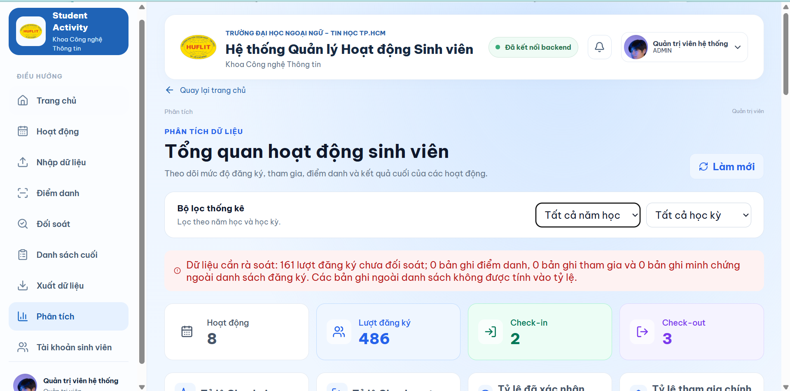
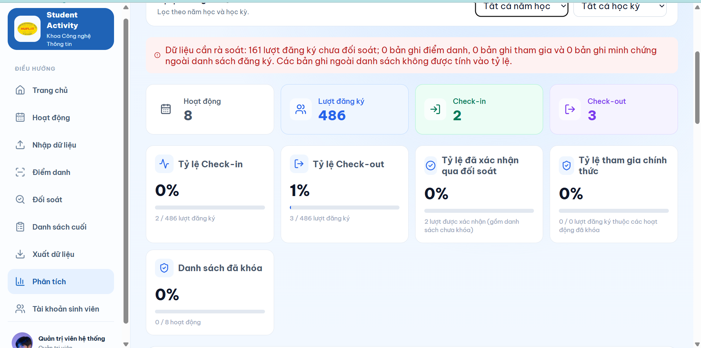
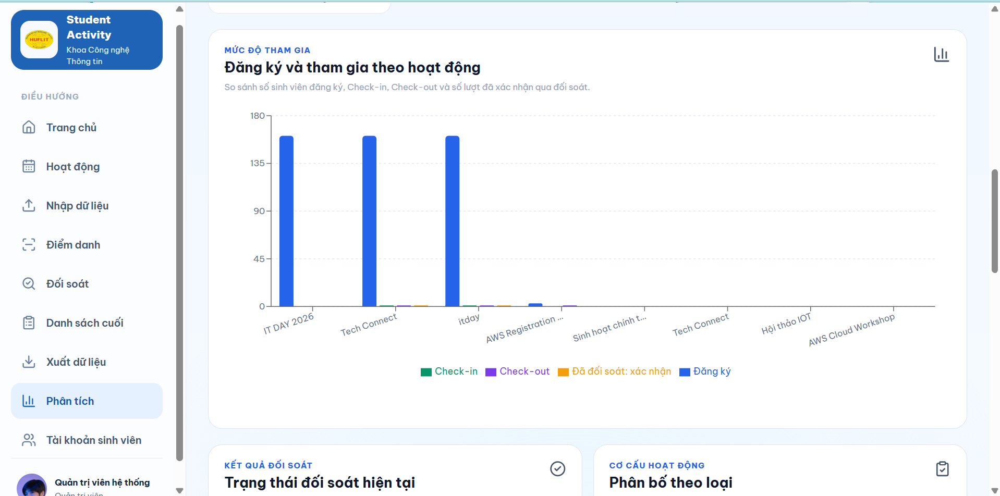

---
title: "Build the Analytics Dashboard"
date: 2026-11-09
weight: 2
chapter: false
pre: "<b>5.8.2.</b>"
---

## Build the Analytics Dashboard

In this section, we will explore analytics visualization using the React/Vite Frontend of the Student Activity Management & Engagement Analytics Platform.

The Analytics Dashboard helps ADMIN users monitor activities, registrations, attendance, and confirmed participation results.

Dashboard data is aggregated by the FastAPI Backend and delivered through REST APIs.

#### 1. Understand the Dashboard architecture

```text
ADMIN
   |
   v
React / Vite Dashboard
   |
   v
API Service
   |
   | REST API + Access Token
   v
FastAPI Analytics Processing
   |
   v
Business Data Storage
   |
   +-- Activities
   +-- Registrations
   +-- Attendance
   +-- Evidence
   +-- Participation
```

Processing workflow:

1. ADMIN opens the Analytics Dashboard.
2. The Frontend requests analytical data.
3. The Backend validates authentication and authorization.
4. The Backend retrieves records within the requested scope.
5. The Backend aggregates and returns results.
6. The Frontend displays indicators, charts, or statistical tables.

The Frontend does not connect directly to DynamoDB using AWS credentials.

#### 2. Start the Backend and Frontend

Backend Terminal:

```powershell
cd C:\Projects\student-activity-platform\backend

.\.venv\Scripts\Activate.ps1

$env:SAP_DEMO_MODE="1"

python -m uvicorn app.main:app --reload
```

Frontend Terminal:

```powershell
cd C:\Projects\student-activity-platform\frontend

npm run dev
```

Open:

[http://localhost:5173](http://localhost:5173)

Do not start additional instances if both services are already running.

<!--

-->

#### 3. Open the Analytics Dashboard

1. Sign in using an ADMIN Demo account.
2. Open the Home page or administration menu.
3. Navigate to Analytics or Dashboard.
4. Inspect the available statistical components.

<!--

-->

Dashboard components may include:

* Summary Cards.
* Activity Statistics.
* Attendance Overview.
* Participation Results.
* Detailed Data Tables.

Inspect the current interface to identify which components are implemented.

#### 4. Display summary indicators

Summary Cards help users quickly understand important metrics.

Using the sample dataset from section 5.8.1:

```text
Total Registrations: 4
Total Check-in: 3
Complete Attendance: 2
Confirmed Participants: 1
```

Indicators should be retrieved from the Backend or calculated from API data using consistent business definitions.

Avoid hardcoded statistics in the actual Dashboard.

Illustrative React Component:

```jsx
function MetricCard({ title, value }) {
  return (
    <div className="metric-card">
      <h3>{title}</h3>
      <strong>{value}</strong>
    </div>
  );
}

export default MetricCard;
```

The Component receives data through props and can be reused for different metrics.

Example:

```jsx
function AnalyticsSummary({ metrics }) {
  return (
    <div className="analytics-summary">
      <MetricCard
        title="Total Registrations"
        value={metrics.total_registrations}
      />

      <MetricCard
        title="Total Check-in"
        value={metrics.total_check_in}
      />

      <MetricCard
        title="Confirmed Participants"
        value={metrics.confirmed_participants}
      />
    </div>
  );
}
```

These examples illustrate Component organization. Metric field names must match the actual Backend response.

Preserve existing Dashboard Components when the application already works.

<!--

-->

#### 5. Connect the Dashboard to REST APIs

Open:

```text
frontend/src/services/api.js
```

Locate the functions responsible for Analytics or activity statistics requests.

Verify:

* API_BASE_URL points to the correct Backend.
* Requests include the appropriate Activity ID or supported parameters.
* Access Tokens are provided for protected APIs.
* Responses are processed and passed to Dashboard Components.
* Connection errors are handled appropriately.

Local Backend address:

```text
http://127.0.0.1:8000
```

When the Frontend is deployed on AWS Amplify, the Backend address is configured using the HTTPS Endpoint provided by Cloudflare Quick Tunnel.

Deployment will be covered in section 5.9.

#### 6. Inspect Analytics API requests

Press F12 to open Developer Tools.

1. Select Network.
2. Select Fetch/XHR.
3. Open the Analytics Dashboard.
4. Identify the statistics request.
5. Inspect its Request URL and HTTP Status Code.
6. Review the Response Body.

<!--

-->

Compare API response values with the displayed indicators.

If the Dashboard shows four registrations, verify that the API response contains the corresponding data within the same activity scope.

#### 7. Display activity statistics

Dashboard functionality may include activity-level statistics.

Illustrative data:

| Activity | Registrations | Check-in | Confirmed |
| --- | --- | --- | --- |
| AWS Workshop | 100 | 85 | 75 |
| TechConnect | 150 | 130 | 110 |
| IT Day Demo | 200 | 180 | 160 |

These are synthetic visualization examples, not actual event results.

Possible visualization methods include:

* Bar Charts for activity comparisons.
* Summary Tables for detailed records.
* Percentage Indicators for participation rates.

Use the visualization library or Components already available in the project.

If a corresponding chart is unavailable, treat it as a potential extension rather than an implemented feature.

<!--

-->

#### 8. Display Participation results

Participation results may be grouped into:

* CONFIRMED.
* REJECTED.
* Records awaiting a final decision.

Example:

```text
CONFIRMED: 1
REJECTED: 1
Awaiting decision: 2
```

Use tables, summary indicators, or distribution charts according to the current interface.

"Awaiting decision" is a descriptive grouping, not a newly defined Backend status.

<!--

-->

#### 9. Test data filtering

If filtering is available:

1. Open Analytics.
2. Select an activity.
3. Verify updated indicators.
4. Select another activity.
5. Inspect the new results.
6. Clear filters or return to the overview if supported.

Possible filters include:

* Activity.
* Scheduled time.
* Activity status.
* Participation result.

Only test filters supported by the current Frontend and Backend implementation.

<!--

-->

#### 10. Handle data-loading states

The Dashboard should handle:

* Loading: Waiting for API data.
* Success: Valid analytics data received.
* Empty: No records in the selected scope.
* Error: Request failure or invalid data.

Illustrative React Component:

```jsx
function DashboardContent({
  loading,
  error,
  metrics
}) {
  if (loading) {
    return <p>Loading analytics data...</p>;
  }

  if (error) {
    return <p>{error}</p>;
  }

  if (!metrics) {
    return <p>No analytics data available.</p>;
  }

  return (
    <AnalyticsSummary metrics={metrics} />
  );
}
```

This example demonstrates interface state handling rather than a complete Dashboard implementation.

Do not replace failed API results with zero-valued metrics and present them as valid statistics.

#### 11. Verify ADMIN and STUDENT permissions

ADMIN users can access administrative analytics within their authorized scope.

STUDENT users can view personal activity participation information through their individual interface.

Verify:

* ADMIN can access authorized administrative statistics.
* STUDENT cannot access other students' private data.
* The Backend enforces authorization for protected Analytics APIs.
* Displayed information remains within the user's authorized scope.

<!--


-->

#### 12. Summarize Dashboard tests

| Test Case | Expected Result |
| --- | --- |
| Dashboard Loading | Data retrieved from Backend |
| Summary Cards | Values match API responses |
| Activity Statistics | Correct activity scope |
| Participation Statistics | CONFIRMED and REJECTED distinguished |
| Activity Filter | Correct scope updated when supported |
| Empty Data | Appropriate empty state |
| API Error | Appropriate error notification |
| ADMIN Authorization | Administrative analytics accessible |
| STUDENT Authorization | Access restricted to authorized data |

#### Conclusion

In this section, we explored Analytics Dashboard development using React/Vite and FastAPI REST APIs.

The Dashboard transforms business data into visual information that helps organizers monitor activity results and student engagement.

In the next section, we will export business records as CSV/XLSX reports.

[Next: Export CSV/XLSX Reports](../5.8.3-export-reports/)
