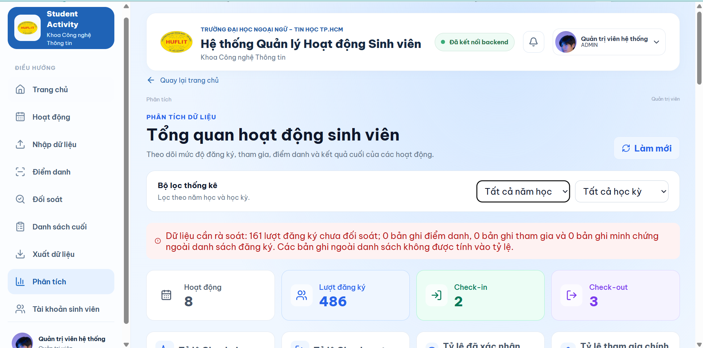
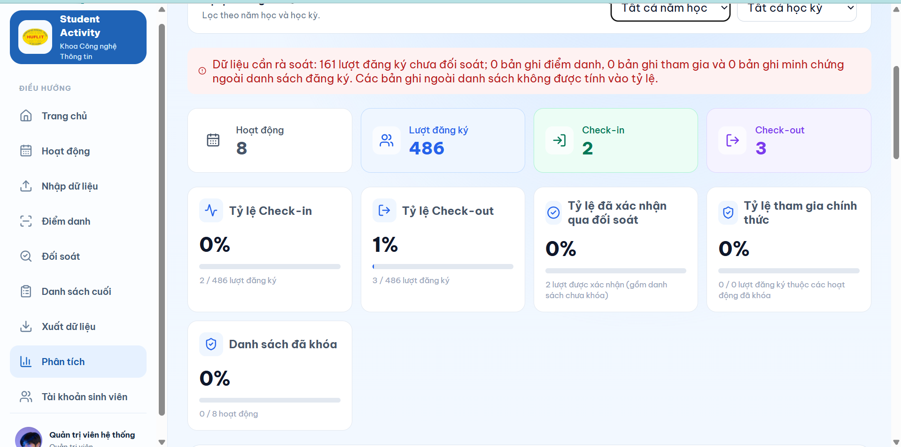
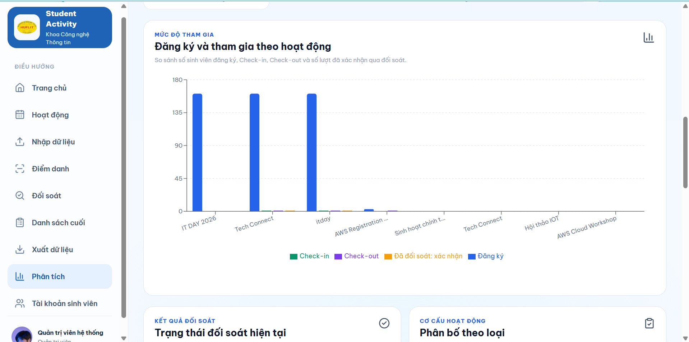

---
title: "Xây dựng Analytics Dashboard"
date: 2026-11-09
weight: 2
chapter: false
pre: "<b>5.8.2.</b>"
---

## Xây dựng Analytics Dashboard

Trong phần này, chúng ta sẽ tìm hiểu cách xây dựng và hiển thị dữ liệu phân tích trên giao diện React/Vite của Student Activity Management & Engagement Analytics Platform.

Analytics Dashboard giúp ADMIN theo dõi tình hình hoạt động, số lượng sinh viên đăng ký, dữ liệu điểm danh và kết quả xác nhận tham gia.

Dashboard sử dụng dữ liệu được tổng hợp bởi FastAPI Backend thông qua REST API.

#### 1. Tìm hiểu kiến trúc Dashboard

```text
ADMIN
   |
   v
React / Vite Dashboard
   |
   v
API Service
   |
   | REST API + Access Token
   v
FastAPI Analytics Processing
   |
   v
Business Data Storage
   |
   +-- Activities
   +-- Registrations
   +-- Attendance
   +-- Evidence
   +-- Participation
```

Luồng xử lý:

1. ADMIN truy cập Analytics Dashboard.
2. Frontend gửi yêu cầu lấy dữ liệu thống kê.
3. Backend kiểm tra Access Token và quyền truy cập.
4. Backend truy xuất dữ liệu theo phạm vi được yêu cầu.
5. Backend tổng hợp và trả về kết quả.
6. Frontend hiển thị các chỉ số, biểu đồ hoặc bảng thống kê.

Frontend không truy cập trực tiếp Amazon DynamoDB bằng AWS Credentials.

#### 2. Khởi chạy Backend và Frontend

Mở Terminal Backend:

```powershell
cd C:\Projects\student-activity-platform\backend

.\.venv\Scripts\Activate.ps1

$env:SAP_DEMO_MODE="1"

python -m uvicorn app.main:app --reload
```

Mở Terminal Frontend:

```powershell
cd C:\Projects\student-activity-platform\frontend

npm run dev
```

Truy cập:

[http://localhost:5173](http://localhost:5173)

Nếu Backend và Frontend đã hoạt động, không cần khởi chạy thêm phiên mới.

<!--

-->

#### 3. Mở Analytics Dashboard

1. Đăng nhập bằng tài khoản ADMIN Demo.
2. Truy cập Trang chủ hoặc menu quản trị.
3. Mở chức năng Analytics hoặc Dashboard.
4. Kiểm tra các khu vực thống kê được hiển thị.

<!--

-->

Các thành phần Dashboard có thể bao gồm:

* Summary Cards: Hiển thị các chỉ số tổng quan.
* Activity Statistics: Hiển thị số liệu của từng hoạt động.
* Attendance Overview: Hiển thị dữ liệu điểm danh.
* Participation Results: Hiển thị kết quả xác nhận tham gia.
* Data Table: Hiển thị dữ liệu chi tiết.

Cần đối chiếu với giao diện hiện tại để xác định các thành phần đã được triển khai.

#### 4. Hiển thị các chỉ số tổng quan

Summary Cards giúp người dùng nhanh chóng nắm bắt các thông tin quan trọng.

Ví dụ với dữ liệu Demo ở mục 5.8.1:

```text
Total Registrations: 4
Total Check-in: 3
Complete Attendance: 2
Confirmed Participants: 1
```

Các chỉ số được lấy từ Backend hoặc tính toán từ dữ liệu API theo định nghĩa nghiệp vụ thống nhất.

Không sử dụng số liệu cố định trong Dashboard thực tế.

Ví dụ minh họa Component React:

```jsx
function MetricCard({ title, value }) {
  return (
    <div className="metric-card">
      <h3>{title}</h3>
      <strong>{value}</strong>
    </div>
  );
}

export default MetricCard;
```

Component nhận dữ liệu thông qua props để có thể tái sử dụng cho nhiều chỉ số khác nhau.

Ví dụ sử dụng:

```jsx
function AnalyticsSummary({ metrics }) {
  return (
    <div className="analytics-summary">
      <MetricCard
        title="Total Registrations"
        value={metrics.total_registrations}
      />

      <MetricCard
        title="Total Check-in"
        value={metrics.total_check_in}
      />

      <MetricCard
        title="Confirmed Participants"
        value={metrics.confirmed_participants}
      />
    </div>
  );
}
```

Các đoạn code trên minh họa cách tổ chức Component. Tên thuộc tính metrics cần khớp với dữ liệu thực tế của Backend.

Không thay thế Dashboard Component hiện có nếu giao diện đã hoạt động.

<!--

-->

#### 5. Kết nối Dashboard với REST API

Mở file:

```text
frontend/src/services/api.js
```

Tìm các hàm gửi Request liên quan đến Analytics hoặc thống kê hoạt động.

Các bước cần kiểm tra:

* API_BASE_URL trỏ đến đúng Backend.
* Request gửi đúng Activity ID hoặc tham số được hỗ trợ.
* Access Token được cung cấp cho API được bảo vệ.
* Response được xử lý và chuyển đến Dashboard Component.
* Các lỗi kết nối được hiển thị phù hợp.

Địa chỉ Backend trong môi trường local:

```text
http://127.0.0.1:8000
```

Khi triển khai Frontend trên AWS Amplify, địa chỉ Backend sẽ được cấu hình theo HTTPS Endpoint của Cloudflare Quick Tunnel.

Nội dung Deployment được thực hiện chi tiết tại phần 5.9.

#### 6. Kiểm tra Analytics API Request

Mở Developer Tools bằng phím F12.

1. Chọn tab Network.
2. Chọn bộ lọc Fetch/XHR.
3. Truy cập Analytics Dashboard.
4. Xác định Request lấy dữ liệu thống kê.
5. Kiểm tra Request URL và HTTP Status Code.
6. Kiểm tra Response Body.

<!--

-->

Đối chiếu dữ liệu Response với các chỉ số hiển thị trên Dashboard.

Nếu Dashboard hiển thị Total Registrations bằng 4, cần xác định API Response có trả về dữ liệu tương ứng trong đúng phạm vi hoạt động hay không.

#### 7. Hiển thị thống kê theo hoạt động

Dashboard có thể hỗ trợ theo dõi các kết quả thống kê của từng hoạt động.

Ví dụ dữ liệu minh họa:

| Hoạt động | Đăng ký | Check-in | Xác nhận |
| --- | --- | --- | --- |
| AWS Workshop | 100 | 85 | 75 |
| TechConnect | 150 | 130 | 110 |
| IT Day Demo | 200 | 180 | 160 |

Các số liệu trên chỉ là dữ liệu giả lập để minh họa biểu đồ, không phải kết quả của các sự kiện thực tế.

Có thể sử dụng các cách hiển thị:

* Bar Chart: So sánh số lượng giữa các hoạt động.
* Summary Table: Hiển thị số liệu chi tiết.
* Percentage Indicator: Hiển thị tỷ lệ tham gia.

Sử dụng thư viện biểu đồ hoặc Component đã có trong project.

Nếu chưa có biểu đồ tương ứng, đây là hướng mở rộng Dashboard chứ không phải chức năng đã được xác nhận hoàn thành.

<!--

-->

#### 8. Hiển thị trạng thái Participation

Kết quả Participation có thể được biểu diễn theo các nhóm:

* CONFIRMED.
* REJECTED.
* Chưa có quyết định cuối cùng.

Ví dụ từ bộ dữ liệu ở mục 5.8.1:

```text
CONFIRMED: 1
REJECTED: 1
Awaiting decision: 2
```

Có thể hiển thị bằng bảng, thẻ thống kê hoặc biểu đồ phân bố tùy theo giao diện hiện tại.

Không sử dụng "Awaiting decision" như một trạng thái Backend mới nếu hệ thống chưa định nghĩa trạng thái đó.

<!--

-->

#### 9. Kiểm tra chức năng lọc dữ liệu

Nếu Dashboard hỗ trợ bộ lọc, thực hiện kiểm thử:

1. Mở trang Analytics.
2. Chọn một hoạt động cụ thể.
3. Kiểm tra các chỉ số được cập nhật.
4. Chuyển sang hoạt động khác.
5. Kiểm tra dữ liệu mới.
6. Xóa bộ lọc hoặc quay về phạm vi tổng quan nếu được hỗ trợ.

Các bộ lọc có thể bao gồm:

* Hoạt động.
* Thời gian tổ chức.
* Trạng thái hoạt động.
* Kết quả xác nhận tham gia.

Chỉ thực hiện những bộ lọc đã có trong phiên bản Frontend và Backend hiện tại.

<!--

-->

#### 10. Xử lý trạng thái tải dữ liệu

Dashboard cần xử lý phù hợp các trạng thái:

* Loading: Đang gửi Request hoặc chờ dữ liệu.
* Success: Nhận được dữ liệu hợp lệ.
* Empty: Không có bản ghi trong phạm vi đã chọn.
* Error: Request thất bại hoặc dữ liệu không hợp lệ.

Ví dụ React Component:

```jsx
function DashboardContent({
  loading,
  error,
  metrics
}) {
  if (loading) {
    return <p>Loading analytics data...</p>;
  }

  if (error) {
    return <p>{error}</p>;
  }

  if (!metrics) {
    return <p>No analytics data available.</p>;
  }

  return (
    <AnalyticsSummary metrics={metrics} />
  );
}
```

Đây là ví dụ xử lý trạng thái giao diện, không phải mã nguồn Dashboard hoàn chỉnh.

Khi API xảy ra lỗi, không thay toàn bộ chỉ số bằng 0 rồi hiển thị như một kết quả thống kê hợp lệ.

#### 11. Kiểm tra quyền ADMIN và STUDENT

ADMIN có thể xem Dashboard quản trị trong phạm vi được cấp quyền.

STUDENT sử dụng giao diện cá nhân để theo dõi hoạt động và kết quả tham gia của bản thân.

Kiểm tra:

* ADMIN có thể truy cập chức năng thống kê quản trị.
* STUDENT không được truy cập trái quyền dữ liệu sinh viên khác.
* Backend kiểm tra quyền cho các API Analytics được bảo vệ.
* Giao diện không hiển thị dữ liệu vượt quá phạm vi được cấp quyền.

<!--


-->

#### 12. Tổng hợp kết quả kiểm thử

| Test Case | Kết quả mong đợi |
| --- | --- |
| Dashboard Loading | Dữ liệu được tải từ Backend |
| Summary Cards | Chỉ số đúng với API Response |
| Activity Statistics | Hiển thị dữ liệu đúng hoạt động |
| Participation Statistics | Phân biệt CONFIRMED và REJECTED |
| Activity Filter | Cập nhật đúng phạm vi nếu được hỗ trợ |
| Empty Data | Hiển thị trạng thái phù hợp |
| API Error | Hiển thị thông báo lỗi |
| ADMIN Authorization | Cho phép truy cập thống kê quản trị |
| STUDENT Authorization | Giới hạn theo quyền cá nhân |

#### Kết luận

Trong phần này, chúng ta đã tìm hiểu cách xây dựng Analytics Dashboard bằng React/Vite và sử dụng REST API do FastAPI cung cấp.

Dashboard giúp chuyển đổi dữ liệu nghiệp vụ thành các thông tin trực quan, hỗ trợ Ban Tổ chức theo dõi và đánh giá mức độ tham gia hoạt động của sinh viên.

Trong phần tiếp theo, chúng ta sẽ tìm hiểu cách xuất dữ liệu thành báo cáo CSV/XLSX.

[Tiếp theo: Xuất báo cáo CSV/XLSX](../5.8.3-export-reports/)
