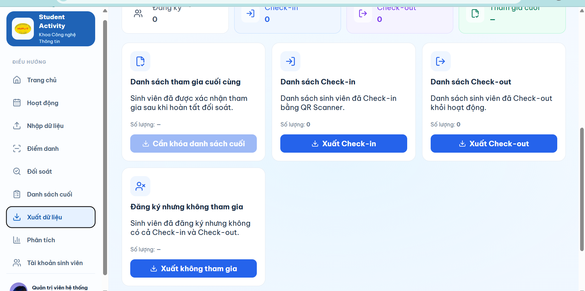

---
title: "Export CSV/XLSX Reports"
date: 2026-11-09
weight: 3
chapter: false
pre: "<b>5.8.3.</b>"
---

## Export CSV/XLSX Reports

In this section, we will explore report export functionality in the Student Activity Management & Engagement Analytics Platform.

After completing registration, attendance recording, evidence imports, and participation confirmation, organizers need consolidated results for administration and reporting.

Export functionality converts business data into files that can be opened using Microsoft Excel or other data processing tools.

#### 1. Understand the purpose of Export

Exported records can support:

* Registration list verification.
* Check-in and Check-out summaries.
* Evidence tracking.
* Reconciliation review.
* Confirmed participant lists.
* Activity result archiving.
* Administrative reporting.

Exported results reflect the selected data scope at the time the report is generated.

Exporting a report does not automatically update official student conduct scores or university records in the University Portal.

#### 2. Distinguish CSV and XLSX

| Criteria | CSV | XLSX |
| --- | --- | --- |
| Format | Delimited text | Excel Workbook |
| Compatibility | Excel, Python, and other tools | Excel and compatible applications |
| Cell formatting | Not supported | Supported |
| Multiple worksheets | No | Yes |
| Purpose | Data exchange and processing | Structured reporting |

Select the file format supported by the current application.

Do not rename a CSV file with an XLSX extension because the two formats use different file structures.

#### 3. Understand the Export architecture

```text
ADMIN
   |
   v
React / Vite Frontend
   |
   | Export Request
   v
FastAPI Backend
   |
   v
Authentication & Authorization
   |
   v
Retrieve Business Records
   |
   v
Generate Report Data
   |
   v
Return CSV / XLSX File
   |
   v
Browser Download
```

The Backend validates permissions, retrieves records, and generates report content.

The Frontend receives the response and supports the browser download process.

If an existing Export operation generates the file directly in the Frontend from API data, review its actual implementation.

#### 4. Prepare report data

Reuse the Demo activity from sections 5.6 and 5.7.

Illustrative records:

| Student ID | Check-in | Check-out | Evidence | Participation |
| --- | --- | --- | --- | --- |
| 0818000001 | 08:05 | 11:30 | Yes | CONFIRMED |
| 0818000002 | 08:10 | Not recorded | Yes | Not yet confirmed |
| 0818000003 | Not recorded | Not recorded | Yes | REJECTED |
| 0818000004 | 08:15 | 11:35 | No | Not yet confirmed |

These are synthetic examples.

Use the actual Activity ID and business records stored by the Backend when performing the Export exercise.

#### 5. Access the Export function

1. Open the Web Application.
2. Sign in using an ADMIN account.
3. Select the target activity.
4. Open data management, reconciliation, or participation results.
5. Locate Export or Download Report.

<!--

-->

Verify the selected activity and report scope.

If filters are available, determine whether the Export includes all records or only filtered records.

#### 6. Export a CSV report

If CSV Export is available:

1. Select the activity.
2. Select the report type.
3. Choose Export CSV.
4. Verify the downloaded file.
5. Open it using Excel or a text editor.

Example filename:

```text
participation-report.csv
```

Illustrative content:

```csv
activity_id,mssv,full_name,check_in,check_out,evidence_status,participation_status
ACT-DEMO-001,0818000001,Student A,08:05,11:30,YES,CONFIRMED
ACT-DEMO-001,0818000002,Student B,08:10,,YES,
ACT-DEMO-001,0818000003,Student C,,,YES,REJECTED
ACT-DEMO-001,0818000004,Student D,08:15,11:35,NO,
```

The filename, column names, and timestamp format are illustrative.

Use the actual report structure supported by the application.

<!--

-->

#### 7. Open CSV using Microsoft Excel

To preserve leading zeros in student IDs:

1. Open Microsoft Excel.
2. Select Data.
3. Select From Text/CSV.
4. Select the exported file.
5. Inspect the File Origin and encoding.
6. Select Transform Data if data types need adjustment.
7. Set the Student ID column to Text.
8. Load the data into the worksheet.

<!--

-->

{}
CSV files do not store cell data types. Opening a CSV directly in Excel may convert student IDs into numbers and remove leading zeros. Verify identifier formatting when reviewing reports.
{}

#### 8. Export an XLSX report

If Excel Export is supported:

1. Select the target activity.
2. Choose Export XLSX or Export Excel.
3. Download the file.
4. Open it using Microsoft Excel.
5. Inspect worksheets and report content.

Example filename:

```text
participation-report.xlsx
```

<!--

-->

Verify relevant information:

* Activity name.
* Activity ID.
* Student ID.
* Student full name.
* Registration information.
* Check-in and Check-out timestamps.
* Evidence status.
* Participation confirmation result.

Actual columns depend on the supported report type.

If the report is generated using Python, use the Excel processing libraries declared in the project's requirements.txt.

#### 9. Illustrate report generation using Python

Create a separate practice file:

```text
export_report_demo.py
```

Content:

```python
import csv

records = [
    {
        "activity_id": "ACT-DEMO-001",
        "mssv": "0818000001",
        "full_name": "Student A",
        "check_in": "08:05",
        "check_out": "11:30",
        "evidence_status": "YES",
        "participation_status": "CONFIRMED"
    },
    {
        "activity_id": "ACT-DEMO-001",
        "mssv": "0818000003",
        "full_name": "Student C",
        "check_in": "",
        "check_out": "",
        "evidence_status": "YES",
        "participation_status": "REJECTED"
    }
]

fields = [
    "activity_id",
    "mssv",
    "full_name",
    "check_in",
    "check_out",
    "evidence_status",
    "participation_status"
]

def safe_csv_value(value):
    if isinstance(value, str):
        if value.startswith((
            "=", "+", "-", "@", "\t", "\r", "\n"
        )):
            return "'" + value
    return value

with open(
    "participation-report.csv",
    "w",
    newline="",
    encoding="utf-8-sig"
) as file:

    writer = csv.DictWriter(
        file,
        fieldnames=fields
    )

    writer.writeheader()

    for record in records:
        writer.writerow({
            key: safe_csv_value(value)
            for key, value in record.items()
        })

print("Report exported successfully")
```

Run:

```powershell
python export_report_demo.py
```

Expected output:

```text
Report exported successfully
```

The participation-report.csv file is created in the current directory.

Explanation:

* csv.DictWriter: Writes dictionary data into CSV.
* writeheader(): Generates column headers.
* writerow(): Writes individual records.
* utf-8-sig: Helps Excel recognize UTF-8 encoding.
* safe_csv_value(): Illustrates a basic mitigation for CSV Formula Injection in text fields.

{}
This is a standalone learning script using two synthetic records. It does not connect to the Backend, access DynamoDB, or replace the project's Export functionality.
{}

<!--

-->

#### 10. Inspect the Export API

Open Developer Tools.

1. Select Network.
2. Perform an Export operation.
3. Identify the corresponding request.
4. Inspect the Request URL and HTTP Method.
5. Verify the HTTP Status Code.
6. Inspect Response Headers.

Common Content-Type values:

```text
CSV:
text/csv

XLSX:
application/vnd.openxmlformats-officedocument.spreadsheetml.sheet
```

The Backend may include a Content-Disposition header to suggest the downloaded filename.

<!--

-->

Review the actual Endpoint and response using the API Service and Swagger UI.

If the file is generated entirely in the Frontend using previously retrieved data, there may be no separate file download request.

#### 11. Verify report access permissions

Test the ADMIN and STUDENT roles.

ADMIN:

* Export administrative reports within authorized permissions.
* Access records belonging to authorized activities.

STUDENT:

* Cannot export other students' private information without permission.
* Can only access personal reporting functionality if supported.

The Backend must enforce authorization for protected Export APIs.

{}
Reports may contain student IDs, names, and participation information. Do not upload real student data to public GitHub repositories or internship report websites. Use synthetic records or redact identifying information.
{}

#### 12. Distinguish Export from Serverless CSV Processing

The project contains two different workflows:

* Application Export: Generate reports from application business data.
* Serverless CSV Processing Demo: Read CSV files from Amazon S3, process them using AWS Lambda, and write JSON results back to S3.

The Web Application Export workflow does not automatically use AWS Lambda.

Downloading a CSV/XLSX report does not establish that the file has been stored in Amazon S3.

Serverless CSV Processing will be covered separately in section 5.10.

#### Results

After completing this section, we have explored the process of exporting business data as CSV/XLSX reports.

These reports support activity result verification, data archiving, and administrative reporting.

In the next section, we will compare the Dashboard, REST API responses, and exported reports to verify data accuracy.

[Next: Verify Analytics and Reports](../5.8.4-verify-analytics/)
