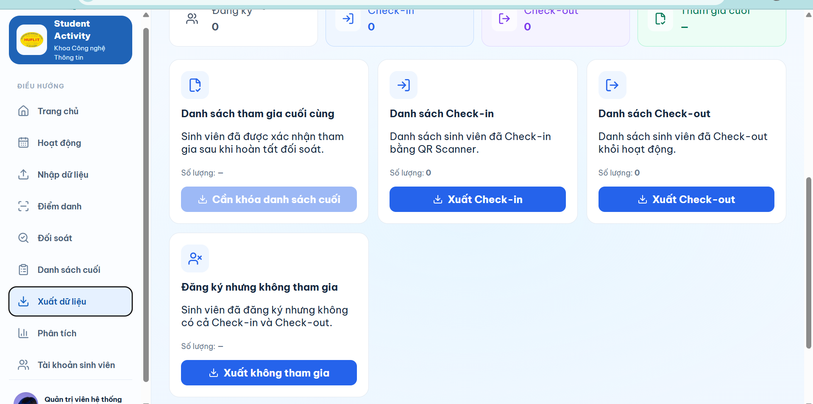

---
title: "Xuất báo cáo CSV/XLSX"
date: 2026-11-09
weight: 3
chapter: false
pre: "<b>5.8.3.</b>"
---

## Xuất báo cáo CSV/XLSX

Trong phần này, chúng ta sẽ thực hành xuất báo cáo dữ liệu hoạt động sinh viên từ hệ thống Student Activity Management & Engagement Analytics Platform.

Sau khi hoàn thành đăng ký, điểm danh, nhập minh chứng và xác nhận tham gia, Ban Tổ chức cần tổng hợp kết quả để phục vụ công tác quản lý và báo cáo.

Chức năng Export giúp chuyển dữ liệu nghiệp vụ thành file có thể mở bằng Microsoft Excel hoặc các công cụ xử lý dữ liệu khác.

#### 1. Tìm hiểu mục đích của Export

Dữ liệu xuất báo cáo có thể phục vụ:

* Kiểm tra danh sách sinh viên đăng ký.
* Tổng hợp kết quả Check-in và Check-out.
* Theo dõi tình trạng minh chứng.
* Kiểm tra kết quả đối soát.
* Tổng hợp danh sách sinh viên được xác nhận tham gia.
* Lưu trữ kết quả hoạt động.
* Hỗ trợ Ban Tổ chức lập báo cáo.

Kết quả Export phản ánh dữ liệu thuộc phạm vi được chọn tại thời điểm tạo báo cáo.

Việc xuất file không tự động cập nhật điểm rèn luyện hoặc kết quả chính thức lên University Portal.

#### 2. Phân biệt CSV và XLSX

| Tiêu chí | CSV | XLSX |
| --- | --- | --- |
| Định dạng | Văn bản phân tách bằng dấu phẩy hoặc dấu phân cách | Excel Workbook |
| Khả năng mở | Excel, Python và nhiều công cụ khác | Excel và các ứng dụng tương thích |
| Định dạng ô | Không lưu kiểu định dạng ô | Hỗ trợ kiểu dữ liệu và định dạng |
| Nhiều trang tính | Không | Có |
| Mục đích | Trao đổi và xử lý dữ liệu | Báo cáo và trình bày dữ liệu |

Trong hệ thống, định dạng file xuất cần được lựa chọn theo chức năng hiện có.

Không tự thay đổi phần mở rộng của file CSV thành XLSX vì hai định dạng có cấu trúc khác nhau.

#### 3. Kiến trúc xử lý Export

```text
ADMIN
   |
   v
React / Vite Frontend
   |
   | Export Request
   v
FastAPI Backend
   |
   v
Authentication & Authorization
   |
   v
Retrieve Business Records
   |
   v
Generate Report Data
   |
   v
Return CSV / XLSX File
   |
   v
Browser Download
```

Backend chịu trách nhiệm kiểm tra quyền truy cập, truy xuất dữ liệu và tạo nội dung báo cáo.

Frontend tiếp nhận Response và hỗ trợ người dùng tải file xuống.

Nếu một chức năng Export được thực hiện trực tiếp tại Frontend từ dữ liệu API, cần kiểm tra cách xử lý cụ thể trong source code hiện tại.

#### 4. Chuẩn bị dữ liệu báo cáo

Sử dụng hoạt động Demo đã hoàn thành các phần 5.6 và 5.7.

Ví dụ dữ liệu tổng hợp:

| MSSV | Check-in | Check-out | Evidence | Participation |
| --- | --- | --- | --- | --- |
| 0818000001 | 08:05 | 11:30 | Có | CONFIRMED |
| 0818000002 | 08:10 | Chưa ghi nhận | Có | Chưa xác nhận |
| 0818000003 | Chưa ghi nhận | Chưa ghi nhận | Có | REJECTED |
| 0818000004 | 08:15 | 11:35 | Không | Chưa xác nhận |

Dữ liệu trên chỉ là ví dụ minh họa.

Khi thực hiện Export, sử dụng Activity ID thực tế và các kết quả nghiệp vụ đã lưu trong Backend.

#### 5. Truy cập chức năng Export

1. Mở Web Application.
2. Đăng nhập bằng tài khoản ADMIN.
3. Chọn hoạt động cần xuất báo cáo.
4. Mở trang quản lý dữ liệu, đối soát hoặc kết quả tham gia.
5. Tìm chức năng Export hoặc Download Report.

<!--

-->

Kiểm tra thông tin hoạt động và phạm vi dữ liệu trước khi xuất.

Nếu hệ thống hỗ trợ lựa chọn bộ lọc, cần xác định báo cáo xuất toàn bộ danh sách hay chỉ các bản ghi đã lọc.

#### 6. Xuất báo cáo CSV

Nếu giao diện cung cấp chức năng Export CSV:

1. Chọn hoạt động.
2. Chọn loại dữ liệu cần xuất.
3. Chọn Export CSV.
4. Kiểm tra file được trình duyệt tải xuống.
5. Mở file bằng Excel hoặc trình soạn thảo văn bản.

Ví dụ tên file:

```text
participation-report.csv
```

Ví dụ nội dung:

```csv
activity_id,mssv,full_name,check_in,check_out,evidence_status,participation_status
ACT-DEMO-001,0818000001,Student A,08:05,11:30,YES,CONFIRMED
ACT-DEMO-001,0818000002,Student B,08:10,,YES,
ACT-DEMO-001,0818000003,Student C,,,YES,REJECTED
ACT-DEMO-001,0818000004,Student D,08:15,11:35,NO,
```

Tên file, tên cột và định dạng thời gian trên là ví dụ.

Cần sử dụng cấu trúc báo cáo thực tế của đồ án khi thực hiện kiểm thử.

<!--

-->

#### 7. Mở CSV bằng Microsoft Excel

Để giữ nguyên MSSV có chữ số 0 ở đầu:

1. Mở Microsoft Excel.
2. Chọn Data.
3. Chọn From Text/CSV.
4. Chọn file đã xuất.
5. Kiểm tra File Origin và encoding.
6. Chọn Transform Data nếu cần thay đổi kiểu dữ liệu.
7. Đặt cột MSSV thành Text.
8. Tải dữ liệu vào bảng tính.

<!--

-->

{}
CSV không lưu kiểu dữ liệu của từng ô. Khi mở trực tiếp bằng Excel, MSSV có thể bị chuyển thành số và mất chữ số 0 ở đầu. Đây là vấn đề cần kiểm tra trong quá trình nhập và đọc báo cáo.
{}

#### 8. Xuất báo cáo XLSX

Nếu hệ thống hỗ trợ Export Excel:

1. Chọn hoạt động cần xuất báo cáo.
2. Chọn chức năng Export XLSX hoặc Export Excel.
3. Tải file về máy tính.
4. Mở file bằng Microsoft Excel.
5. Kiểm tra các trang tính và nội dung báo cáo.

Ví dụ tên file:

```text
participation-report.xlsx
```

<!--

-->

Các thông tin cần kiểm tra:

* Tên hoạt động.
* Activity ID.
* MSSV.
* Họ tên sinh viên.
* Dữ liệu đăng ký.
* Thời gian Check-in và Check-out.
* Trạng thái minh chứng.
* Kết quả xác nhận tham gia.

Các cột thực tế phụ thuộc vào loại báo cáo được hỗ trợ.

Nếu báo cáo được xuất bằng thư viện Python, có thể sử dụng các thư viện xử lý Excel đã được khai báo trong requirements.txt.

#### 9. Minh họa cách tạo báo cáo bằng Python

Trong phần này, chúng ta sẽ tìm hiểu cách tạo file CSV từ dữ liệu nghiệp vụ đã được tổng hợp.

Tạo file thực hành riêng:

```text
export_report_demo.py
```

Nội dung:

```python
import csv

records = [
    {
        "activity_id": "ACT-DEMO-001",
        "mssv": "0818000001",
        "full_name": "Student A",
        "check_in": "08:05",
        "check_out": "11:30",
        "evidence_status": "YES",
        "participation_status": "CONFIRMED"
    },
    {
        "activity_id": "ACT-DEMO-001",
        "mssv": "0818000003",
        "full_name": "Student C",
        "check_in": "",
        "check_out": "",
        "evidence_status": "YES",
        "participation_status": "REJECTED"
    }
]

fields = [
    "activity_id",
    "mssv",
    "full_name",
    "check_in",
    "check_out",
    "evidence_status",
    "participation_status"
]

def safe_csv_value(value):
    if isinstance(value, str):
        if value.startswith((
            "=", "+", "-", "@", "\t", "\r", "\n"
        )):
            return "'" + value
    return value

with open(
    "participation-report.csv",
    "w",
    newline="",
    encoding="utf-8-sig"
) as file:

    writer = csv.DictWriter(
        file,
        fieldnames=fields
    )

    writer.writeheader()

    for record in records:
        writer.writerow({
            key: safe_csv_value(value)
            for key, value in record.items()
        })

print("Report exported successfully")
```

Chạy:

```powershell
python export_report_demo.py
```

Kết quả:

```text
Report exported successfully
```

File participation-report.csv sẽ được tạo trong thư mục hiện tại.

Giải thích:

* csv.DictWriter: Ghi dữ liệu Dictionary vào CSV.
* writeheader(): Tạo dòng tiêu đề.
* writerow(): Ghi từng bản ghi.
* utf-8-sig: Hỗ trợ nhận diện encoding UTF-8 khi mở bằng Excel.
* safe_csv_value(): Minh họa cách giảm nguy cơ CSV Formula Injection đối với dữ liệu văn bản.

{}
Đây là script học tập độc lập, sử dụng hai bản ghi giả lập. Script không kết nối Backend, không truy cập DynamoDB và không thay thế chức năng Export hiện tại của đồ án.
{}

<!--

-->

#### 10. Kiểm tra Export API

Mở Developer Tools.

1. Chọn Network.
2. Thực hiện thao tác Export từ giao diện.
3. Tìm Request liên quan.
4. Kiểm tra Request URL và HTTP Method.
5. Kiểm tra HTTP Status Code.
6. Kiểm tra Response Headers.

Các Content-Type thường sử dụng:

```text
CSV:
text/csv

XLSX:
application/vnd.openxmlformats-officedocument.spreadsheetml.sheet
```

Backend có thể cung cấp Content-Disposition để trình duyệt xác định tên file tải xuống.

<!--

-->

Tên Endpoint và Response thực tế cần được đối chiếu với API Service và Swagger UI của project.

Nếu Export được xử lý hoàn toàn tại Frontend từ dữ liệu đã tải, có thể không xuất hiện một Request tải file riêng.

#### 11. Kiểm tra quyền xuất báo cáo

Sử dụng tài khoản ADMIN và STUDENT để kiểm tra phạm vi truy cập.

ADMIN:

* Xuất báo cáo quản trị theo quyền được cấp.
* Truy cập dữ liệu thuộc hoạt động được phép quản lý.

STUDENT:

* Không được xuất danh sách dữ liệu sinh viên khác nếu không có quyền.
* Chỉ được truy cập các chức năng báo cáo cá nhân nếu hệ thống hỗ trợ.

Backend cần kiểm tra quyền đối với các API Export được bảo vệ.

{}
File báo cáo có thể chứa MSSV, họ tên và dữ liệu tham gia của sinh viên. Không đưa dữ liệu thật lên GitHub hoặc website báo cáo thực tập công khai. Sử dụng dữ liệu Demo hoặc che các thông tin nhận dạng trước khi chụp ảnh.
{}

#### 12. Phân biệt Export với Serverless CSV Processing

Trong kiến trúc đồ án có hai quy trình khác nhau:

* Application Export: Xuất báo cáo từ dữ liệu nghiệp vụ của hệ thống.
* Serverless CSV Processing Demo: Đọc file CSV từ Amazon S3, xử lý bằng AWS Lambda và ghi kết quả JSON trở lại S3.

Chức năng Export của Web Application không mặc định sử dụng AWS Lambda để tạo file.

Việc tải báo cáo CSV/XLSX cũng không đồng nghĩa với file đã được lưu vào Amazon S3.

Serverless CSV Processing sẽ được thực hành riêng trong phần 5.10.

#### Kết quả

Sau khi hoàn thành phần này, chúng ta đã tìm hiểu quy trình xuất dữ liệu nghiệp vụ thành báo cáo CSV/XLSX.

File báo cáo giúp Ban Tổ chức kiểm tra, lưu trữ và sử dụng kết quả tham gia hoạt động.

Trong phần tiếp theo, chúng ta sẽ đối chiếu Dashboard, REST API và file báo cáo để xác minh tính chính xác của dữ liệu.

[Tiếp theo: Kiểm thử Dashboard và báo cáo](../5.8.4-verify-analytics/)
