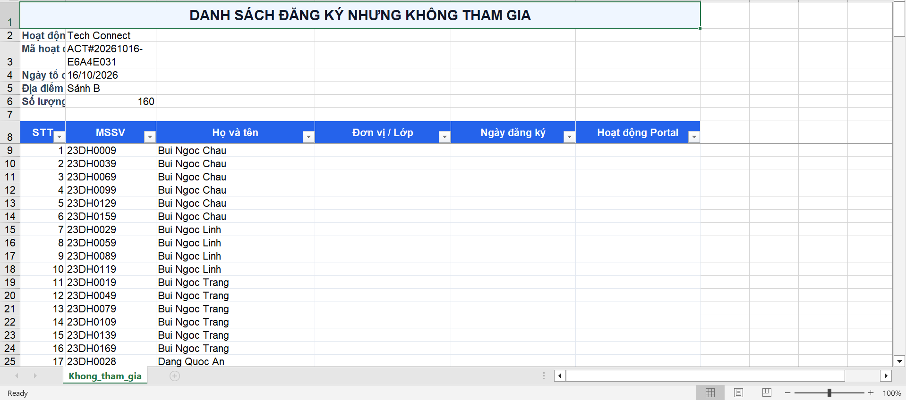

---
title: "Verify Analytics and Reports"
date: 2026-11-09
weight: 4
chapter: false
pre: "<b>5.8.4.</b>"
---

## Verify Analytics and Reports

In this section, we will verify the Analytics Dashboard and report Export functionality of the Student Activity Management & Engagement Analytics Platform.

The objective is to ensure that analytical indicators accurately reflect business records, exported reports contain the correct data scope, and users only access authorized information.

#### 1. Prepare the testing environment

Complete:

* Section 5.6 - Registration and Attendance Management.
* Section 5.7 - Evidence Processing and Reconciliation.
* Section 5.8.1 - Prepare Analytics Data and Metrics.
* Section 5.8.2 - Build the Analytics Dashboard.
* Section 5.8.3 - Export CSV/XLSX Reports.

Ensure that the following are available:

* FastAPI Backend.
* React/Vite Frontend.
* ADMIN and STUDENT Demo accounts.
* An activity with test datasets.
* Exported report files.

#### 2. Understand the verification workflow

```text
Business Data
      |
      v
FastAPI Backend
      |
      +-------------------+
      |                   |
      v                   v
Analytics API       Export Processing
      |                   |
      v                   v
React Dashboard       CSV / XLSX
      |                   |
      +---------+---------+
                |
                v
        Data Verification
```

Testing should verify that:

* The Backend uses the correct source records.
* Metrics are aggregated within the correct scope.
* The Frontend displays accurate results.
* Reports do not contain unintended missing or duplicate records.
* Access permissions are enforced.

#### 3. Define the test dataset

Reuse the four-student Demo activity from section 5.7.

Source data:

| Student ID | Registration | Check-in | Check-out | Evidence |
| --- | --- | --- | --- | --- |
| 0818000001 | Yes | Yes | Yes | Yes |
| 0818000002 | Yes | Yes | No | Yes |
| 0818000003 | Yes | No | No | Yes |
| 0818000004 | Yes | Yes | Yes | No |

Participation results:

| Student ID | Status |
| --- | --- |
| 0818000001 | CONFIRMED |
| 0818000002 | Not yet confirmed |
| 0818000003 | REJECTED |
| 0818000004 | Not yet confirmed |

These synthetic records provide expected results for Dashboard verification.

#### 4. Verify Analytics indicators

Sign in using an ADMIN account and open the Analytics Dashboard.

Select the Demo activity if an activity filter is available.

Compare supported indicators with the following expected results:

| Metric | Expected Result |
| --- | --- |
| Total Registrations | 4 |
| Total Check-in | 3 |
| Total Check-out | 2 |
| Complete Attendance | 2 |
| Evidence Submitted | 3 |
| Confirmed Participants | 1 |
| Rejected Participants | 1 |
| Awaiting Decision | 2 |
| Check-in Rate | 75% |
| Attendance Completion Rate | 50% |
| Confirmed Participation Rate | 25% |

The example rates use total registrations as the denominator.

<!--

-->

The current Dashboard is not required to display every indicator listed above.

Only compare metrics that use matching business definitions and data scopes.

#### 5. Verify the Analytics API

Open Swagger UI:

[http://127.0.0.1:8000/docs](http://127.0.0.1:8000/docs)

1. Authenticate using an ADMIN account.
2. Locate the statistics API used by the Dashboard.
3. Provide the Activity ID or appropriate parameters.
4. Execute the request.
5. Inspect the response.
6. Compare the values with the Dashboard.

<!--

-->

If the API response is correct but the Dashboard is incorrect, review:

* Frontend response field mapping.
* Selected activity scope.
* Stored interface state.
* Additional Frontend calculations.
* Data refresh behavior.

If the API response is incorrect, review Backend aggregation logic and source data.

#### 6. Test activity filtering

If activity filtering is supported, prepare two Demo activities.

Example:

```text
Activity A: AWS Workshop Demo
Registrations: 4
Confirmed Participants: 1

Activity B: Cloud Computing Seminar
Registrations: 6
Confirmed Participants: 4
```

Perform the following:

1. Select Activity A.
2. Verify its indicators.
3. Select Activity B.
4. Verify the new indicators.
5. Return to the overall scope if supported.

Expected results:

* No unintended data mixing between activities.
* Correct Dashboard scope.
* Appropriate API request parameters.
* Updated analytical indicators.

<!--

-->

Aggregating both activities produces 10 registration records and 5 confirmed participation records.

This does not necessarily represent 10 unique students because individuals may register for multiple activities.

#### 7. Test Participation updates

Select a Demo record that has not received a final decision.

1. Open Participation.
2. Review the student's source records.
3. Confirm or reject participation according to business requirements.
4. Return to the Analytics Dashboard.
5. Refresh data using the application's supported mechanism.
6. Inspect the updated indicators.

If one eligible student changes to CONFIRMED:

```text
Before:
Confirmed Participants: 1
Awaiting Decision: 2

After:
Confirmed Participants: 2
Awaiting Decision: 1
```

Updated rate:

```text
Confirmed Participation Rate
= 2 / 4 x 100
= 50%
```

This is an illustrative scenario that assumes the student satisfies the confirmation requirements.

<!--

-->

Do not assume that the Dashboard supports live WebSocket updates. Verify the current data refresh mechanism.

#### 8. Test an empty dataset

Create a Demo activity without registration records.

Open its Analytics view if supported.

Expected results:

* No data retrieval errors.
* Appropriate count values.
* No NaN or Infinity rate values.
* No division-by-zero errors.
* An appropriate empty-data message.

<!--

-->

When the denominator is zero, display 0% or a not-applicable value according to the selected metric definition.

#### 9. Verify exported reports

Export a report for the Demo activity.

Open the downloaded CSV or XLSX file.

Verify:

* The file opens successfully.
* Activity ID matches the selected activity.
* Student identifiers remain accurate.
* Registration and Attendance information is correct.
* CONFIRMED and REJECTED results match Backend records.
* No unintended duplicate records appear.
* Record counts match the selected report type.

<!--

-->

Examples:

* A complete registration report may contain four student records.
* A confirmed-only report may contain one record before additional confirmation.
* A new confirmed-only report may contain two records after another valid confirmation.

Different report types do not necessarily contain the same number of records.

#### 10. Verify CSV reports using Python

Create a separate practice file:

```text
verify_export_report.py
```

Content:

```python
import csv
from collections import Counter

file_path = input(
    "Enter CSV file path: "
).strip().strip('"')

with open(
    file_path,
    "r",
    encoding="utf-8-sig",
    newline=""
) as file:

    reader = csv.DictReader(file)

    required_columns = {
        "activity_id",
        "mssv",
        "participation_status"
    }

    actual_columns = set(
        reader.fieldnames or []
    )

    missing_columns = (
        required_columns - actual_columns
    )

    if missing_columns:
        raise ValueError(
            f"Missing columns: {missing_columns}"
        )

    rows = list(reader)

keys = [
    (
        row["activity_id"].strip(),
        row["mssv"].strip()
    )
    for row in rows
]

key_counts = Counter(keys)

duplicate_keys = [
    key
    for key, count in key_counts.items()
    if count > 1
]

status_counts = Counter(
    row["participation_status"].strip()
    for row in rows
)

print("Total rows:", len(rows))
print("Unique activity/student keys:", len(key_counts))
print("Duplicate keys:", duplicate_keys)
print("Confirmed:", status_counts["CONFIRMED"])
print("Rejected:", status_counts["REJECTED"])
print("Other or unconfirmed:",
      len(rows)
      - status_counts["CONFIRMED"]
      - status_counts["REJECTED"])
```

Run:

```powershell
python verify_export_report.py
```

Enter the path of the CSV file to inspect.

Example:

```text
C:\Projects\student-activity-platform\participation-report.csv
```

Using the illustrative four-student report before additional confirmation, the expected output is:

```text
Total rows: 4
Unique activity/student keys: 4
Duplicate keys: []
Confirmed: 1
Rejected: 1
Other or unconfirmed: 2
```

<!--

-->

{}
This script illustrates CSV verification for a report containing one row per student and activity. Column names, encoding, and delimiter must match the actual exported file. Reports containing multiple evidence or attendance records per student may legitimately contain repeated keys and require different verification rules.
{}

#### 11. Verify Amazon DynamoDB source data

If the relevant AWS Pilots are enabled, verify source business records in DynamoDB.

Open:

[Amazon DynamoDB Console](https://console.aws.amazon.com/dynamodb/)

Select:

```text
Asia Pacific (Singapore)
ap-southeast-1
```

Inspect the following tables:

* SAP-Activities.
* SAP-Registrations.
* SAP-Attendance.
* SAP-Evidence.
* SAP-Participation.

Retrieve records by Activity ID using the procedures described in section 5.4.

<!--

-->

Compare Registration, Attendance, and Participation records with the corresponding business results.

{}
The Dashboard retrieves information through FastAPI rather than connecting directly to DynamoDB. DynamoDB verification confirms Cloud data storage within the relevant AWS Pilot scope. It does not establish that every Analytics API currently reads directly from DynamoDB.
{}

#### 12. Verify access permissions

Use the two Demo accounts.

##### ADMIN

* Access administrative analytics.
* View authorized activity statistics.
* Export authorized administrative reports.

##### STUDENT

* View personal participation information.
* Cannot access unauthorized administrative analytics.
* Cannot export other students' information without permission.

Test both the interface and REST APIs.

Protected APIs must reject authenticated users who lack the required permissions.

<!--

-->

#### 13. Troubleshoot common issues

| Issue | What to Check |
| --- | --- |
| Dashboard cannot load | Backend, API URL, Access Token, and CORS |
| Incorrect statistics | Activity ID, scope, and aggregation logic |
| Invalid rate | Zero denominator or invalid source data |
| Statistics not updated | Data refresh mechanism |
| Report download fails | Export API or download handling |
| Missing leading zeros | CSV/XLSX data type handling |
| Incorrect text encoding | CSV encoding |
| Incorrect activity in report | Export parameters and filtering rules |
| Missing DynamoDB records | AWS Pilot and repository configuration |

#### 14. Summarize test results

| Test Case | Expected Result |
| --- | --- |
| Analytics API | Correct data scope returned |
| Dashboard Metrics | Values match Backend results |
| Participation Update | Indicators update after data refresh |
| Activity Filter | Correct activity displayed when supported |
| Empty Dataset | No calculation errors |
| CSV/XLSX Export | Valid and readable file |
| Report Data | Records match the selected report type |
| Student ID Formatting | Identifiers preserved |
| ADMIN Authorization | Authorized administrative access |
| STUDENT Authorization | Unauthorized data access denied |
| DynamoDB Verification | Source records verified when Pilot is enabled |

Workshop participants should record actual results, capture supporting screenshots, and identify incomplete tests.

#### Conclusion

In this section, we verified Analytics Dashboard and Export functionality in the Student Activity Management & Engagement Analytics Platform.

By comparing Registration, Attendance, Evidence, and Participation records, the system can provide analytical indicators supporting student activity management.

The Dashboard uses React/Vite for visualization, while FastAPI handles business data processing and aggregation.

Exported reports help organizers access and review participation results consistently.

In the next section, we will deploy the Frontend using AWS Amplify Hosting and connect it to the FastAPI Backend through Cloudflare Quick Tunnel to create an Internet-accessible Demo environment.

[Next: AWS Amplify and Cloudflare Tunnel Deployment](../../5.9-Deployment/)
