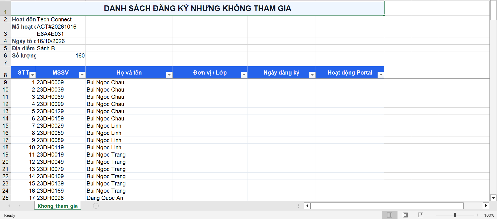

---
title: "Kiểm thử Dashboard và báo cáo"
date: 2026-11-09
weight: 4
chapter: false
pre: "<b>5.8.4.</b>"
---

## Kiểm thử Dashboard và báo cáo

Trong phần này, chúng ta sẽ kiểm tra tính chính xác của Analytics Dashboard và chức năng Export trong hệ thống Student Activity Management & Engagement Analytics Platform.

Mục tiêu là xác minh các chỉ số thống kê phản ánh đúng dữ liệu nghiệp vụ, báo cáo được tạo đúng phạm vi và người dùng chỉ được truy cập dữ liệu phù hợp với quyền được cấp.

#### 1. Chuẩn bị môi trường kiểm thử

Đảm bảo đã hoàn thành:

* Phần 5.6 - Quản lý đăng ký và điểm danh.
* Phần 5.7 - Xử lý minh chứng và đối soát dữ liệu.
* Phần 5.8.1 - Chuẩn bị dữ liệu và chỉ số phân tích.
* Phần 5.8.2 - Xây dựng Analytics Dashboard.
* Phần 5.8.3 - Xuất báo cáo CSV/XLSX.

Các thành phần cần hoạt động:

* FastAPI Backend.
* React/Vite Frontend.
* Tài khoản ADMIN và STUDENT Demo.
* Hoạt động có đầy đủ dữ liệu phục vụ kiểm thử.
* File báo cáo được tạo từ chức năng Export.

#### 2. Tìm hiểu luồng xác minh dữ liệu

```text
Business Data
      |
      v
FastAPI Backend
      |
      +-------------------+
      |                   |
      v                   v
Analytics API       Export Processing
      |                   |
      v                   v
React Dashboard       CSV / XLSX
      |                   |
      +---------+---------+
                |
                v
        Data Verification
```

Quá trình kiểm thử cần đảm bảo:

* Backend sử dụng đúng dữ liệu nguồn.
* Các chỉ số được tổng hợp đúng phạm vi.
* Frontend hiển thị đúng kết quả.
* Báo cáo không thiếu hoặc trùng dữ liệu ngoài quy tắc nghiệp vụ.
* Quyền truy cập được kiểm tra.

#### 3. Xác định dữ liệu kiểm thử

Sử dụng lại hoạt động Demo gồm bốn sinh viên từ phần 5.7.

Dữ liệu nguồn:

| MSSV | Đăng ký | Check-in | Check-out | Minh chứng |
| --- | --- | --- | --- | --- |
| 0818000001 | Có | Có | Có | Có |
| 0818000002 | Có | Có | Không | Có |
| 0818000003 | Có | Không | Không | Có |
| 0818000004 | Có | Có | Có | Không |

Kết quả Participation:

| MSSV | Trạng thái |
| --- | --- |
| 0818000001 | CONFIRMED |
| 0818000002 | Chưa xác nhận |
| 0818000003 | REJECTED |
| 0818000004 | Chưa xác nhận |

Đây là bộ dữ liệu giả lập được sử dụng để tính kết quả mong đợi trước khi kiểm thử Dashboard.

#### 4. Kiểm tra các chỉ số Analytics

Đăng nhập bằng tài khoản ADMIN và mở Analytics Dashboard.

Nếu có bộ lọc hoạt động, chọn hoạt động Demo.

Đối chiếu các chỉ số được hỗ trợ với kết quả đã tính:

| Chỉ số | Kết quả mong đợi |
| --- | --- |
| Total Registrations | 4 |
| Total Check-in | 3 |
| Total Check-out | 2 |
| Complete Attendance | 2 |
| Evidence Submitted | 3 |
| Confirmed Participants | 1 |
| Rejected Participants | 1 |
| Awaiting Decision | 2 |
| Check-in Rate | 75% |
| Attendance Completion Rate | 50% |
| Confirmed Participation Rate | 25% |

Các tỷ lệ trên sử dụng tổng số sinh viên đăng ký làm mẫu số.

<!--

-->

Không bắt buộc Dashboard hiện tại phải có toàn bộ chỉ số trong bảng.

Chỉ đối chiếu trực tiếp những chỉ số sử dụng cùng định nghĩa nghiệp vụ và phạm vi dữ liệu.

#### 5. Kiểm tra Analytics API

Mở Swagger UI:

[http://127.0.0.1:8000/docs](http://127.0.0.1:8000/docs)

1. Xác thực bằng tài khoản ADMIN.
2. Tìm API thống kê được sử dụng bởi Dashboard.
3. Nhập Activity ID hoặc tham số phù hợp.
4. Thực hiện Request.
5. Kiểm tra Response.
6. So sánh kết quả với Dashboard.

<!--

-->

Nếu API trả về dữ liệu đúng nhưng Dashboard hiển thị sai, kiểm tra:

* Cách Frontend ánh xạ thuộc tính.
* Phạm vi hoạt động đang được chọn.
* Dữ liệu được lưu trong trạng thái giao diện.
* Công thức tính toán bổ sung tại Frontend.
* Cơ chế tải lại dữ liệu.

Nếu API trả về số liệu sai, kiểm tra logic tổng hợp tại Backend và dữ liệu nguồn.

#### 6. Kiểm tra chức năng lọc hoạt động

Nếu hệ thống hỗ trợ bộ lọc hoạt động, chuẩn bị hai hoạt động Demo.

Ví dụ:

```text
Activity A: AWS Workshop Demo
Registrations: 4
Confirmed Participants: 1

Activity B: Cloud Computing Seminar
Registrations: 6
Confirmed Participants: 4
```

Thực hiện:

1. Chọn Activity A.
2. Kiểm tra số liệu thuộc Activity A.
3. Chuyển sang Activity B.
4. Kiểm tra số liệu thuộc Activity B.
5. Quay lại phạm vi tổng quan nếu được hỗ trợ.

Kết quả mong đợi:

* Không ghép nhầm dữ liệu giữa các hoạt động.
* Dashboard hiển thị đúng phạm vi.
* API Request sử dụng tham số phù hợp.
* Các chỉ số được cập nhật đúng.

<!--

-->

Nếu tổng hợp cả hai hoạt động, tổng số lượt đăng ký là 10 và tổng số lượt xác nhận là 5.

Không suy ra có 10 sinh viên duy nhất nếu một sinh viên đăng ký cả hai hoạt động.

#### 7. Kiểm tra cập nhật dữ liệu Participation

Chọn một bản ghi Demo chưa có quyết định cuối cùng.

1. Mở chức năng Participation.
2. Kiểm tra dữ liệu nguồn của sinh viên.
3. Thực hiện xác nhận hoặc từ chối theo điều kiện nghiệp vụ.
4. Mở lại Analytics Dashboard.
5. Tải lại dữ liệu theo cơ chế của ứng dụng.
6. Kiểm tra các chỉ số liên quan.

Ví dụ, nếu một sinh viên chưa xác nhận được chuyển hợp lệ sang CONFIRMED:

```text
Before:
Confirmed Participants: 1
Awaiting Decision: 2

After:
Confirmed Participants: 2
Awaiting Decision: 1
```

Tỷ lệ xác nhận mới:

```text
Confirmed Participation Rate
= 2 / 4 x 100
= 50%
```

Các số liệu trên chỉ minh họa tình huống cập nhật thành công khi sinh viên đáp ứng điều kiện nghiệp vụ.

<!--

-->

Không mặc định Dashboard hỗ trợ cập nhật tức thời bằng WebSocket. Kiểm tra theo cơ chế tải lại dữ liệu hoặc làm mới giao diện hiện tại.

#### 8. Kiểm tra dữ liệu rỗng

Tạo một hoạt động Demo chưa có danh sách đăng ký.

Mở Analytics của hoạt động đó nếu hệ thống hỗ trợ.

Kết quả mong đợi:

* Không xảy ra lỗi khi truy xuất dữ liệu.
* Các số lượng được hiển thị phù hợp.
* Không xuất hiện NaN hoặc Infinity trong chỉ số tỷ lệ.
* Không xảy ra lỗi chia cho 0.
* Có thông báo chưa có dữ liệu nếu phù hợp.

<!--

-->

Trường hợp mẫu số bằng 0, hệ thống có thể hiển thị 0% hoặc không áp dụng theo định nghĩa chỉ số đã chọn.

#### 9. Kiểm tra file Export

Thực hiện xuất báo cáo từ hoạt động Demo.

Mở file CSV hoặc XLSX đã tải xuống.

Kiểm tra:

* File có thể mở bình thường.
* Activity ID thuộc đúng hoạt động.
* MSSV giữ nguyên thông tin định danh.
* Các bản ghi đăng ký và điểm danh chính xác.
* Kết quả CONFIRMED và REJECTED phù hợp.
* Không xuất hiện bản ghi trùng lặp ngoài phạm vi nghiệp vụ.
* Số lượng dòng dữ liệu phù hợp với loại báo cáo.

<!--

-->

Ví dụ:

* Báo cáo toàn bộ sinh viên đăng ký có thể chứa 4 dòng dữ liệu.
* Báo cáo chỉ xuất sinh viên CONFIRMED có thể chứa 1 dòng dữ liệu trước khi cập nhật kết quả.
* Sau khi xác nhận thêm một sinh viên, báo cáo CONFIRMED mới có thể chứa 2 dòng dữ liệu.

Không yêu cầu mọi loại báo cáo đều có cùng số dòng.

#### 10. Đối chiếu báo cáo bằng Python

Có thể sử dụng Python để kiểm tra file CSV đã xuất.

Tạo file thực hành riêng:

```text
verify_export_report.py
```

Nội dung:

```python
import csv
from collections import Counter

file_path = input(
    "Enter CSV file path: "
).strip().strip('"')

with open(
    file_path,
    "r",
    encoding="utf-8-sig",
    newline=""
) as file:

    reader = csv.DictReader(file)

    required_columns = {
        "activity_id",
        "mssv",
        "participation_status"
    }

    actual_columns = set(
        reader.fieldnames or []
    )

    missing_columns = (
        required_columns - actual_columns
    )

    if missing_columns:
        raise ValueError(
            f"Missing columns: {missing_columns}"
        )

    rows = list(reader)

keys = [
    (
        row["activity_id"].strip(),
        row["mssv"].strip()
    )
    for row in rows
]

key_counts = Counter(keys)

duplicate_keys = [
    key
    for key, count in key_counts.items()
    if count > 1
]

status_counts = Counter(
    row["participation_status"].strip()
    for row in rows
)

print("Total rows:", len(rows))
print("Unique activity/student keys:", len(key_counts))
print("Duplicate keys:", duplicate_keys)
print("Confirmed:", status_counts["CONFIRMED"])
print("Rejected:", status_counts["REJECTED"])
print("Other or unconfirmed:",
      len(rows)
      - status_counts["CONFIRMED"]
      - status_counts["REJECTED"])
```

Chạy script:

```powershell
python verify_export_report.py
```

Nhập đường dẫn file CSV cần kiểm tra.

Ví dụ:

```text
C:\Projects\student-activity-platform\participation-report.csv
```

Nếu sử dụng báo cáo bốn sinh viên minh họa trước khi cập nhật kết quả xác nhận, kết quả mong đợi:

```text
Total rows: 4
Unique activity/student keys: 4
Duplicate keys: []
Confirmed: 1
Rejected: 1
Other or unconfirmed: 2
```

<!--

-->

{}
Script trên là ví dụ kiểm tra CSV có một dòng cho mỗi sinh viên trong một hoạt động. Tên cột, encoding và dấu phân cách cần khớp với file thực tế. Nếu báo cáo chứa nhiều dòng minh chứng hoặc nhiều lượt ghi nhận cho mỗi sinh viên, cặp khóa trùng có thể là hợp lệ và cần sử dụng quy tắc kiểm tra khác.
{}

#### 11. Kiểm tra dữ liệu trên Amazon DynamoDB

Nếu các AWS Pilot tương ứng đã được bật, có thể xác minh dữ liệu nguồn phục vụ Analytics trên DynamoDB.

Truy cập:

[Amazon DynamoDB Console](https://console.aws.amazon.com/dynamodb/)

Chọn Region:

```text
Asia Pacific (Singapore)
ap-southeast-1
```

Kiểm tra các bảng:

* SAP-Activities.
* SAP-Registrations.
* SAP-Attendance.
* SAP-Evidence.
* SAP-Participation.

Sử dụng Activity ID để truy xuất các bản ghi tương ứng theo hướng dẫn mục 5.4.

<!--

-->

Đối chiếu dữ liệu Registration, Attendance và Participation với kết quả nghiệp vụ.

{}
Dashboard truy xuất dữ liệu thông qua FastAPI, không trực tiếp kết nối DynamoDB. Việc kiểm tra item trên DynamoDB xác nhận dữ liệu Cloud đã được lưu trong phạm vi AWS Pilot, không chứng minh toàn bộ Analytics API hiện đang đọc trực tiếp từ DynamoDB.
{}

#### 12. Kiểm tra quyền truy cập

Sử dụng hai tài khoản Demo.

##### ADMIN

* Truy cập Dashboard quản trị.
* Xem các chỉ số hoạt động được cấp quyền.
* Xuất báo cáo quản trị.

##### STUDENT

* Xem dữ liệu tham gia cá nhân.
* Không truy cập trái quyền Dashboard quản trị.
* Không xuất báo cáo chứa thông tin sinh viên khác khi không được phép.

Kiểm tra cả giao diện và REST API.

Đối với API được bảo vệ, tài khoản đã xác thực nhưng không đủ quyền cần nhận phản hồi từ chối phù hợp.

<!--

-->

#### 13. Kiểm tra các lỗi thường gặp

| Vấn đề | Nội dung cần kiểm tra |
| --- | --- |
| Dashboard không tải dữ liệu | Backend, API URL, Access Token và CORS |
| Số liệu không chính xác | Activity ID, phạm vi và logic tổng hợp |
| Chỉ số tỷ lệ bị lỗi | Mẫu số bằng 0 hoặc dữ liệu không hợp lệ |
| Số liệu không cập nhật | Cơ chế tải lại dữ liệu |
| Không tải được báo cáo | Export API hoặc xử lý download |
| MSSV mất số 0 đầu | Kiểu dữ liệu khi mở CSV/XLSX |
| Ký tự tiếng Việt bị lỗi | Encoding của CSV |
| Báo cáo chứa dữ liệu sai hoạt động | Tham số Export và quy tắc lọc |
| DynamoDB chưa có dữ liệu | Cấu hình AWS Pilot và repository |

#### 14. Tổng hợp kết quả kiểm thử

| Test Case | Kết quả mong đợi |
| --- | --- |
| Analytics API | Trả về dữ liệu đúng phạm vi |
| Dashboard Metrics | Khớp dữ liệu Backend |
| Participation Update | Chỉ số cập nhật sau khi tải lại dữ liệu |
| Activity Filter | Hiển thị đúng hoạt động nếu được hỗ trợ |
| Empty Dataset | Không xảy ra lỗi tính toán |
| CSV/XLSX Export | File hợp lệ và mở được |
| Report Data | Khớp với loại báo cáo |
| Student ID Formatting | Giữ nguyên MSSV |
| ADMIN Authorization | Truy cập chức năng quản trị phù hợp |
| STUDENT Authorization | Không truy cập dữ liệu trái quyền |
| DynamoDB Verification | Dữ liệu nguồn được xác minh khi bật Pilot |

Người thực hiện Workshop cần ghi nhận kết quả thực tế, bổ sung ảnh minh chứng và đánh dấu những trường hợp chưa hoàn thành.

#### Kết luận

Trong phần này, chúng ta đã thực hiện kiểm tra Analytics Dashboard và chức năng Export của Student Activity Management & Engagement Analytics Platform.

Thông qua việc đối chiếu dữ liệu từ Registration, Attendance, Evidence và Participation, hệ thống có thể cung cấp các chỉ số thống kê phục vụ công tác quản lý hoạt động sinh viên.

Dashboard được hiển thị bằng React/Vite, trong khi FastAPI đảm nhiệm xử lý và tổng hợp dữ liệu nghiệp vụ.

Kết quả báo cáo giúp Ban Tổ chức sử dụng dữ liệu một cách thuận tiện và nhất quán hơn.

Trong phần tiếp theo, chúng ta sẽ triển khai Frontend lên AWS Amplify Hosting và kết nối với Backend FastAPI thông qua Cloudflare Quick Tunnel để xây dựng môi trường Demo có thể truy cập qua Internet.

[Tiếp theo: Triển khai AWS Amplify và Cloudflare Tunnel](../../5.9-Deployment/)
