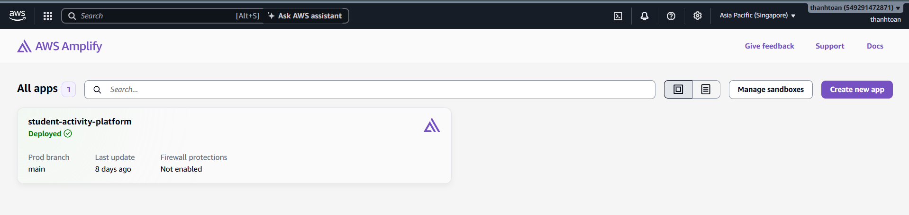
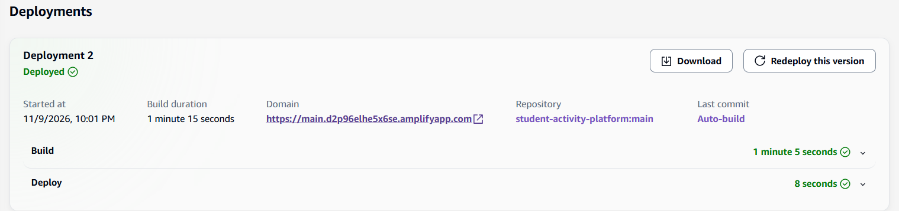
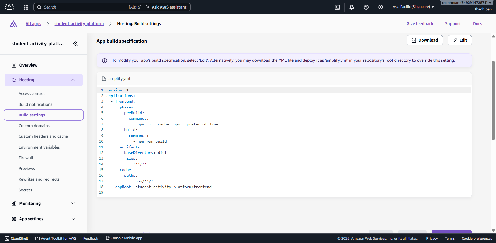
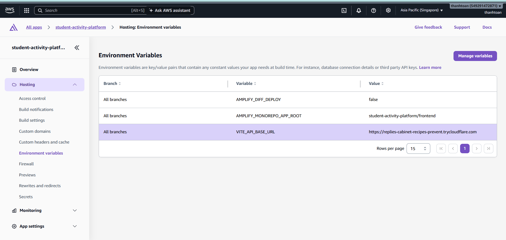
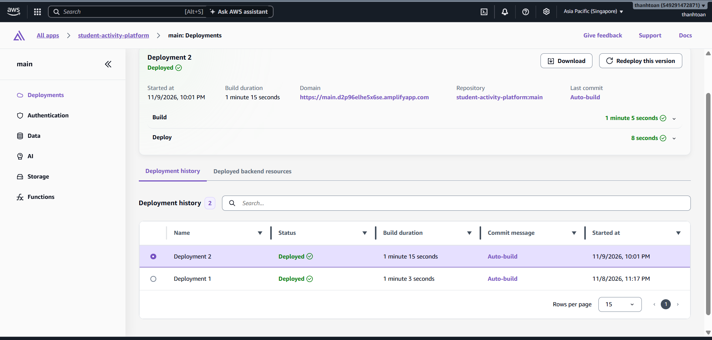
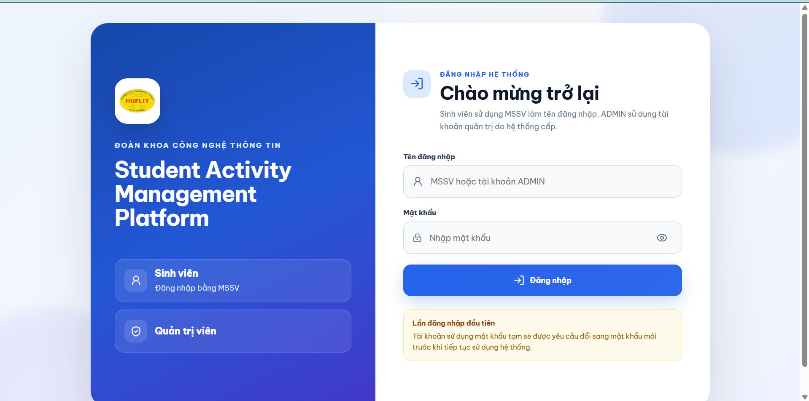

---
title: "Deploy the Frontend with AWS Amplify Hosting"
date: 2026-11-09
weight: 3
chapter: false
pre: "<b>5.9.3.</b>"
---

## Deploy the Frontend with AWS Amplify Hosting

In this section, we will deploy the React/Vite interface of the Student Activity Management & Engagement Analytics Platform using AWS Amplify Hosting.

AWS Amplify retrieves the Frontend source code from GitHub, installs dependencies, builds the application, and provides an Internet-accessible HTTPS Website.

#### 1. Prepare for deployment

Complete:

* Section 5.9.1 - Prepare Source Code and Deployment Configuration.
* Section 5.9.2 - Connect the Backend using Cloudflare Quick Tunnel.

Required components:

* GitHub Repository fcaj.
* Branch main.
* React/Vite Frontend that builds successfully.
* FastAPI Demo Backend running on port 8001.
* Cloudflare Quick Tunnel HTTPS URL.
* AWS Account with Amplify Hosting permissions.

Verify the Tunnel Health Endpoint before deployment.

#### 2. Open the AWS Amplify Console

1. Open the [AWS Management Console](https://console.aws.amazon.com/).

2. Search for AWS Amplify.

3. Open the [AWS Amplify Console](https://console.aws.amazon.com/amplify/).

4. Select the Region containing the project's Amplify App.

5. For a new application, choose Create new app.

<!--

-->

{}
If the Amplify App already exists, open it and inspect the main branch. Do not create another application solely to update the Backend API URL.
{}

#### 3. Connect the GitHub Repository

When creating a new Amplify App:

1. Select GitHub as the Git Provider.
2. Choose Next.
3. Authenticate the GitHub connection.
4. Grant access to the required repository.
5. Select fcaj.
6. Select the main branch.

<!--



-->

Grant access only to the required repository when possible.

#### 4. Identify the Frontend directory

Inspect the GitHub source code to identify the directory containing the React/Vite package.json file.

Example structure:

```text
fcaj/
├── backend/
├── frontend/
│   ├── src/
│   └── package.json
└── ...
```

In this example, the application root is:

```text
frontend
```

If the project is nested:

```text
fcaj/
└── student-activity-platform/
    └── frontend/
        └── package.json
```

The application root becomes:

```text
student-activity-platform/frontend
```

These structures are illustrative. Use the actual Frontend location in the current GitHub Repository.

If the My app is a monorepo option is available, select it and specify the appropriate application path.

<!--

-->

#### 5. Configure Amplify Build Settings

Amplify requires instructions for dependency installation, application builds, and locating deployment artifacts.

If frontend is located directly in the repository root, an illustrative monorepo build configuration is:

```yaml
version: 1
applications:
  - appRoot: frontend
    frontend:
      phases:
        preBuild:
          commands:
            - npm ci
        build:
          commands:
            - npm run build
      artifacts:
        baseDirectory: dist
        files:
          - '**/*'
```

Explanation:

* appRoot: Identifies the React/Vite application directory.
* preBuild: Installs dependencies.
* build: Builds the Frontend.
* baseDirectory: Identifies the output directory.
* files: Specifies deployment artifacts.

With this configuration, build commands run from appRoot.

If package-lock.json is unavailable, prepare a lockfile or use npm install as appropriate.

For a nested Frontend, replace appRoot with the actual directory.

For monorepo applications, verify that AMPLIFY_MONOREPO_APP_ROOT matches appRoot.

<!--

-->

{}
This is an illustrative React/Vite build configuration, not a verified copy of the original amplify.yml used during the previous deployment. Preserve existing working build settings and review the required configuration.
{}

Reference:

[Configuring monorepo build settings](https://docs.aws.amazon.com/amplify/latest/userguide/monorepo-configuration.html)

#### 6. Configure VITE_API_BASE_URL

This step enables the Amplify-hosted Frontend to communicate with FastAPI.

In the Amplify Console:

1. Open the Frontend application.
2. Select Hosting from the navigation pane.
3. Select Environment variables.
4. Choose Manage variables.
5. Add or update:

```text
Variable:
VITE_API_BASE_URL
```

Value:

```text
https://YOUR-TUNNEL.trycloudflare.com
```

Replace the example with the active Cloudflare Quick Tunnel URL.

<!--

-->

During the November 9, 2026 test, the project used:

```text
VITE_API_BASE_URL=
https://replies-cabinet-recipes-prevent.trycloudflare.com
```

This is a historical deployment value.

For a new workshop execution, use the active URL from section 5.9.2.

Do not append /health or /docs to the Base URL.

{}
Do not store AWS credentials, account passwords, or Access Tokens in VITE_-prefixed variables. These values may be embedded in publicly delivered JavaScript.
{}

#### 7. Deploy the Frontend

For a new Amplify App:

1. Review the Repository and Branch.
2. Review Build Settings.
3. Review Environment variables.
4. Choose Save and deploy.

For an existing application:

1. Save the updated environment variable.
2. Open the main branch.
3. Redeploy the branch using the Amplify Console.

<!--

-->

Amplify prepares the build environment, retrieves source code, installs dependencies, builds the application, and deploys Frontend assets.

Inspect the Build Logs to monitor these operations.

<!--

-->

#### 8. Verify Deployment status

After deployment:

* The main branch has a successful deployment status.
* Build Logs contain no critical errors.
* The dist directory has been used for deployment.
* A Website URL is available.

The project previously used:

```text
https://main.d2p96elhe5x6se.amplifyapp.com
```

<!--

-->

This is the Website URL used during the historical deployment test. A new Amplify App will provide its own Website URL.

#### 9. Configure React SPA routing

If the React application uses client-side routing, verify direct access and page refresh behavior for application routes.

Illustrative routes:

```text
/login
/activities
/profile
```

Use the actual routes defined in the application.

If the Home page loads but direct navigation to an application route fails, inspect Rewrites and redirects in Amplify Hosting.

An SPA rewrite can route application paths to index.html.

Illustrative configuration:

```json
[
    {
        "source": "</^[^.]+$/>",
        "target": "/index.html",
        "status": "200"
    }
]
```

This example handles SPA routes without periods and avoids rewriting ordinary assets with file extensions.

Preserve suitable existing rewrite rules rather than introducing duplicates.

<!--

-->

Reference:

[Redirects and rewrites in Amplify Hosting](https://docs.aws.amazon.com/amplify/latest/userguide/redirects.html)

#### 10. Verify the Website and API connectivity

Open the Amplify Website.

Verify:

* The login page is displayed.
* CSS and JavaScript assets load correctly.
* No critical Frontend resource errors occur.
* The Frontend uses the Cloudflare HTTPS API Endpoint.

Press F12 to open Developer Tools.

Select Network and perform a login operation.

The Request URL should point to:

```text
https://YOUR-TUNNEL.trycloudflare.com/auth/login
```

Instead of:

```text
http://127.0.0.1:8000/auth/login
```

<!--



-->

If the Frontend still calls localhost, verify:

* VITE_API_BASE_URL has been saved correctly.
* api.js reads the environment variable.
* Amplify has rebuilt the Frontend.
* The browser is not using an outdated build.

#### 11. Verify CORS after deployment

FastAPI must allow the Amplify Website origin.

The previous deployment used:

```text
https://main.d2p96elhe5x6se.amplifyapp.com
```

For a new Amplify App, configure its actual Website origin.

Restart FastAPI if the CORS configuration changes.

Inspect Network requests to confirm browser API access.

<!--

-->

#### 12. Update the application when the Tunnel changes

When cloudflared starts again and generates a new URL:

1. Copy the new URL.
2. Verify its /health Endpoint.
3. Open Amplify Environment variables.
4. Update VITE_API_BASE_URL.
5. Save the configuration.
6. Redeploy the main branch.
7. Open the Website and inspect API requests.

Vite reads VITE_-prefixed variables during the build process.

Saving a new environment variable does not update JavaScript that has already been deployed.

Rebuild and redeploy the Frontend to apply the new URL.

#### 13. Troubleshoot common issues

| Issue | What to Check |
| --- | --- |
| Build failure | Node.js, package.json, and Build Logs |
| package.json not found | appRoot or build directory |
| dist not found | Build command and artifacts |
| Blank Website | JavaScript, CSS, and build configuration |
| Route refresh failure | SPA Rewrites and redirects |
| Failed to fetch | Tunnel, Backend, and CORS |
| Requests target localhost | VITE_API_BASE_URL and Redeploy |
| Outdated API URL | Environment variables and deployed build |
| HTTP 502 | Backend port 8001 and cloudflared |

#### Results

During the November 9, 2026 deployment test, the project successfully:

* Deployed the React/Vite Frontend using AWS Amplify Hosting.
* Used the fcaj repository and main branch.
* Configured VITE_API_BASE_URL.
* Redeployed the Frontend with the HTTPS Backend URL.
* Verified requests from Amplify to FastAPI through Cloudflare Quick Tunnel.

AWS Amplify provides Cloud hosting for the Web interface, while the Demo Backend remains hosted on the local computer.

[Next: Verify the Deployed Application](../5.9.4-test-deployment/)
