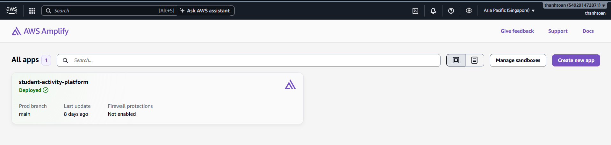
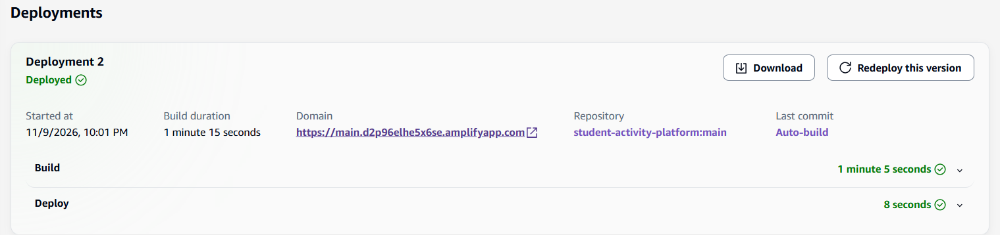
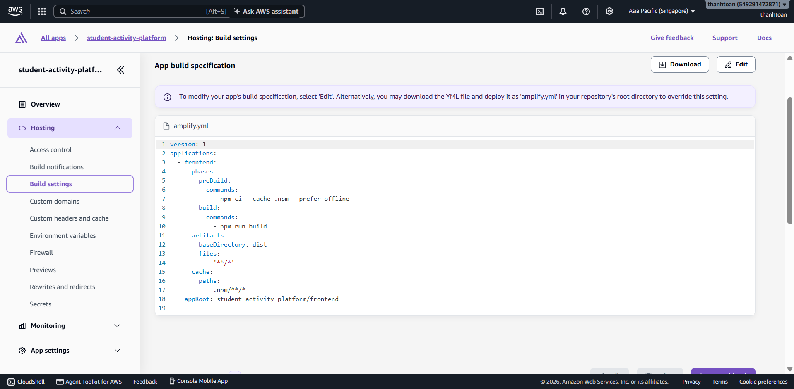
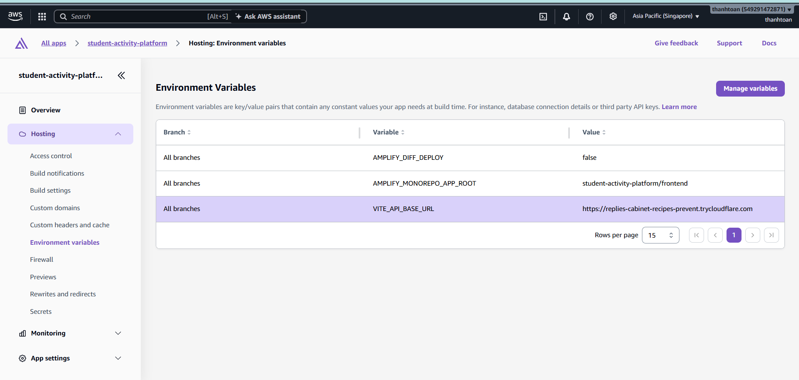
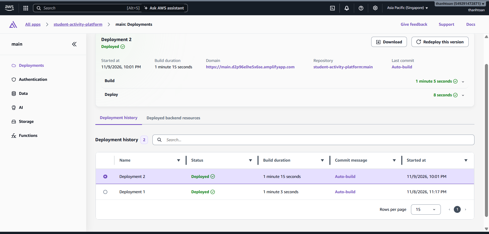
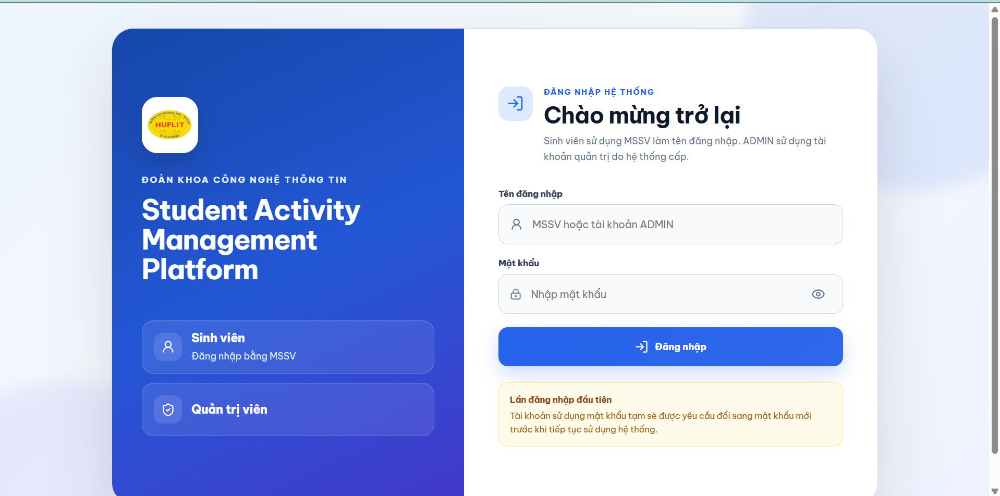

---
title: "Triển khai Frontend lên AWS Amplify Hosting"
date: 2026-11-09
weight: 3
chapter: false
pre: "<b>5.9.3.</b>"
---

## Triển khai Frontend lên AWS Amplify Hosting

Trong phần này, chúng ta sẽ triển khai giao diện React/Vite của Student Activity Management & Engagement Analytics Platform lên AWS Amplify Hosting.

AWS Amplify sẽ lấy mã nguồn Frontend từ GitHub, cài đặt các thư viện cần thiết, build ứng dụng và cung cấp Website HTTPS để truy cập qua Internet.

#### 1. Chuẩn bị trước khi triển khai

Đảm bảo đã hoàn thành:

* Phần 5.9.1 - Chuẩn bị source code và cấu hình triển khai.
* Phần 5.9.2 - Kết nối Backend bằng Cloudflare Quick Tunnel.

Các thành phần cần chuẩn bị:

* GitHub Repository fcaj.
* Branch main.
* React/Vite Frontend có thể build thành công.
* FastAPI Backend Demo đang chạy tại port 8001.
* Cloudflare Quick Tunnel HTTPS URL.
* AWS Account có quyền sử dụng Amplify Hosting.

Kiểm tra lại Health Endpoint của Tunnel trước khi triển khai.

#### 2. Mở AWS Amplify Console

1. Truy cập [AWS Management Console](https://console.aws.amazon.com/).

2. Tìm kiếm AWS Amplify.

3. Mở [AWS Amplify Console](https://console.aws.amazon.com/amplify/).

4. Chọn Region chứa Amplify App của đồ án.

5. Nếu tạo ứng dụng mới, chọn Create new app.

<!--

-->

{}
Nếu Amplify App đã được tạo trong lần triển khai trước đây, hãy mở ứng dụng hiện tại và kiểm tra branch main. Không tạo thêm một ứng dụng mới chỉ để cập nhật API URL.
{}

#### 3. Kết nối GitHub Repository

Khi tạo Amplify App mới:

1. Chọn GitHub làm Git Provider.
2. Chọn Next.
3. Xác thực kết nối GitHub theo hướng dẫn.
4. Cấp quyền truy cập repository cần triển khai.
5. Chọn repository fcaj.
6. Chọn branch main.

<!--



-->

Chỉ cấp quyền truy cập repository cần thiết thay vì cấp quyền cho tất cả repository nếu không cần.

#### 4. Xác định thư mục Frontend

Kiểm tra source code trên GitHub để xác định thư mục chứa package.json của React/Vite.

Ví dụ cấu trúc repository:

```text
fcaj/
├── backend/
├── frontend/
│   ├── src/
│   └── package.json
└── ...
```

Trong trường hợp này, thư mục ứng dụng là:

```text
frontend
```

Nếu project được đặt sâu hơn:

```text
fcaj/
└── student-activity-platform/
    └── frontend/
        └── package.json
```

Thì đường dẫn ứng dụng sẽ là:

```text
student-activity-platform/frontend
```

Hai cấu trúc trên là ví dụ minh họa. Sử dụng đúng vị trí Frontend trên GitHub Repository hiện tại.

Nếu Amplify hỗ trợ tùy chọn My app is a monorepo, chọn tùy chọn này và nhập đường dẫn ứng dụng phù hợp.

<!--

-->

#### 5. Cấu hình Amplify Build Settings

Amplify cần biết cách cài đặt dependencies, build Frontend và xác định thư mục chứa kết quả build.

Nếu thư mục frontend nằm trực tiếp tại root của repository, có thể sử dụng cấu hình monorepo minh họa:

```yaml
version: 1
applications:
  - appRoot: frontend
    frontend:
      phases:
        preBuild:
          commands:
            - npm ci
        build:
          commands:
            - npm run build
      artifacts:
        baseDirectory: dist
        files:
          - '**/*'
```

Giải thích:

* appRoot: Xác định thư mục ứng dụng React/Vite.
* preBuild: Cài đặt các dependencies.
* build: Build mã nguồn Frontend.
* baseDirectory: Thư mục chứa kết quả build.
* files: Các file được triển khai lên Amplify Hosting.

Trong cấu hình trên, các lệnh build được thực hiện tại appRoot.

Nếu package-lock.json chưa tồn tại, cần chuẩn bị lockfile hoặc sử dụng npm install phù hợp với repository.

Nếu thư mục Frontend nằm sâu hơn, thay appRoot bằng đường dẫn thực tế.

Với monorepo, kiểm tra biến AMPLIFY_MONOREPO_APP_ROOT có giá trị tương ứng với appRoot.

<!--

-->

{}
Đây là cấu hình build minh họa cho ứng dụng React/Vite. Không khẳng định amplify.yml trên là file đã sử dụng nguyên bản trong lần triển khai trước đây. Nếu Amplify App hiện tại đã có cấu hình build hoạt động, hãy giữ nguyên và chỉ kiểm tra các thông tin cần thiết.
{}

Tài liệu tham khảo:

[Configuring monorepo build settings](https://docs.aws.amazon.com/amplify/latest/userguide/monorepo-configuration.html)

#### 6. Cấu hình biến môi trường VITE_API_BASE_URL

Đây là bước quan trọng để Frontend trên AWS Amplify có thể kết nối Backend FastAPI.

Trong Amplify Console:

1. Mở ứng dụng Frontend.
2. Trong thanh điều hướng, chọn Hosting.
3. Chọn Environment variables.
4. Chọn Manage variables.
5. Thêm hoặc cập nhật biến:

```text
Variable:
VITE_API_BASE_URL
```

Giá trị:

```text
https://YOUR-TUNNEL.trycloudflare.com
```

Thay URL minh họa bằng Cloudflare Quick Tunnel URL đang hoạt động.

<!--

-->

Trong lần kiểm thử ngày 09/11/2026, giá trị đã sử dụng là:

```text
VITE_API_BASE_URL=
https://replies-cabinet-recipes-prevent.trycloudflare.com
```

URL trên chỉ phục vụ đối chiếu lịch sử triển khai.

Khi thực hành lại, sử dụng URL mới từ phần 5.9.2.

Không thêm /health hoặc /docs vào cuối Base URL.

{}
Không lưu AWS Credentials, mật khẩu tài khoản hoặc Access Token dưới tiền tố VITE_. Các giá trị VITE_ có thể được đưa vào mã JavaScript công khai khi build.
{}

#### 7. Triển khai Frontend

Nếu đang tạo Amplify App mới:

1. Kiểm tra Repository và Branch.
2. Kiểm tra Build Settings.
3. Kiểm tra Environment variables.
4. Chọn Save and deploy.

Nếu ứng dụng đã tồn tại:

1. Lưu biến môi trường đã cập nhật.
2. Mở branch main.
3. Thực hiện Redeploy bằng chức năng triển khai lại trên Amplify Console.

<!--

-->

Amplify thực hiện các bước chuẩn bị môi trường, lấy source code, cài đặt dependencies, build ứng dụng và triển khai các tài nguyên Frontend.

Theo dõi Build Logs để kiểm tra quá trình thực hiện.

<!--

-->

#### 8. Kiểm tra trạng thái Deployment

Sau khi quá trình triển khai hoàn thành:

* Branch main có trạng thái triển khai thành công.
* Build Logs không có lỗi nghiêm trọng.
* Thư mục dist đã được sử dụng để triển khai.
* Website URL được cung cấp.

Trong đợt triển khai đồ án, Frontend sử dụng địa chỉ:

```text
https://main.d2p96elhe5x6se.amplifyapp.com
```

<!--

-->

Đây là Website URL đã sử dụng trong lịch sử kiểm thử. Khi tạo Amplify App mới, sử dụng URL được AWS cung cấp cho ứng dụng đó.

#### 9. Cấu hình điều hướng cho React SPA

Nếu ứng dụng React sử dụng Client-side Routing, cần kiểm tra việc truy cập trực tiếp hoặc tải lại các đường dẫn trong ứng dụng.

Ví dụ:

```text
/login
/activities
/profile
```

Tên các đường dẫn trên chỉ là ví dụ, cần đối chiếu với router thực tế.

Nếu Website tải được trang chủ nhưng trả về lỗi khi truy cập trực tiếp một đường dẫn nội bộ, kiểm tra Rewrites and redirects trong Amplify Hosting.

Một quy tắc SPA có thể được sử dụng để chuyển các đường dẫn ứng dụng về index.html.

Ví dụ cấu hình:

```json
[
    {
        "source": "</^[^.]+$/>",
        "target": "/index.html",
        "status": "200"
    }
]
```

Quy tắc minh họa này phù hợp với các đường dẫn SPA không chứa dấu chấm và tránh chuyển tiếp các tài nguyên thông thường có phần mở rộng.

Nếu ứng dụng đã có quy tắc phù hợp, không tạo thêm quy tắc trùng lặp.

<!--

-->

Tài liệu tham khảo:

[Redirects and rewrites in Amplify Hosting](https://docs.aws.amazon.com/amplify/latest/userguide/redirects.html)

#### 10. Kiểm tra Website và API Connectivity

Mở Website Amplify.

Kiểm tra:

* Trang đăng nhập được hiển thị.
* CSS và JavaScript được tải đúng.
* Không có lỗi tài nguyên Frontend nghiêm trọng.
* Frontend sử dụng HTTPS API Endpoint của Cloudflare.

Mở Developer Tools bằng phím F12.

Chọn Network và thực hiện đăng nhập.

Request URL cần hướng đến:

```text
https://YOUR-TUNNEL.trycloudflare.com/auth/login
```

Không phải:

```text
http://127.0.0.1:8000/auth/login
```

<!--



-->

Nếu Frontend vẫn gọi Backend local, kiểm tra:

* VITE_API_BASE_URL đã được lưu đúng chưa.
* api.js có đọc biến môi trường này không.
* Amplify đã build lại Frontend chưa.
* Trình duyệt có đang sử dụng bản build cũ không.

#### 11. Kiểm tra CORS sau khi triển khai

FastAPI phải cho phép origin của Website Amplify.

Trong lần kiểm thử trước, origin được sử dụng:

```text
https://main.d2p96elhe5x6se.amplifyapp.com
```

Nếu tạo Amplify App mới, cập nhật origin mới vào cấu hình Backend.

Khởi động lại FastAPI nếu cấu hình CORS đã thay đổi.

Kiểm tra Network để xác nhận các Request API được trình duyệt cho phép.

<!--

-->

#### 12. Cập nhật khi Quick Tunnel thay đổi

Khi cloudflared được khởi động lại và cung cấp URL mới:

1. Sao chép URL mới.
2. Kiểm tra URL mới với /health.
3. Mở Amplify Environment variables.
4. Cập nhật VITE_API_BASE_URL.
5. Lưu cấu hình.
6. Redeploy branch main.
7. Mở lại Website và kiểm tra Network Request.

Vite đọc các biến VITE_ trong quá trình build. Vì vậy, chỉ lưu biến môi trường mới không tự động cập nhật JavaScript đã triển khai.

Cần build và deploy lại Frontend.

#### 13. Xử lý các lỗi thường gặp

| Lỗi | Nội dung kiểm tra |
| --- | --- |
| Build thất bại | Node.js, package.json và Build Logs |
| Không tìm thấy package.json | appRoot hoặc thư mục build |
| Không tìm thấy dist | Lệnh npm run build và artifacts |
| Website hiển thị trang trống | JavaScript, CSS và cấu hình build |
| Refresh trang nội bộ báo lỗi | SPA Rewrites and redirects |
| Failed to fetch | Tunnel, Backend và CORS |
| Request gọi localhost | VITE_API_BASE_URL và Redeploy |
| API URL cũ | Kiểm tra biến môi trường và bản build |
| HTTP 502 | Backend port 8001 và cloudflared |

#### Kết quả

Trong đợt triển khai ngày 09/11/2026, đồ án đã thực hiện thành công:

* Triển khai React/Vite Frontend trên AWS Amplify Hosting.
* Sử dụng repository fcaj và branch main.
* Cấu hình VITE_API_BASE_URL.
* Redeploy Frontend với HTTPS Backend URL.
* Kiểm tra Request từ Website Amplify đến FastAPI thông qua Cloudflare Quick Tunnel.

AWS Amplify giúp đưa giao diện Web lên môi trường Cloud, trong khi Backend Demo vẫn được duy trì trên máy tính local.

[Tiếp theo: Kiểm thử ứng dụng sau khi triển khai](../5.9.4-test-deployment/)
